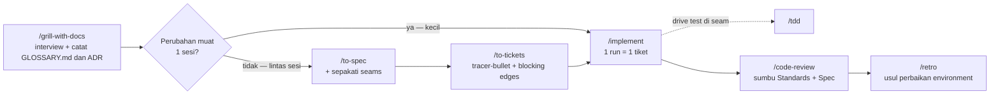

# Research: Matt Pocock — "The Main Flow"

Sumber utama:
- Katalog: https://www.aihero.dev/skills (bagian *The Main Flow*) dan https://www.aihero.dev/skills-catalog
- Repo: https://github.com/mattpocock/skills (docs/engineering/*.md, skills/engineering/*)
- Tanggal research: 15 Oktober 2026

Catatan: link `the-main-flow-*` di halaman `/skills` saat ini 404. Isi bagian ini direkonstruksi dari halaman katalog (`/skills-catalog`) dan dokumentasi repo yang setara.

## Apa itu The Main Flow

Deskripsi resmi: **"The idea→ship spine, in order"** — rangkaian skill inti dari ide sampai rilis, dipakai berurutan. Ini rantai utama ("the main build chain") di sistem skill Matt Pocock, dan semua skill lain (Shaping, Engineering, Productivity, Reference) berperan sebagai cabang yang menyuapi atau menopang rantai ini.

Rantai lengkap `grill-with-docs → to-spec → to-tickets → implement → code-review → retro` hanya ditempuh pada cabang multi-sesi; pada perubahan kecil, `to-spec`/`to-tickets` dilewati. Di dalam satu run `implement`: `tdd` dipanggil per seam, lalu `code-review` dijalankan sebelum commit (bisa juga dijalankan standalone dari sesi fresh). Antar tiket: clear context, satu tiket per sesi.

Isi bagian: 6 lesson (03–08) di katalog, setelah Getting Started (setup + ask-matt):

| # | Skill | Peran satu baris |
| --- | --- | --- |
| 03 | `/grill-with-docs` | Diinterview soal rencana, sekaligus mencatat keputusan & istilah ke repo |
| 04 | `/to-spec` | Ubah percakapan yang sudah disepakati menjadi spec tertulis |
| 05 | `/to-tickets` | Pecah spec menjadi tiket kecil yang bisa dikerjakan agent |
| 06 | `/implement` | Bangun spec/tiket menjadi kode, test-first |
| 07 | `/code-review` | Review diff terhadap standar repo dan terhadap spec |
| 08 | `/retro` | Evaluasi sesi, usulkan perbaikan environment repo |

Karakter umum rantai ini:

- Semua skill di flow ini **user-invoked** (dipanggil manual dengan `/nama-skill`), bukan model-invoked. Pengecualian: `code-review` juga bisa dipicu otomatis oleh model saat diminta "review sejak X".
- `implement` mengorkestrasi dua skill di luar flow sebagai bagian internalnya: `tdd` (menulis test di seam) dan `code-review` (sebelum commit).
- Prasyarat sekali per repo untuk semua skill yang mempublish ke tracker (to-spec, to-tickets): jalankan `/setup-matt-pocock-skills` dulu (memilih issue tracker: GitHub/GitLab/lokal `.scratch/`, label triage, lokasi docs).
- Prinsip besar yang diulang di dokumen: **tidak ada skill yang re-validasi atau membuka ulang keputusan hulu**; yang belum diputuskan diselesaikan sebelum masuk flow.

## 1. `/grill-with-docs` — interview + domain docs (lesson 03)

**Apa yang dilakukan:** mewawancarai kamu soal rencana/desain sampai kamu dan agent punya satu pemahaman yang sama, sambil menulis istilah dan keputusan ke repo. Ini interview `grill-me` (ronde pertanyaan → tunggu → ronde berikutnya) yang diarahkan ke codebase.

**Berstate / stateful:** beda dari grilling lain yang hanya meninggalkan hasil di kepala sesi, skill ini menulis ke disk:

- Istilah yang disepakati → `GLOSSARY.md` di root (atau per-context jika ada `GLOSSARY-MAP.md`), ditulis *saat itu juga*, bukan batch di akhir.
- Keputusan yang lolos 3 gate (sulit dibalik, mengejutkan tanpa konteks, trade-off nyata) → ADR di `docs/adr/`.
- Sisanya → hanya di percakapan.

**Kapan dipakai:** di awal perubahan di dalam repo, saat rencana masih kabur dan istilah belum mapan. Untuk non-repo gunakan `grill-me`; untuk kerja yang tak muat satu sesi gunakan `wayfinder`.

**Prasyarat penting:** `SKILL.md`-nya hanya satu baris yang mendelegasikan ke 2 skill lain — `grilling` (wawancara) dan `domain-modeling` (penulisan). Install `grill-with-docs` saja = skill rusak (pertanyaan menumpuk tanpa struktur, tidak ada paper trail). Masalah paling banyak dilaporkan adalah kegagalan load dependensi ini.

**Output & langkah berikutnya:** glossary adalah output utama; kebanyakan sesi menghasilkan 0 ADR dan itu normal. Konsekuensinya, sebagian besar keputusan hanya hidup di context window — maka langsung lanjut ke `/to-spec` di percakapan yang sama (jangan clear). Kalau perubahannya kecil, langsung `/implement`.

**Known issues:** bug terbuka — saat skill dijalankan di dalam orchestration layer lain, bagian penulisan file diam-diam tidak jalan. Keputusan yang tak menjadi ADR tidak dikaitkan ke spec/tiket/test, dan bisa melunak jadi prosa saat dikonversi ke spec.

## 2. `/to-spec` — percakapan menjadi spec (lesson 04)

**Apa yang dilakukan:** mengubah percakapan yang baru saja terjadi menjadi **spec** dan mempublishnya sebagai satu issue di tracker. Tidak mewawancarai ulang — semua keputusan sudah dibuat upstream. Spec adalah *decision record*, bukan tempat membuat keputusan baru. Spec yang menyatakan hal yang tak pernah kamu ucapkan = defect.

**Kapan dipakai:** hanya kalau build-nya **terlalu besar untuk satu sesi** (harus dipecah lintas sesi). Kalau muat satu context window, skip spec dan langsung `/implement`. Kalau belum ada keputusan sama sekali, mulai dari `grill-with-docs`.

**Detail penting — seams sebelum prosa:** sebelum menulis, skill membuat sketsa **seam** (batas publik tempat perilaku diuji) dan mengeceknya dengan kamu. Prefer seam yang sudah ada, ambil seam setinggi mungkin; idealnya satu seam per perubahan. Seam yang disepakati di sini dipakai downstream: `tdd` hanya bekerja di seam yang disepakati, dan `code-review` menilai diff terhadap spec — seam yang tak disepakati muncul sebagai temuan review.

**Spec vs tiket:** spec = tujuan + keputusan; tiket = langkah. Tiket sekali pakai (dihapus/ditutup setelah selesai), spec bertahan lebih lama. Kalau arah berubah, hapus tiket yang belum selesai, pertahankan spec.

**Known issues (paling banyak dilaporkan):** spec diberi label `ready-for-agent` sehingga agent AFK yang polling label itu bisa membangun seluruh spec dalam satu run, bukan per tiket — workaround: kecualikan spec parent secara eksplisit di prompt agent AFK, atau lepas label setelah `/to-tickets` jalan. Selain itu: tidak mengecek duplikasi di tracker, tidak meng-link ADR, tidak ada summary mode, dan template berbasis user story kurang cocok untuk refactor/arsitektur.

**Tips operasional:** jangan clear/compact antara `/to-spec` dan `/to-tickets` — tracker kadang memotong spec yang besar saat dibaca ulang; biarkan satu window.

**Where it fits:** masuk rantai hanya di cabang multi-sesi; map `wayfinder` yang sudah bersih masuk ke sini via `/to-spec #<map_issue>`. `/to-prd` lama adalah skill ini (rename di v1.1).

## 3. `/to-tickets` — spec menjadi tiket tracer-bullet (lesson 05)

**Apa yang dilakukan:** memecah plan/spec/percakapan menjadi kumpulan **tiket** di issue tracker. Setiap tiket mendeklarasikan **blocking edges** (tiket lain yang harus selesai dulu).

**Aturan inti — tracer bullet (vertical slice):** setiap tiket adalah jalur tipis tapi lengkap melewati semua layer (schema, API, UI, test) yang bisa di-demo sendiri begitu landing. Bukan potong per layer (horizontal slice). Data dari lapangan: satu tim dengan 26 tiket per-layer mengalami ~20 agent run per tiket dengan ~3/4 rework; post-mortem mereka menyalahkan slicing horizontal, bukan implementasinya. Setiap tiket juga diukur agar muat satu context window fresh, karena sesi yang belum pernah melihat spec yang akan mengerjakannya.

**Alur:** cek prefactoring dulu ("make the change easy, then make the easy change") dan letakkan di depan. Lalu tampilkan breakdown sebagai numbered list dan **kuis kamu** (granularitas benar? edge real? ada yang perlu merge/split?) — tidak ada yang masuk tracker sebelum kamu setuju. Ini titik push-back utama karena over-decomposition adalah masalah paling sering dilaporkan.

**Blocking edges di tracker:**

| Tracker | Lokasi edge | Cara kerja |
| --- | --- | --- |
| Markdown lokal | Teks di `.scratch/<feature>/issues/<NN>-<slug>.md`, urut blocker dulu | Dari atas ke bawah, manual |
| Tracker nyata (GitHub, Linear) | Native blocking links / sub-issues | Tiket yang blocker-nya selesai ada di **frontier** dan bisa diambil paralel |

**Pengecualian — wide refactor:** perubahan mekanis yang blast radius-nya se-codebase (rename kolom, retype simbol) tidak bisa di-slice vertikal. Skill menyusunnya **expand–contract**: expand (tambah bentuk baru di samping lama) → migrate (pindahkan call site per batch, satu tiket per batch) → contract (hapus bentuk lama setelah tak ada caller).

**Tiket dari sini agent-ready by construction — jangan lewatkan `triage`** (triage untuk pekerjaan dari orang lain).

**Known issues:** over-decomposition (perbaiki di langkah kuis); tiket per-layer; kriteria acceptance yang tidak bisa gagal (mis. sudah benar di base commit) — periksa manual: untuk setiap kriteria, sebutkan observasi yang membuatnya salah. Skill **berhenti di artifact**: tidak ada auto-dispatch — kamu sendiri yang melihat board, menghitung tiket tanpa blocker terbuka, dan membuka sesi agent sebanyak itu dengan context fresh.

## 4. `/implement` — build satu tiket, test-first (lesson 06)

**Apa yang dilakukan:** membangun pekerjaan yang **sudah diputuskan**. Arahkan ke tiket, spec, atau plan di percakapan; skill menulis kode, menjalankan `tdd` di seam, typecheck terus-menerus, menjalankan `code-review` di akhir, lalu commit ke branch saat ini. Tidak pernah membuka ulang plan: tanpa interview, tanpa ronde klarifikasi, tanpa proposal pendekatan lain.

**Satu run = lima langkah:**

1. Baca tiket/spec dan tentukan seam.
2. Jalankan `tdd` di seam yang sudah disepakati, satu slice red-green sekaligus.
3. Typecheck sering, jalankan file test tunggal sambil jalan.
4. Jalankan seluruh test suite sekali di akhir.
5. Jalankan `code-review`, lalu commit ke branch saat ini.

**Ritme yang dimaksudkan:** satu run = satu tiket. Tiket `to-tickets` sudah berukuran satu context window, jadi ritmenya: clear context → implement satu tiket → commit → clear lagi. Untuk seluruh spec sekaligus pakai `implement-spec` (paralel dengan subagent + integration branch). **Jangan** jalankan beberapa sesi `/implement` di satu checkout yang sama — laporan lapangan: `git commit --amend` mendarat di commit sesi lain, stash hilang, commit di branch salah (satu working directory, satu index, satu HEAD).

**Seam adalah inti skill ini, sekaligus titik terlemahnya:** "pre-agreed" tidak terjadi di dalam `implement` — yang bertanya adalah `tdd`, yang menolak menulis test di seam yang belum dikonfirmasi. Kesepakatan terjadi di spec (ideal) atau di pertukaran pertama run. Kalau tidak terjadi di mana pun, run jadi "just write the code" tanpa peringatan.

**Perilaku yang disengaja vs bug:** `implement` tidak menutup tiket / tidak mencentang acceptance criteria — kamu yang merekonsiliasi (penting untuk rantai dependency: frontier = tiket yang semua blocker-nya *closed*). Commit langsung ke branch saat ini, tanpa mode PR (bisa di-override di invocation; body PR dirapikan oleh skill `pr`). Review terjadi di sesi yang baru menulis kode (bias) — alternatifnya skip review bawaan dan jalankan `/code-review` di sesi fresh.

**Konflik yang perlu diketahui:** `code-review` me-review `git diff <fixed-point>...HEAD` (tanpa staged/working-tree). Karena `implement` menjalankannya *sebelum* commit, review bisa "tidak melihat" perubahan jika belum ada interim commit. Commit dulu, baru review.

**Budget:** tiket non-trivial bisa melewati 100k token dalam satu run — itu normal, tandanya tiketnya terlalu besar, bukan effort level yang kurang.

**Where it fits:** build step di rantai; mengonsumsi output `to-tickets`, mendrive `tdd`, menutup dengan `code-review`. Ia mempercayai skill hulu — tiket yang terstruktur buruk akan dibangun apa adanya.

## 5. `/code-review` — review dua sumbu (lesson 07)

**Apa yang dilakukan:** me-review diff antara `HEAD` dan fixed point yang kamu sebut (commit, branch, tag, `main`, `HEAD~5`) di dua sumbu independen:

| | Standards | Spec |
| --- | --- | --- |
| Pertanyaan | Apakah dibangun dengan benar? | Apakah ini barang yang benar? |
| Membaca | Standar terdokumentasi repo (`CODING_STANDARDS.md`, `CONTRIBUTING.md`, dsb.) + baseline smell | Issue/spec asal |
| Melaporkan | Pelanggaran aturan terdokumentasi + smells (selalu judgement call) | Requirement hilang/parsial, scope creep, implementasi salah |
| Sitasi tiap temuan | File standar + aturannya, atau nama smell + hunk | Baris spec |

Setiap sumbu berjalan di **sub-agent terpisah** agar tak saling melihat reasoning. Laporan **tidak pernah menggabungkan/men-rank ulang kedua sumbu**: diakhiri dengan isu terburuk *per sumbu* dan menolak memilih satu pemenang keseluruhan — sebuah perubahan bisa lolos satu sumbu dan gagal sumbu lain.

**Standards axis:** repo selalu menang atas baseline. Baseline = 12 code smell dari bab 3 Fowler *Refactoring* (Mysterious Name, Duplicated Code, Feature Envy, Data Clumps, Primitive Obsession, Repeated Switches, Shotgun Surgery, Divergent Change, Speculative Generality, Message Chains, Middle Man, Refused Bequest) — masing-masing heuristik berlabel "possible X", selalu disertai cara memperbaiki. Kedua sumbu melewati apa yang sudah ditegakkan linter.

**Spec axis — cara menemukan spec, berurutan:** (1) referensi issue di commit message (`#123`, `Closes #45`) via dokumen tracker dari setup, (2) path yang kamu lewatkan sebagai argumen, (3) file spec di `docs/`, `specs/`, `.scratch/`, (4) tanya kamu. Tanpa spec: sumbu Spec dilewati dan laporan berkata "no spec available" alih-alih mengarang requirement.

**Kapan dipakai:** kamu harus menyuplai fixed point; kalau tidak, skill bertanya tanpa menebak. Ia memvalidasi ref dan diff kosong sebelum spawn sub-agent. Untuk berburu bug (null path, race, off-by-one) gunakan review bawaan Claude Code, bukan ini. Untuk review per-tiket atau sekali di akhir branch — keduanya valid; per-tiket membuat diff kecil dan spec jelas, batching menangkap interaksi antar tiket.

**Known issues:**

- **Name clash dengan `/code-review` bawaan Claude Code** (masalah paling dilaporkan): keduanya beda fungsi. Plugin marketplace → prefix `mattpocock-skills:`; install biasa → file lokal yang menang. Workaround durable: fork dengan nama baru.
- **Sub-agent bisa menginvoke `/code-review` lagi dan fan-out** (bug terbuka, pernah dilaporkan >50 agent). Patch di fork: tambahkan satu baris "Do not invoke `/code-review` or spawn additional agents" di kedua brief.
- **Temuan = hipotesis, bukan bukti.** Skill tidak memverifikasi ulang klaim; baca sitasi tiap temuan sebelum bertindak.
- **Tidak ada jaminan konvergensi.** Tiap run bisa menemukan hal baru; jangan loop sampai "clean".

**Praktik yang disarankan:** review dari sesi **fresh** — sesi yang sama dengan penulis kode = confirmation bias.

## 6. `/retro` — perbaiki environment, bukan kode (lesson 08)

**Apa yang dilakukan:** membaca record sesi (current session secara default, atau sesi lama di session logs), menemukan momen di mana agent kesulitan, dan mengusulkan perbaikan ke **environment** agent — daftar kandidat, paling parah dulu. Ia tidak memperbaiki bug apa pun langsung; ia bertanya "apa di repo ini yang membuat masalah itu mungkin terjadi" dan mengusulkan check/pointer/standar yang mencegahnya lain kali. **Hanya mengusulkan** — tidak ada yang berubah sampai kamu memilih kandidat.

**Kapan dipakai:** di akhir sesi yang lebih sulit dari seharusnya (agent lama mencari sesuatu, membuat kesalahan yang bisa dicegah tool, butuh info yang tak bisa diakses). Sesi mulus tidak banyak memberi pelajaran.

**Kategori temuan → lokasi fix:**

| Yang salah di sesi | Fix |
| --- | --- |
| Agent lama menemukan file/fakta | **Navigation pointer** dari file yang sudah ia baca |
| Kesalahan yang bisa dicegah tool | **Automated check**: lint rule, type, test, pre-commit hook, CI job |
| Reviewer melewatkan judgement call | Aturan di `CODING_STANDARDS.md` yang dibaca reviewer |
| `AGENTS.md`/`CLAUDE.md` membengkak | Pindahkan steering-nya ke standards/checks |
| Tool call mahal untuk hasilnya | Streamline tool atau ganti |
| Baris steering yang tidak mengubah apa pun | Hapus **no-op**-nya |
| Info yang tak bisa dijangkau agent | Lebarkan akses (tee log dev server ke file, read-only access) |

**Ide utama:** standar adalah milik **reviewer**, bukan implementer. Agent implementer punya tekanan context paling besar; agent reviewer hanya menerima diff. Jadi aturan baru diletakkan di review, **tidak pernah di `AGENTS.md`** (yang dibaca di setiap sesi). Sebelum menulis aturan, klasifikasikan: pelanggaran **mekanis** (API terlarang, bentuk import, lokasi file) → deterministic check; hanya judgement call sejati yang jadi prosa. Kalau repo tak punya guardrail sama sekali (tanpa pre-commit hook, tanpa CI lint/typecheck/test), itu dilaporkan sebagai temuan tersendiri.

**Known issues / catatan:** tidak bisa menulis lint rule sendiri (menunggu konfirmasi, sengaja human-in-the-loop; tak ada dry-run mode); tidak pernah mengaudit check lama — pruning tetap tugasmu ("rule yang sering menyala di kode bagus = tanda harus dihapus"); kritik terkuat: AI cenderung lupa kesulitan di tengah sesi dan mengarang saran generik — buang kandidat yang tak bisa ditelusuri ke momen spesifik. `retro` bukan memory system: ia mengubah environment, tidak menyimpan apa yang terjadi. Untuk penilaian kode hasil sesi gunakan `code-review`, bukan ini. Ia memuat skill `writing-for-agents` sebelum mulai (gaya penulisan steering file), dan menopang `code-review` (aturan baru masuk ke Standards axis).

## Benang merah (ringkasan lintas skill)

1. **Urutan = keputusan dulu, dokumen kedua, kode terakhir.** `grill-with-docs` memutuskan, `to-spec`/`to-tickets` merekam, `implement` membangun tanpa membuka ulang, `code-review` memverifikasi terhadap rekaman itu, `retro` memperbaiki lingkungannya.
2. **Dua pemotongan flow:** (a) kecil/satu sesi → `grill-with-docs` (atau plan di thread) → `/implement` langsung; (b) besar/lintas sesi → `grill-with-docs → to-spec → to-tickets → implement per tiket`. `code-review` dan `retro` menutup keduanya.
3. **Cost of context window** adalah alasan desain berulang: spec ada karena window berakhir; tiket diukur per window; `to-spec`+`to-tickets` harus satu window; retry review sebaiknya dari sesi fresh.
4. **Seams adalah kontrak antar-skill:** disepakati di `to-spec`, ditegakkan `tdd`, dipertanggungjawabkan di `code-review`.
5. **Human tetap pemutus:** semua skill di flow ini user-invoked; kuiz tiket, pemilihan kandidat retro, penutupan tiket, dan dispatch adalah pekerjaan user, bukan skill.
