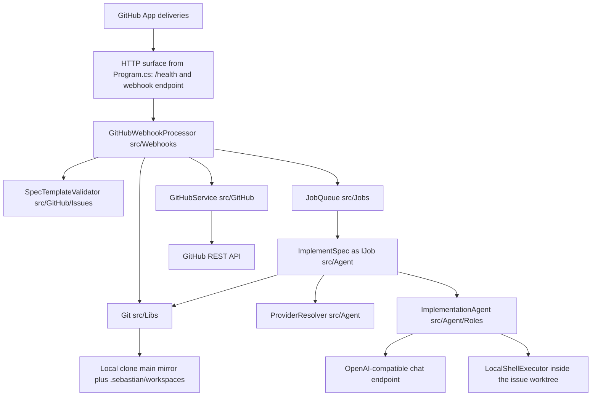
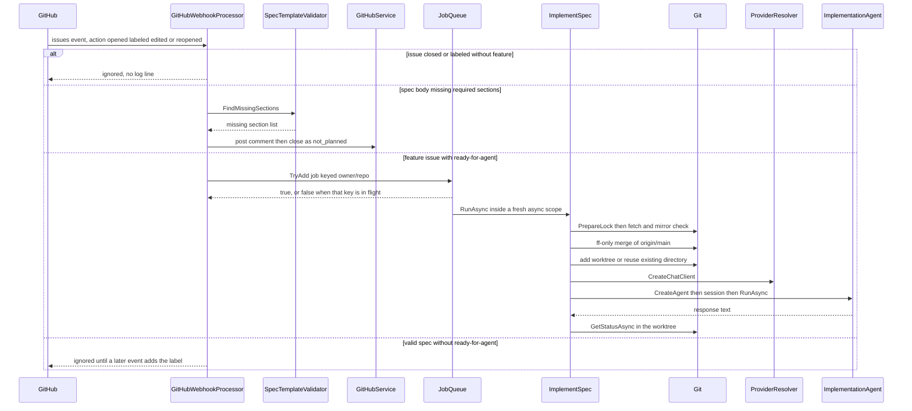

# System Overview and Runtime Topology

Sebastian is a single self-hosted ASP.NET Core process (`net10.0`, published AOT) that turns GitHub issue events into agent work. It is deliberately one process, one repository, and one long-running host: there is no scheduler, no worker fleet, no database, and no dashboard. Everything the process remembers between deliveries lives in git, in GitHub (issue labels, body, comments, state), and in the untracked `.sebastian/` folder — the in-memory job queue is the only volatile piece.

The process must be started from the root of the clone it operates on: `Git` refuses to start when the content root is not the git top level, and every later workspace operation is derived from that clone. A single installation therefore serves exactly one repository, and an issue event arriving for any other repository is rejected rather than redirected.

## Process shape

The whole host is wired in `Program.cs`: configuration binding plus a generated validator, four singleton collaborators, two hosted services, and two HTTP endpoints.

Component view of the process: one HTTP surface, intake and git hosted inside the request, and all agent work behind the queue.

The public surface is intentionally tiny. `app.MapGet("/health", () => "ok")` provides liveness, and `app.MapGitHubWebhooks(secret: config.GitHub.WebhookSecret)` is the only inbound integration. No authentication middleware is registered anywhere in the host: the webhook endpoint is anonymous but every delivery is verified against the HMAC secret supplied from configuration, so the secret — not an auth scheme — is the trust boundary. Keep that in mind when changing how configuration is bound.

| Registration | Lifetime actually used | Role |
| --- | --- | --- |
| `GitHubService` | singleton | GitHub App credentials and the only issue writes |
| `ProviderResolver` | singleton | Provider selection, `IChatClient` factory |
| `Git` | singleton **and** `IHostedService` (same instance via factory) | Git command execution, repository identity, mirror sync |
| `JobQueue` | singleton **and** `IHostedService` (same instance via factory) | Admission API plus the background consumer |
| `WebhookEventProcessor` | singleton factory over the internal `GitHubWebhookProcessor` | Intake policy |
| `SebastianConfig` options | singleton, validated on start | Configuration snapshot |

Two hosted services carry background responsibility. `Git` is registered as a singleton and exposed as `IHostedService` through a factory lambda that resolves the same singleton, so it initializes (require the content root to be the git top level, parse `origin`) before hosted services start and remains the shared entry point for every git command. `JobQueue` is likewise one singleton that is both a `BackgroundService` and the admission API used by the webhook path. Because both are resolved through factory lambdas from the singleton registration, the hosted service and the injected collaborator are the same object — a detail that matters if you are tempted to make either transient.

Startup is deliberately eager about credentials: `GitHubService` and `ProviderResolver` are resolved immediately after build so that a missing PEM file or an unconfigured provider fails the start instead of the first job. Two other startup behaviors are deliberately forgiving. The startup git sync is best-effort and bounded to ten seconds, because a missed push delivery must not prevent the app from starting. And `WebhookEventProcessor` itself is a lazy singleton, constructed on the first delivery — so a failure in that factory surfaces as a failed webhook request, not a failed deployment. See [Startup, Composition, and Configuration Binding](startup-and-composition.md) for the composition mechanics and [Running, Configuration, and Deployment](../operations/running-and-deployment.md) for the operator view.

## Domain ownership

Each runtime domain has one owner file. Read the table as "where behavior changes go", not as a source inventory.

| Domain | Owner | What it decides |
| --- | --- | --- |
| Intake / event policy | `src/Webhooks/GitHubWebhookProcessor.cs` | Which issue actions and labels matter, when to close an issue, when to enqueue a job, and that push events sync git inline |
| Input contract | `src/GitHub/Issues/SpecTemplateValidator.cs` | Which markdown sections an issue body must fill to be implementable |
| Admission and execution | `src/Jobs/JobQueue.cs` with the `IJob` contract in `src/Jobs/IJob.cs` | Dedupe by job key, concurrency, per-job DI scope, error isolation |
| Git workspace | `src/Libs/Git.cs` (commands, mirror sync) and `PrepareWorkspaceAsync` in `src/Agent/ImplementSpec.cs` (policy, paths, branch naming) | That local `main` is a fast-forward-only mirror and that each issue gets its own worktree |
| Agent | `src/Agent/ImplementSpec.cs` and `src/Agent/Roles/` | The task prompt, the harness agent, its tools, and its sandbox |
| Model access | `src/Agent/ProviderResolver.cs` | Which configured provider and model produce the `IChatClient` |
| GitHub writes | `src/GitHub/GitHubService.cs` | The only two write operations the system performs |

The split between `Git.cs` and `ImplementSpec.PrepareWorkspaceAsync` is worth internalizing: `Git` executes git and never decides policy, while `ImplementSpec` decides *what* to fetch, when a mirror state is unacceptable, where worktrees live, and what branch they use. New git behavior that encodes a rule belongs in the caller, not in the command runner.

`Git` shells out to a real `git` binary (`GIT_TERMINAL_PROMPT=0`, output captured, process tree killed on cancellation) rather than using a library. Practical consequences: the host needs git on `PATH`, and the trust model has no "push" primitive at all — the git layer never commits, never pushes, and never creates pull requests, and the agent is told the same.

## The one request path

All work enters through webhook intake. Issues events are handled synchronously inside the request: the processor filters, validates the spec, and either closes the issue with an explanatory comment or hands an `ImplementSpec` job to the queue. Push events do not touch the queue at all — they call `git.SyncMainAsync` inline (with a `// shortcut:` comment acknowledging the latency tradeoff), which is why webhook response time is a real design constraint for anything added to intake.

Webhook → queue → agent: intake stays synchronous, while workspace preparation and the agent run happen on a queue worker.

Two serialization layers keep this safe without locks in the intake layer. `JobQueue` rejects a key that is already in flight, so a repeated label/edit event cannot start a second run for the same issue while the first is still queued or running. `ImplementSpec` additionally funnels every workspace preparation through a single static semaphore because there is only one repository whose index and `main` ref may be touched at a time — and that semaphore is what makes the queue's degree of parallelism (ten) irrelevant to git safety. Because the queue key is released in a `finally` block, a failed run does not block the issue forever — but it also registers no retry; another qualifying event is required.

A successful run ends at a log line. `ImplementSpec` records the worktree path, the short git status of the agent's changes, and the agent's response text. There is no commit, no push, and no pull request in the code today; that gap against the PRD is documented in [Product Intent vs. Implemented Behavior](../concepts/product-intent-and-gaps.md) rather than being a missing wiring detail.

## State, and what survives a restart

There is no database, and state is deliberately spread across three places the system already trusts:

- **Git**, inside the clone: local `main` is a read-only mirror fast-forwarded to `origin/main` at startup and on push deliveries, and each issue gets a worktree at `.sebastian/workspaces/<issue>` on branch `sebastian/issue-<n>`.
- **GitHub**: the `feature` and `ready-for-agent` labels, the issue body that carries the spec, the comments the system posts, and the closed state it sets. Labels are the workflow's memory — they record the present, not a history.
- **The local `.sebastian/` folder**, which is gitignored: agent worktrees and whatever uncommitted work the agent produced. Deleting it destroys that work, which is also why an existing worktree directory is reused rather than recreated.

Everything else is memory: the unbounded channel and the in-flight key set are gone on restart, so queued jobs are lost and a redelivered or re-labeled event is the only way to resume. The `.sebastian` layout, mirror rules, and worktree lifecycle are covered in [Git Mirror and Worktree Model](../concepts/git-workspaces.md); queue semantics and drain/cancellation behavior in [Job Queue and Execution Semantics](../concepts/job-queue.md).

## Boundaries worth preserving

- **Signature-verified, not authenticated.** The webhook secret from `GitHub:WebhookSecret` is the only gate on the endpoint; there is no user, no session, and no bearer token. Adding a route elsewhere in the host without considering this changes the trust model.
- **Single repository.** `Git` requires the content root to be the git top level and parses `origin`; `ImplementSpec` then rejects any issue whose `owner/repository` does not match that parsed identity. Multi-repository support is an explicit non-goal of the current design, not an oversight.
- **Local `main` is not a workspace.** Mirror-state problems (not on `main`, uncommitted tracked changes, commits ahead of `origin/main`) make workspace preparation throw instead of guessing; the sync path, by contrast, logs and skips. That asymmetry keeps a foreground request from failing while never letting the agent start from a questionable base.
- **Failures are contained per job.** A job exception is logged and swallowed so the queue keeps consuming; cancellation during shutdown is treated as normal. Intake failures are contained differently — the push sync path catches git failures itself and only warns.
- **The agent is the least-privileged component.** It receives a confined shell tool and file access rooted at the worktree, with command denials for git write operations and network tools, and a prompt that forbids git, new dependencies, and edits outside the workspace. The pipeline, not the agent, owns git and GitHub. See [Agent Roles, Tools, and Sandbox Boundaries](../concepts/agent-execution.md).

## Extension points

The architecture is small enough that extension happens at four seams, in roughly increasing order of effort:

1. **New GitHub events** — override another `Process*WebhookAsync` in `GitHubWebhookProcessor`; `ProcessWebhookAsync` already logs every delivery before dispatch, so leaves stay easy to trace.
2. **New job kinds** — implement `IJob` with a stable `Key` and enqueue through `JobQueue.TryAdd`. The queue is type-agnostic and will create the DI scope, apply concurrency, dedupe, and isolate failures for you.
3. **New agent roles** — derive from `AgentRole`, override `Configure`, and get an `IChatClient` from `ProviderResolver` per run. Note the current disposal contract: the run owns and disposes its chat client.
4. **New GitHub writes** — extend `GitHubService`, which today exposes only comment-posting and closing with reason `not_planned`. Anything broader (labels, PRs, merges) is new surface, not a configuration toggle.

All four seams share one constraint implied by the domain table: nothing in the process composes two repositories at once, so any new job kind that touches git must either go through `ImplementSpec`-style serialization or declare why it is safe not to.

For the trace with per-hop state and the failure branch details, continue with [Feature Issue to Agent Workspace](../workflows/feature-implementation.md) and [Webhook Intake and Event Routing](../integrations/github-webhooks.md); for a task-oriented entry point see the [Quickstart](../quickstart.md).
