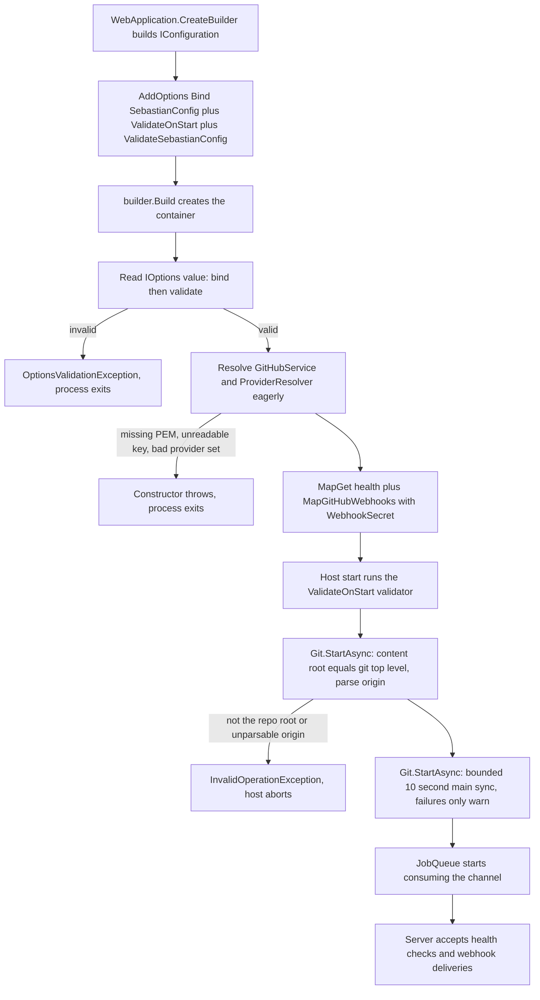

# Startup, Composition, and Configuration Binding

`Program.cs` is the entire composition root: about fifty lines that build the host, bind and validate configuration, register four singleton collaborators, expose two of them as hosted services, and map two endpoints. There is no `Startup` class, no module/extension method split, and no registration site anywhere else in the repository — every `AddSingleton`, `AddHostedService`, and endpoint mapping lives in that one file. Read it as the answer to "what exists at runtime"; read every other type as something it chooses to construct.



Startup phases in execution order, with the three points where a misconfiguration stops the process instead of surfacing later.

## Configuration: one bound tree, one generated validator

Binding is declared in three lines and is deliberately minimal:

```csharp
builder.Services
    .AddOptions<SebastianConfig>()
    .Bind(builder.Configuration)
    .ValidateOnStart();
builder.Services.AddSingleton<IValidateOptions<SebastianConfig>>(new ValidateSebastianConfig());
```

Three consequences follow, and each is load-bearing:

- **`ValidateOnStart`** makes the host run validation as part of startup instead of on first use, so a broken configuration terminates the process rather than producing a half-configured server that fails on the first webhook. `IOptions<SebastianConfig>` is also read directly right after `Build()`, and the options factory runs the validators when it materializes `.Value`, so the same failure surfaces even earlier in practice.
- **`ValidateSebastianConfig`** is a source-generated validator: the class is declared `[OptionsValidator] internal sealed partial class ValidateSebastianConfig : IValidateOptions<SebastianConfig> { }`, so the validation logic is emitted at compile time from the DataAnnotations attributes on the config types. Adding a rule means adding an attribute (or a hand-written validator), not registering a lambda.
- **The validator is registered as a singleton instance**, which is exactly the shape the generated implementation has; it is stateless.

### The key tree

`SebastianConfig` is not a flat settings bag — its property names *are* the configuration keys. The binder maps `:`-separated (JSON) or `__`-separated (environment variable) paths onto this tree, and a `List<ProviderConfig>` binds by numeric index.

| Key path | Type / rule | Consumed by |
| --- | --- | --- |
| `GitHub:WebhookSecret` | `string`, `[Required]` | `MapGitHubWebhooks` in `Program.cs`; the HMAC trust boundary |
| `GitHub:AppId` | `int`, `[Range(1, int.MaxValue)]` | `GitHubService` token provider |
| `GitHub:PrivateKeyPath` | `string`, `[Required]` — a **path**, not key material | `GitHubService` (`File.ReadAllText`) |
| `GitHub:InstallationId` | `string`, `[Required]` | `GitHubService` token provider |
| `Agent:Name` | `string`, `[Required]` | `ImplementationAgent` role name in `ImplementSpec` |
| `Agent:General:Provider` | `string`, `[Required]` | `ProviderResolver` selection key |
| `Agent:General:Model` | `string`, `[Required]` | `ProviderResolver` → `GetChatClient` |
| `Agent:Providers:<index>:Name` | `string`, `[Required]`, unique when case-insensitive | `ProviderResolver` |
| `Agent:Providers:<index>:Endpoint` | `string?`, optional; must be an absolute URI when present | `ProviderResolver`, default `https://api.openai.com/v1` |
| `Agent:Providers:<index>:ApiKey` | `string`, `[Required]` | `ProviderResolver` → `ApiKeyCredential` |

Nested validation is explicit rather than implicit: `GitHub` and `Agent` carry `[ValidateObjectMembers]`, `Agent.Providers` carries `[ValidateEnumeratedItems]`, so a missing section or a bad list element is reported as a validation failure on the parent instead of escaping as a `null!` dereference later. `[Required]` on a `string` rejects null, empty, *and* whitespace-only values (`" "` fails), which is pinned by `BlankApiKeyIsRejectedByGeneratedValidator` in the provider-resolver tests. `[Range(1, int.MaxValue)]` on `AppId` means an absent `GitHub:AppId` binds to `0` and fails validation instead of silently authenticating as app zero.

### AOT constraints on binding

`Sebastian.csproj` sets `PublishAot` and `EnableConfigurationBindingGenerator`, with the in-file justification: *"Reflection binding is not AOT-safe; generated binder needs non-required properties (CS9035)."* That single comment explains both build settings and the shape of the config classes:

- Binding uses the source-generated binder, so binding behavior is fixed at compile time. Anything the generated binder cannot handle — custom `TypeConverter`s resolved by reflection, `IConfigurationSection` polymorphism, non-public setters, exotic collection types — silently stops binding rather than failing loudly.
- Every property keeps a `= null!;` initializer instead of being declared `required`, because the generated binder needs settable non-required members. Converting these properties to `required` properties to "fix" the null-forgiving operator breaks the build (CS9035).

Treat a new config field as a three-part change: a bindable public property on the tree, a validation attribute if it is mandatory, and a consumer that reads it from `IOptions<SebastianConfig>`.

### Configuration is a startup-time snapshot

Nothing in the codebase injects `IOptionsMonitor<T>` or `IOptionsSnapshot<T>`; every consumer takes `IOptions<SebastianConfig>` and reads `.Value`. `Program.cs` additionally reads the value once at composition time and passes `config.GitHub.WebhookSecret` into `MapGitHubWebhooks`. Configuration is therefore frozen for the lifetime of the process, including the webhook secret — changing any setting requires a restart. Do not introduce `IOptionsMonitor` for one field without deciding what happens to the already-mapped webhook signature check.

## Where the values come from, and where secrets live

There is **no committed `appsettings.json`** in this repository, and no `launchSettings.json`. The host therefore relies on the default `WebApplication.CreateBuilder(args)` stack — optional `appsettings.json` / `appsettings.{Environment}.json`, user secrets in the Development environment, environment variables, then command-line arguments — and in a real deployment that means environment variables or user secrets.

`.gitignore` encodes the secrets policy:

- `.env` and `.env.*` are ignored (with `!.env.example` allowed back in), alongside `appsettings.Development.json`.
- Key material is ignored by extension: `*.pem`, `*.key`, `*.pfx`, `*.p12`, `*.snk`, `*.user`. `GitHub:PrivateKeyPath` points at a PEM that must never be committed, which is exactly why the setting is a path rather than an inline key.
- Runtime state (`bin/`, `obj/`, `.sebastian/`) and the design-time `.archify/` folder are ignored too.

Note the gap this creates: the `.env` entry protects a local file from being committed, but **nothing in the project loads a `.env` file** — there is no env-file package in `Sebastian.csproj` and no loader in code. Those values must actually be present in the process environment (or supplied through user secrets, or the command line); writing a `.env` and expecting Sebastian to read it does nothing. Environment variable names follow the tree with `__` as the separator, so `GitHub:WebhookSecret` corresponds to `GitHub__WebhookSecret` and `Agent:Providers:0:ApiKey` to `Agent__Providers__0__ApiKey`.

## The service graph

| Registration | Shape | Constructed when | Purpose |
| --- | --- | --- | --- |
| `IOptions<SebastianConfig>` + `IValidateOptions<SebastianConfig>` | options, singleton validator | first `.Value` read | one validated config snapshot |
| `GitHubService` | `AddSingleton<GitHubService>()` | **eagerly after `Build()`** | octokit/Kiota client with the app installation token |
| `ProviderResolver` | `AddSingleton<ProviderResolver>(factory)` | **eagerly after `Build()`** | picks a provider and model once |
| `Git` + `IHostedService` | `AddSingleton<Git>(factory)` and `AddHostedService(sp => sp.GetRequiredService<Git>())` | host start | git command runner and the repository guard |
| `JobQueue` + `IHostedService` | `AddSingleton<JobQueue>()` and `AddHostedService(sp => sp.GetRequiredService<JobQueue>())` | host start | admission API *and* the background consumer |
| `WebhookEventProcessor` | `AddSingleton<WebhookEventProcessor>(factory)` | first webhook delivery | hands `GitHubWebhookProcessor` to the Octokit endpoint |
| `ILogger<T>` per type | framework | on demand | source-generated logging |

### Why the hosted services are resolved through factories

`Git` and `JobQueue` each need to be *two things at once*: a collaborator injected into other components, and an `IHostedService` the host starts and stops. The two-descriptor trick above is what guarantees those are the same object. `services.AddHostedService(sp => sp.GetRequiredService<Git>())` registers a factory that pulls the already-registered singleton out of the container, so `GitHubWebhookProcessor`'s injected `Git` and the `Git` the host called `StartAsync` on are identical. Registering `AddSingleton<Git>()` a second time under `IHostedService`, or letting the framework construct its own instance, would give you a hosted service that initializes one object while webhook handling uses another — with `Git.Repository` still `null` in the copy the processor sees, which surfaces as `"Git repository is not initialized. The Git hosted service has not started."` from `PrepareWorkspaceAsync` rather than as an obvious wiring error.

`JobQueue` has the equivalent constraint in the other direction: it is a `BackgroundService` (so the host owns starting and stopping its consumer loop) *and* the admission API that `GitHubWebhookProcessor` calls `TryAdd` on. If those were different instances, `TryAdd` would write to a channel nobody reads.

`AddSingleton<Git>(factory)` and `AddSingleton<ProviderResolver>(factory)` are spelled as lambdas that call the constructors directly, which pins each singleton's dependency set at the registration site instead of leaving it to be inferred from a constructor signature. `GitHubService` and `JobQueue` use the plain generic form because their dependencies are the framework ones (`IOptions<SebastianConfig>`, `IServiceProvider`, `ILogger<JobQueue>`) and the container can supply them without help.

### Why `WebhookEventProcessor` is a factory, not an implementation-type registration

`GitHubWebhookProcessor` is `internal sealed` and derives from `Octokit.Webhooks.WebhookEventProcessor`; the library resolves the abstract `WebhookEventProcessor` from the request's service provider. The code carries the reason inline:

```csharp
// Factory, not AddSingleton<TService, TImpl>: internal processor is unknown to DI's reflection path.
builder.Services.AddSingleton<WebhookEventProcessor>(
    services => new GitHubWebhookProcessor(
        services.GetRequiredService<ILogger<GitHubWebhookProcessor>>(),
        services.GetRequiredService<GitHubService>(),
        services.GetRequiredService<JobQueue>(),
        services.GetRequiredService<Git>()));
```

The registration `AddSingleton<WebhookEventProcessor, GitHubWebhookProcessor>()` would name the internal type as a generic implementation argument and delegate construction to the container's reflection-based activator. The factory instead performs a plain compile-time-checked constructor call and only exposes the public base type, so the internal implementation never participates in reflection-based constructor discovery. It also documents the exact four dependencies of the webhook leaf in one place. Preserve the pattern when adding a fifth dependency: extend the factory call, and verify the constructor signature here rather than relying on the container to find it.

Worth noting explicitly: `ProviderResolver`, `GitHubService`, `Git`, `JobQueue`, and `GitHubWebhookProcessor` are all `internal`; the test project sees them only because `Sebastian.csproj` declares `<InternalsVisibleTo Include="Sebastian.Tests" />`.

### Jobs run in scopes, but collaborators do not

`JobQueue.ExecuteAsync` creates an `AsyncServiceScope` per job and passes `scope.ServiceProvider` into `IJob.RunAsync`. Because every meaningful collaborator is a root singleton, the scope does not produce per-job copies of `Git`, `GitHubService`, `ProviderResolver`, or `JobQueue`; `ImplementSpec` resolves them through the scope and lands on the same instances the webhook path uses. The scope's practical contribution is scoped logger and disposable bookkeeping. Do not put mutable per-job state into a singleton just because the scope exists.

## The fail-fast contract

Everything below throws *before the process serves a webhook*, which is the point: a misconfigured Sebastian should not accept work it cannot finish.

| Failure | Where | Timing | Observable symptom |
| --- | --- | --- | --- |
| Missing `GitHub` or `Agent` section, blank `WebhookSecret` / `PrivateKeyPath` / `InstallationId` / `Name` / `Provider` / `Model` / provider `Name` / `ApiKey`, `AppId` below 1 | generated `ValidateSebastianConfig` | reading `IOptions.Value` right after `Build()`, and again at host start | `OptionsValidationException` naming the failed member |
| No providers configured | `ProviderResolver` ctor | eager resolution | `"At least one agent provider must be configured."` |
| Same provider `Name` twice (case-insensitive) | `ProviderResolver` ctor | eager resolution | `"Agent provider '<name>' is configured more than once."` |
| `Agent:General:Provider` matches no entry | `ProviderResolver` ctor | eager resolution | `"Agent provider '<name>' is not configured."` |
| Endpoint present but not an absolute URI | `ProviderResolver` ctor | eager resolution | `"Agent provider '<name>' has an invalid endpoint."` |
| PEM path missing/unreadable, or not a valid RSA PEM | `GitHubService` ctor (`File.ReadAllText`, `ImportFromPem`) | eager resolution | file system or crypto exception |
| Content root is not the git top level | `Git.StartAsync` → `EnsureRepositoryAsync` | hosted service start | `"Sebastian must run from the repository root. Content root is '<path>', git root is '<path>'."` |
| `origin` remote missing, or its URL is not `owner/repo`-shaped | `Git.StartAsync` → `GetRemoteUrlAsync` / `RepositoryIdentity.Parse` | hosted service start | `"git remote get-url origin failed: ..."` or `"Could not parse the origin remote URL."` |

The eager block that owns the first two credential failures is three lines, and its comment states the intent: *"Construct the services now so missing credentials fail at startup."* Both types validate in their constructors — `ProviderResolver` resolves the selected provider and endpoint once, `GitHubService` imports the private key and builds the token provider and adapter — so resolution *is* the validation.

Because `Git` is registered before `JobQueue`, the repository invariant is checked before the queue begins consuming; and because the host only routes traffic once hosted services have started, neither check can be dodged by an early delivery.

### What deliberately does not fail at startup

- **Model reachability.** `ProviderResolver` never contacts the endpoint; it validates shape only. `CreateChatClient` builds the OpenAI client per job, so a wrong-but-well-formed API key or a bad model id fails inside the first agent run (where the job layer logs it) and not at boot.
- **GitHub API reachability.** No network call is made to GitHub during startup; only the PEM is read.
- **Mirror state.** `Git.StartAsync` runs `EnsureRepositoryAsync` (which throws) and then a *best-effort* `SyncMainAsync` bounded to ten seconds that catches `InvalidOperationException` and `OperationCanceledException` and only warns. Dirty `main`, being on another branch, or local commits are not startup failures; they are rejected later, per job, by `FindMirrorProblemAsync` in `PrepareWorkspaceAsync`. A missed push delivery must not prevent boot, but an agent must never start from a questionable base.
- **Filesystem layout.** `.sebastian/workspaces` is created on demand when a workspace is prepared.

## Changing startup safely

- **Add a setting** by extending the `SebastianConfig` tree with a bindable property plus validation, then consume it through `IOptions<SebastianConfig>`. Do not add a second options type bound by reflection, and do not add a committed `appsettings.json` containing real secrets.
- **Make something fail fast** by resolving it eagerly next to `GitHubService` / `ProviderResolver`, not by hoping a constructor runs. The eager list is an explicit, intentional list — appending to it is how a new credential class joins the fail-fast contract.
- **Add a hosted service that others inject** using the same two-descriptor factory pattern so there is exactly one instance; a plain `AddHostedService<T>()` creates an object nothing else can reach.
- **Keep constructor work cheap and side-effect-free for singletons that are not eagerly resolved**, because `WebhookEventProcessor` is constructed on the first delivery and a throw there is a failed request, not a failed deployment.
- **Order matters.** Hosted services start in registration order; if a new service depends on the repository guard having run, register it after `Git`.

## Test coverage for this page

The startup-time failure modes are pinned at the unit level rather than end to end:

- `ProviderResolverTests` asserts the missing-provider, duplicate-name, and empty-list `InvalidOperationException`s by constructing `ProviderResolver` with `Options.Create(config)`, and asserts whitespace-only `ApiKey` is rejected by the generated `ValidateSebastianConfig` — i.e. the fail-fast messages and the validator are both protected.
- `ImplementSpecTests` and `JobQueueTests` construct `Git` and `JobQueue` directly (`new(new TestHostEnvironment(path), logger)`), so the DI composition itself is never exercised.
- There is no `WebApplicationFactory` in the test project and no integration test of `Program.cs`; nothing in the suite would fail if the eager-resolution block, a hosted-service factory, or the `WebhookEventProcessor` registration were removed. Changes to composition need manual verification against a real repository.

See [GitHub App Authentication and Issue Writes](../integrations/github-app-client.md) for the credential chain behind `GitHubService`, [Model Provider Resolution](../concepts/model-providers.md) for provider selection semantics, [Running, Configuration, and Deployment](../operations/running-and-deployment.md) for the operator checklist, and [System Overview and Runtime Topology](overview.md) for where these objects fit in the request path.
