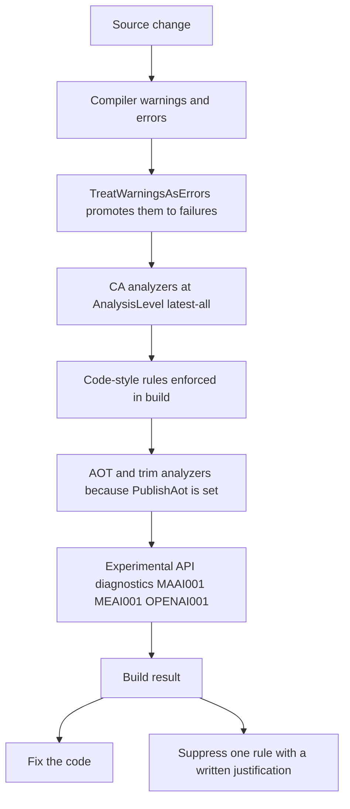

# Code Conventions and Build Constraints

Sebastian's build is not a formality. The project compiles with `TreatWarningsAsErrors`, `AnalysisLevel` set to `latest-all`, code-style enforcement in the build, and `PublishAot`; the practical consequence is that **any new compiler or analyzer diagnostic is a build failure, not a suggestion**, and any code path that only works with a JIT and a reflection-heavy runtime is a build failure too. A change that "works locally" but introduces a `CA`/`IDE`/`IL` diagnostic does not merge, and the repository's own policy for that situation is stated in the project file: fix the underlying issue, or add a `NoWarn` for that specific rule with a reason.

This page covers the constraints and the conventions the existing code establishes for satisfying them. For what the app *does*, start with [System Overview and Runtime Topology](../architecture/overview.md); for how services are wired and bound, see [Startup, Composition, and Configuration Binding](../architecture/startup-and-composition.md).

## The build gate



Every gate between a source change and a successful build, in the order a diagnostic usually surfaces.

| Gate | Setting | What it costs you if violated |
| --- | --- | --- |
| Warnings are errors | `TreatWarningsAsErrors`, `EnforceCodeStyleInBuild` | Any new warning or style diagnostic fails the build instead of scrolling past |
| Analyzer breadth | `AnalysisLevel` `latest-all` | Every analyzer the SDK ships is on, including rules the previous SDK version did not have |
| Native publishing | `PublishAot`, `IlcOptimizationPreference` `Size` | Reflection-based activation, binding, and serialization are reported by the trim/AOT analyzers |
| Configuration binding | `EnableConfigurationBindingGenerator` | Binding must go through the source-generated binder; the reflection binder is not AOT-safe |
| Experimental dependencies | `Microsoft.Agents.AI.*`, `Microsoft.Extensions.AI` | Unannotated use of preview APIs produces `MAAI001`, `MEAI001`, and `OPENAI001` diagnostics |
| Globalization | `InvariantGlobalization` | Culture-sensitive formatting and parsing behave invariantly; ICU data is not available |

Two of these deserve emphasis because they surprise people arriving from JIT-era .NET:

**`latest-all` is a moving target.** The project file says so explicitly: *"latest-all: SDK upgrade can surface new analyzer errors; fix or add a justified NoWarn per rule."* A routine SDK bump can therefore break the build with rules that had nothing to do with your change. The sanctioned responses are: fix the code, or add a narrowly scoped `NoWarn` naming the rule and why it does not apply here. Silencing a rule globally without a reason defeats the configuration, because `TreatWarningsAsErrors` is what makes the analyzer set load-bearing.

**AOT is treated as a property of the code, not a publish-time afterthought.** `PublishAot` turns on the trim and AOT analyzers, so reflective patterns are reported as diagnostics inside the same warnings-as-errors gate as everything else. The codebase contains **no** trim/AOT suppressions (`UnconditionalSuppressMessage`, `DynamicallyAccessedMembers`, `RequiresUnreferencedCode`) — AOT safety is achieved structurally instead, which is the pattern to preserve:

- Configuration binds through a source-generated path (`EnableConfigurationBindingGenerator`), so no runtime reflection over `SebastianConfig`.
- Logging is source-generated through `[LoggerMessage]` partial methods, so no reflection over format strings.
- Git is invoked by spawning the `git` binary with `ProcessStartInfo` and an argument list, not by a reflection-driven wrapper.
- GitHub and webhook traffic go through the generated Kiota/Octokit clients rather than hand-rolled serialization; repository code contains no direct `System.Text.Json` or `Activator` usage.
- Dependency injection constructs the one awkward service with an explicit factory, so the container never has to reflect over an internal implementation type.

The binding constraint has a visible consequence for the config tree: `Sebastian.csproj` carries the comment *"Reflection binding is not AOT-safe; generated binder needs non-required properties (CS9035)"*, and every config property is therefore declared as `public string Foo { get; set; } = null!;` rather than as a `required` property. Converting those to `required` to clean up the null-forgiving operators breaks the build. The key tree and validation rules are documented in [Startup, Composition, and Configuration Binding](../architecture/startup-and-composition.md).

## Suppression: two shapes, both justified

The repository suppresses diagnostics in exactly two spellings, chosen by scope.

**File-level pragma for a whole experimental API surface**, at the top of the files that touch it, naming the rule and the reason:

```csharp
#pragma warning disable MAAI001 // HarnessAgent and file access APIs are experimental.
#pragma warning disable MEAI001 // Microsoft.Extensions.AI experimental extensions.
```

`MAAI001`/`MEAI001` appear in the two role files and in `ImplementSpec` — the places that construct `HarnessAgent`, `LocalShellExecutor`, and file access. `ProviderResolver` instead suppresses `OPENAI001` and `MEAI001` for the OpenAI client surface. Keeping the pragmas at file scope, with the reason on the same line, is what makes it obvious that the experimental surface is contained to the agent layer rather than spread through the domain code. When you add a call to another preview API, expect a new diagnostic id and add it the same way; do not reuse an id that does not match the diagnostic you are silencing.

**Targeted attribute for a single member**, when a file-wide pragma would be too broad and the rule is about that one method or type:

```csharp
[SuppressMessage("Design", "CA1031", Justification = "A failed job must not tear down the queue.")]
protected override async Task ExecuteAsync(CancellationToken stoppingToken)
```

That one is load-bearing behavior, not style: catching broadly inside the per-job body is how the queue keeps consuming after a job throws. The second instance is on the options type, with a comment above it repeating the reason:

```csharp
// CA1812: options types are created by the options infrastructure, not by visible `new`.
[SuppressMessage("Performance", "CA1812", Justification = "Instantiated by the options infrastructure.")]
internal sealed class SebastianConfig
```

The convention to copy: `SuppressMessage` carries a category, a rule id, and a `Justification` sentence that explains why the analyzer is wrong *here*. An empty or vague justification is as good as no suppression at all, because the next reader cannot tell whether it is still true.

## Logging is always source-generated

There is no `logger.LogInformation(...)` call anywhere in the repository. Every log statement is a `private partial` method decorated with `[LoggerMessage]`, and every containing class is declared `partial` to host the generated implementation:

```csharp
[LoggerMessage(Level = LogLevel.Information, Message = "Implementation completed for {Repository}#{IssueNumber} at {Path}. Git status: {Status}. Agent response: {Response}")]
private static partial void LogCompleted(ILogger logger, string repository, int issueNumber, string path, string status, string? response);
```

Three details of the established pattern:

- **The declaring type must be `partial`.** `JobQueue`, `Git`, `GitHubWebhookProcessor`, and `ImplementSpec` are all `internal sealed partial class`. Adding a log line to a non-partial class means making it partial first.
- **A `static` logger parameter is used when the logger is not a field.** `ImplementSpec` is a job object with no logger field, so `LogCompleted` takes `ILogger logger` explicitly and is `static`; `Git` and `JobQueue` hold their logger and declare instance partial methods instead.
- **Levels and message templates live in the attribute**, so the level is visible at the call site in source and structured property names are checked by the generator. Exceptions are passed as a first parameter (`LogFailed(Exception exception, string key)`, `LogSyncFailed(Exception exception)`), which is how the generator wires up exception logging.

## Type and member conventions

**Internal by default, `sealed` unless designed for inheritance.** Every service in `src/` is `internal sealed` (or `internal` for the two intentional extension seams: `AgentRole` is `internal abstract` and `IJob` is `internal interface`). `Program.cs` is the exception — top-level statements, so no type at all.

**Tests reach internals through the project file, not through `public`.** `Sebastian.csproj` declares `<InternalsVisibleTo Include="Sebastian.Tests" />` and the test project holds a `ProjectReference` to the web project. That is why an `internal` method like `AgentRole.CreateOptions()` or `ImplementSpec.PrepareWorkspaceAsync` can be asserted directly, and why making something `public` "so the tests can see it" is the wrong move. The same project file excludes the test tree from compilation with `<DefaultItemExcludes>$(DefaultItemExcludes);tests/**</DefaultItemExcludes>`, so the web project never compiles a second copy of the tests.

**Primary constructors when the constructor only captures parameters.** Classes whose dependencies are pure state use the parameter-list form:

```csharp
internal sealed class ImplementationAgent(
    string name,
    string workspacePath) : AgentRole, IAsyncDisposable
```

`JobQueue`, `ImplementSpec`, and `GitHubWebhookProcessor` follow the same shape. Classes that do real work before the object is usable keep an explicit constructor instead — `Git` normalizes the content root and stores a logger, `ProviderResolver` validates the provider configuration and resolves the endpoint, `GitHubService` imports the PEM and builds the Kiota adapter. The split is visible in the same codebase, and it is the signal to use: primary constructor for capture, explicit constructor for validation or field initialization.

**Factory registrations instead of implementation-type registrations** where the container would otherwise reflect over an internal type. `Program.cs` carries the reason inline:

```csharp
// Factory, not AddSingleton<TService, TImpl>: internal processor is unknown to DI's reflection path.
builder.Services.AddSingleton<WebhookEventProcessor>(
    services => new GitHubWebhookProcessor(
        services.GetRequiredService<ILogger<GitHubWebhookProcessor>>(),
        ...
```

**Small mechanical conventions that appear consistently:** collection expressions (`[new ShellEnvironmentProvider(_shell)]`, array returns); `Path.Combine` plus `Path.TrimEndingDirectorySeparator` rather than string concatenation of paths; an explicit `StringComparison` argument on string comparisons (`Ordinal`, or `OrdinalIgnoreCase` for labels and provider names); `CultureInfo.InvariantCulture` for number parse and format (`Git.CountCommitsAsync`, `ImplementSpec`'s issue-number directory name), which is the direct consequence of `InvariantGlobalization`; `ConfigureAwait(false)` on every `await`, `await using` included; and `_ =` discards (`_ = PrepareLock.Release();`) for results that are deliberately ignored.

## Comments and `// shortcut:`

There is no XML documentation anywhere in the repository — not one `///` comment — and no `TODO`. Comments explain *why* a line is the way it is, and they appear where the alternative would look like a mistake:

```csharp
// One repository: serialize fetch, fast-forward, and worktree changes.
private static readonly SemaphoreSlim PrepareLock = new(1, 1);

// Reuse it: the previous run may hold uncommitted agent work that must not be deleted.
if (Directory.Exists(worktreePath))
```

`// shortcut:` is a distinct marker: it labels a **known pragmatic tradeoff that has been decided, not a defect waiting to be reported**. There are three, and each names both the shortcut and the condition that would justify upgrading it:

- `Git.StartAsync` — *"shortcut: push + startup sync only; add a periodic fetch if missed push webhooks become a problem."* The startup sync is best-effort and bounded to ten seconds for the same reason.
- `Git.SyncMainAsync` — *"shortcut: worktree prep can run during a fast-forward; worst case the prep fails on git's index.lock, the repo stays consistent."* The race is accepted because the failure mode is a failed preparation, not corruption.
- `GitHubWebhookProcessor.ProcessPushWebhookAsync` — *"shortcut: synchronous fetch in the webhook; move to a background queue if delivery latency becomes a problem."* Push handling blocks the HTTP response on purpose.

Treat these as documented decisions. Removing the shortcut is a design change that should replace the comment with the new arrangement; "fixing" it silently, or deleting the comment while leaving the behavior, destroys the only record of why the code looks wrong.

## Project layout constraints

There is no solution file and no `Directory.Build.props`: `dotnet build Sebastian.csproj` and `dotnet test tests/Sebastian.Tests/Sebastian.Tests.csproj` are the entry points, and all shared build settings live in the one web project file.

The test project is deliberately configured *less* strictly than the product: it inherits none of `TreatWarningsAsErrors`, `AnalysisLevel`, `PublishAot`, or `InvariantGlobalization`, and it adds only the xunit stack, a global `<Using Include="Xunit" />` (which is why test files have no `using Xunit;`), and `IsPackable` `false`. Two consequences for a change: a diagnostic that fails the build in `src/` may pass in `tests/` and still be worth fixing, and code that must be AOT-clean cannot be validated by the test project — the analyzer evidence comes from the web project, which does not compile `tests/**`. Test classes are `public sealed`, unlike production types, because xunit discovers them by reflection.

Test conventions and coverage gaps are covered in [Testing Strategy and Harness](../testing/test-strategy.md); the agent-layer use of the experimental pragmas is covered in [Agent Roles, Tools, and Sandbox Boundaries](agent-execution.md).

## Change checklist

- **New analyzer diagnostic?** Fix it. If it genuinely does not apply, add a `NoWarn` for that rule *per rule* with a reason, or a member-scoped `SuppressMessage` with `Justification` — never a blanket disable.
- **New configurable setting?** A bindable, non-`required` property with a `= null!;` initializer, plus a validation attribute if mandatory, plus a consumer reading `IOptions<SebastianConfig>`. Do not reach for a reflection-based binder or a custom `TypeConverter`.
- **New preview API call?** Expect a new experimental diagnostic id; scope the pragma to the file that touches the harness surface.
- **New log line?** A `[LoggerMessage]` partial method on a `partial` class. No `ILogger.Log*` calls.
- **New service?** `internal sealed`, registered with a factory if it takes dependencies you want pinned; internal visibility is enough for the tests.
- **Adding a test?** It may use internals freely; it must not assume the production warnings-as-errors or AOT analysis apply to it.
- **Tempted to simplify an odd-looking block?** Check for a comment or a `// shortcut:` first — the oddity is usually the decision.
