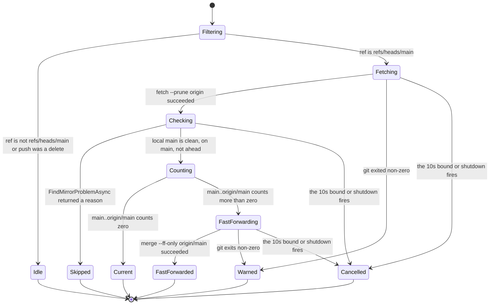
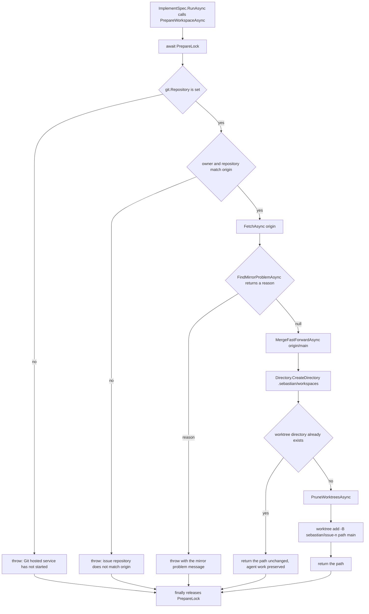
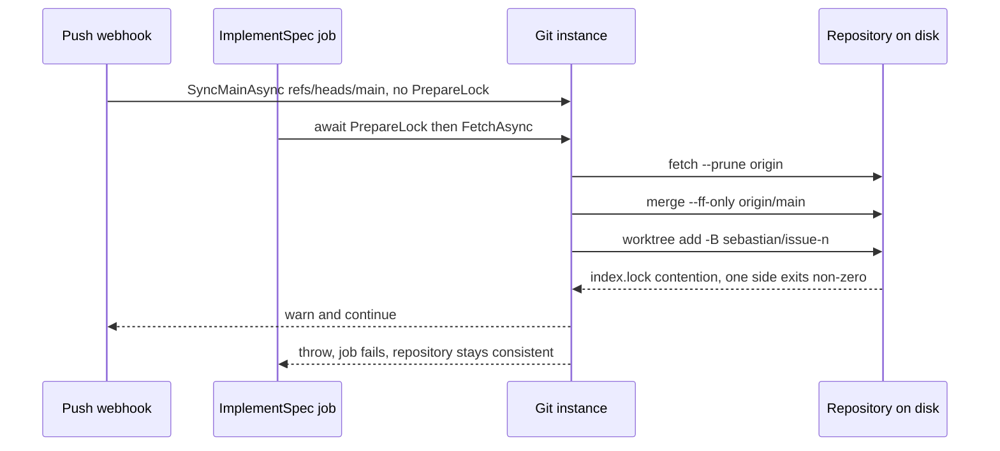

# Git Mirror and Worktree Model

Sebastian owns exactly one clone and never checks anything out of it except `main` and one directory per issue. Two files split that responsibility, and the split is the thing to internalize before changing anything here:

- `src/Libs/Git.cs` is a **command runner plus one policy-free invariant**. It spawns `git` with `ProcessStartInfo`, captures stdout/stderr, throws on a non-zero exit code, and exposes small verbs (`FetchAsync`, `MergeFastForwardAsync`, `AddWorktreeAsync`, …). It knows the names `main` and `origin/main` and nothing else.
- `ImplementSpec.PrepareWorkspaceAsync` is **all the policy**: *whether* the mirror is acceptable, what to do when it is not, where worktrees live, and what branch they get.

Everything below follows from one fact: there is a single repository, a single local `main`, and a single git index — so every git operation that touches the ref or the index has to be serialized, and local `main` is treated as a read-only mirror rather than a workspace. See [System Overview and Runtime Topology](../architecture/overview.md) for where `Git` sits in the process, and [Startup, Composition, and Configuration Binding](../architecture/startup-and-composition.md) for why the `Git` singleton and the `Git` hosted service must be the same object.

## The repository invariant

`Git` is registered as a singleton and as `IHostedService` through a factory that resolves the same instance (`Program.cs`). On host start, `StartAsync` does two very different things in sequence:

1. `EnsureRepositoryAsync` — **throws** on failure.
2. `SyncMainAsync` under a linked `CancellationTokenSource` with `CancelAfter(TimeSpan.FromSeconds(10))` — best-effort, never throws.

`EnsureRepositoryAsync` enforces the identity of the process, in two steps:

| Check | Failure |
| --- | --- |
| `git rev-parse --show-toplevel` equals `IHostEnvironment.ContentRootPath` | `InvalidOperationException`: `"Sebastian must run from the repository root. Content root is '<path>', git root is '<path>'."` |
| `git remote get-url origin` parses via `RepositoryIdentity.Parse` | `InvalidOperationException`: `"Could not parse the origin remote URL."` (a missing remote surfaces earlier as `git remote get-url origin failed: <stderr>` from the generic runner) |

Comparison is done by `PathEquals`, which full-paths and trims trailing separators both sides and compares `OrdinalIgnoreCase` only on Windows. The invariant is checked with `CancellationToken.None`, deliberately: this is not cancellable startup work.

The result is stored in `Git.Repository` (`RepositoryIdentity?`) and logged as `Using repository {Owner}/{Repository} on main`. That property is the *only* thing that later proves the clone's identity, and it is assigned once, at the end of `EnsureRepositoryAsync` — so `PrepareWorkspaceAsync` treats a null `Repository` as "the hosted service has not completed its start" rather than as an empty value.

### RepositoryIdentity: the smallest possible remote parser

`RepositoryIdentity(Owner, Name)` — a positional `record` — is produced by one static `Parse(string?)`. The rules, in order:

1. Null/whitespace → `null`.
2. Trim, trim trailing `/`, then strip a case-insensitive `.git` suffix.
3. If the value contains `://`, parse as an absolute `Uri` and use `uri.AbsolutePath`; a non-parsable URI → `null`.
4. Otherwise treat it as scp-like: everything after the first `:`; no `:` at all → `null`.
5. Split on `/`, drop empty entries, and take the last two segments as owner and name; fewer than two segments → `null`.

So `https://github.com/owner/repo.git`, `https://github.com/owner/repo`, `git@github.com:owner/repo.git`, and `ssh://git@github.com/owner/repo.git` all yield `owner`/`repo`, while `""`, `not-a-remote`, and `https://github.com/only-owner` yield `null`. `RepositoryIdentityTests` pins exactly those seven cases as two `[Theory]`s (four accepted shapes, three rejected). Deeper paths collapse to the last two segments, which is what makes `ssh://host/group/sub/repo.git` behave like `sub/repo` — good enough for the one repo this process serves, and the reason `Program.cs` can validate `owner/repository` on an issue event at all.

## Mirror sync: fetch, check, count, fast-forward

There are exactly two call sites for `SyncMainAsync`:

- **Startup** — `Git.StartAsync`, under the 10-second bound, via the single-argument overload that supplies `refs/heads/main`.
- **Push webhook** — `GitHubWebhookProcessor.ProcessPushWebhookAsync` calls `git.SyncMainAsync(pushEvent.Ref, pushEvent.Deleted, cancellationToken)` **inline inside the request** (with a `// shortcut:` comment acknowledging the latency tradeoff). There is no periodic fetch; a missed push delivery is covered by the next restart.

The three-argument overload is a ref filter first and a sync second: if the push was a deletion, or the ref is anything other than exactly `refs/heads/main` (`StringComparison.Ordinal`), it returns immediately. Branch pushes — including the `sebastian/issue-<n>` branches themselves — never trigger a mirror update.



Every path through `SyncMainAsync`, including the ref filter that makes a push to any other branch a no-op. Only the `FastForwarded` terminal state changes the repository, and every terminal state except that one is a log line rather than an exception.

The happy path reads, in order: `fetch --prune origin`; `FindMirrorProblemAsync`; `rev-list --count main..origin/main`; return early if zero with `Local main already matches origin/main`; otherwise record `rev-parse main`, run `merge --ff-only origin/main`, re-read `rev-parse main`, and log `Fast-forwarded local main from <before> to <after>`.

The merge is `--ff-only` and nothing else. There is no rebase, no `--no-ff`, no merge commit, and **no conflict resolution anywhere in the codebase**: if local `main` and `origin/main` have genuinely diverged, the merge fails, the exception is caught, and the warning is the entire response. That is why `FindMirrorProblemAsync` runs first — the ahead check turns the common divergence case into a skip with a remediation hint instead of a raw git error.

### The three mirror guards, verbatim

`FindMirrorProblemAsync` returns `string?`: `null` means "safe to use as a base", a string means "do not proceed, here is why". It checks, in this order:

1. **Not on `main`** — `git branch --show-current` must be exactly `main` (`Ordinal`, so `Main` fails):
   `"Local main is not checked out (current branch: '<branch>'). Run Sebastian from main."`
2. **Dirty tracked tree** — `git status --porcelain --untracked-files=no` must be empty:
   `"Local main has uncommitted tracked changes. Commit or stash them, or move them to a branch."`
3. **Local-only commits** — `rev-list --count origin/main..main` must be zero:
   `"Local main has <n> commit(s) not on origin/main. Move them to a branch: git branch wip/local && git reset --hard origin/main"`

The `--untracked-files=no` flag in the second check is load-bearing, not incidental: the agent worktrees live at `.sebastian/workspaces` *inside* the clone and are untracked by design (`.gitignore` lists `.sebastian/`), so counting untracked files would make the mirror permanently unusable the first time a worktree existed.

Note what is deliberately absent from the guard set: it does not check that `main` exists, does not check for an in-progress rebase/merge, and does not require the tree to be *clean at the index level* beyond tracked changes. It is a three-way gate, not a full repository health check.

## Two audiences, two failure policies

The same function — `FindMirrorProblemAsync` — is consumed by two callers that treat a non-null answer in opposite ways, and the asymmetry is the central design decision on this page.

| Caller | On a mirror problem | On a git failure | On cancellation |
| --- | --- | --- | --- |
| `Git.SyncMainAsync` (startup, push webhook) | `LogSyncSkipped(problem)` at **Warning**, return normally | `catch (InvalidOperationException)` → `LogSyncFailed` at **Warning** | `catch (OperationCanceledException)` → `LogSyncCancelled` at **Debug** |
| `ImplementSpec.PrepareWorkspaceAsync` (job) | `throw new InvalidOperationException(problem)` | propagates | propagates |

Why the sync path swallows and the prepare path throws:

- **The sync path runs on the critical path of things that must not fail.** Startup must complete even when the machine is offline, the remote is unreachable, or a developer left `main` dirty — otherwise a pushed commit that arrives while the host was down would leave the service unable to boot. The push webhook is the same: the delivery must be acknowledged even if the fetch times out or the fast-forward is rejected, and the `// shortcut:` comment on the ten-second bound states the accepted consequence plainly (*"a missed push webhook must not prevent the app from starting"*). `OperationCanceledException` is caught separately and logged at Debug because the 10-second timeout firing is an expected outcome, not an incident — and the runner already killed the child process tree before rethrowing.
- **The prepare path runs immediately before an agent starts writing code.** Starting an agent on a base that is not the reviewed `main` silently corrupts the only artifact the system produces. There is no safe degraded mode, so the job fails, `JobQueue` logs `Job {Key} failed` at Error, and the in-flight key is released — another qualifying issue event is required to retry. This is also why the mirror check is repeated per job instead of trusting the startup sync or the last push webhook: the mirror may have been left dirty at any point in between.

The practical rule: **a mirror problem is a warning for the intake path and a hard error for the agent path.** See [Failure Handling](../operations/failure-handling.md) for how both land in logs and [Job Queue and Execution Semantics](job-queue.md) for what happens to the job after the throw.

## Worktree preparation

`ImplementSpec.RunAsync` calls `PrepareWorkspaceAsync`, takes the returned path, and hands it to `new ImplementationAgent(options.Value.Agent.Name, workspacePath)` as the sandbox root. `PrepareWorkspaceAsync` is `internal` rather than private purely so `ImplementSpecTests` can drive it without constructing an agent — the test seam convention described in [Code Conventions and Build Constraints](codebase-conventions.md).

### PrepareLock: one static semaphore for the whole process

```csharp
// One repository: serialize fetch, fast-forward, and worktree changes.
private static readonly SemaphoreSlim PrepareLock = new(1, 1);
```

`PrepareLock` is `static`, so it is shared by every `ImplementSpec` instance across every DI scope, not per job. `JobQueue` runs up to `MaxConcurrentJobs = 10` jobs concurrently through `Parallel.ForEachAsync`, so this is what guarantees that no two jobs fetch, fast-forward, or create a worktree at the same time. It is acquired first and released in a `finally`, and it deliberately covers the *entire* preparation — including the fetch — not just the worktree creation: fetching rewrites `origin/main`, and a fast-forward rewrites `main`, so those two must never interleave across jobs.

The semaphore is **not** a repository-wide git lock. Once `PrepareWorkspaceAsync` returns, the lock is free, and the agent works entirely inside its own worktree, which git keeps on a separate branch with a separate index. Two agents can therefore edit and build simultaneously; only the mirror operations are serialized.

### The decision tree



Every branch of `PrepareWorkspaceAsync`, including the three throws that make a job fail instead of starting an agent.

Each step, with the reasoning that is not obvious from the code:

- **Identity cross-check.** `owner`/`repository` come from the webhook event; the comparison against `git.Repository` is `OrdinalIgnoreCase` on both parts, so `Owner/Repo` and `owner/repo` are the same repository. On mismatch: `"Issue repository '<owner>/<repository>' does not match local origin '<local.Owner>/<local.Name>'."` With the single-repository non-goal in [Product Intent vs. Implemented Behavior](product-intent-and-gaps.md), this message is the *only* thing standing between a misconfigured webhook and an agent working in the wrong clone.
- **Fetch, then check, then merge.** `FetchAsync("origin")` runs even though a push webhook may have synced seconds earlier — the guarantee is "as fresh as this job's fetch", not "as fresh as the last webhook". After the guard passes, `MergeFastForwardAsync(Git.BaseRef)` is called **unconditionally**, without a behind-count first. When local `main` already equals `origin/main` this is a no-op that exits zero; the state machine's `behind == 0` short-circuit exists only in the sync path, where it saves a process spawn per push webhook.
- **Layout.** `workspaceRoot = Path.Combine(git.Root, ".sebastian", "workspaces")`, the worktree is `<workspaceRoot>/<issueNumber>`, and the branch is `sebastian/issue-<n>` (invariant-culture formatted number). `.sebastian/workspaces` is created on demand with `Directory.CreateDirectory`, so nothing has to pre-create the folder, and `.gitignore` keeps the whole `.sebastian/` tree out of the mirror.
- **Reuse over recreation.** `if (Directory.Exists(worktreePath)) return worktreePath;` with the comment *"Reuse it: the previous run may hold uncommitted agent work that must not be deleted."* This is correct precisely because nothing in the pipeline commits: the agent's entire output is the uncommitted state of that worktree, which `RunAsync` later reports through `git -C <worktree> status --short`. Recreating the directory would destroy the previous run's product.
- **Prune then add.** Only when the directory is missing does it call `PruneWorktreesAsync` (dropping git's bookkeeping for worktrees removed by hand) and then `AddWorktreeAsync(worktreePath, branch, Git.BaseBranch)`, which is `git worktree add -B <branch> <path> main`. Two details matter: the start point is local `main` — the just-fast-forwarded mirror — not `origin/main`, so the worktree cannot start from an unsynced ref; and `-B` *creates or resets* the branch, so a leftover `sebastian/issue-<n>` ref from an earlier run is re-pointed at `main` rather than failing the command.

### The documented index.lock race

`PrepareLock` serializes preparation against preparation, but it does not serialize preparation against the push-webhook sync, which runs on a request thread inside `SyncMainAsync` and takes no semaphore. The code accepts this deliberately, with the shortcut comment at the top of the sync:

```
// shortcut: worktree prep can run during a fast-forward; worst case the prep fails on git's index.lock, the repo stays consistent.
```

The reasoning is worth keeping intact if you touch either side: a concurrent `git merge --ff-only` and `git worktree add` can collide on `.git/index.lock`, and the loser fails with a non-zero exit. That failure is an `InvalidOperationException` from the command runner — a failed *preparation* for that one job, logged and retried by the next event, never a corrupted repository. Closing the race would mean taking `PrepareLock` in the webhook sync path, i.e. blocking a webhook request behind up to ten job preparations; the current tradeoff prefers the rare, contained failure. If you do decide to close it, take the lock in `SyncMainAsync` rather than dropping it from `PrepareWorkspaceAsync`, and keep the push webhook's latency budget in mind.



The accepted overlap: preparation holds `PrepareLock`, the webhook sync does not, and the only casualty is a failed job.

## Lifecycle of a worktree directory

| Event | Effect on `.sebastian/workspaces/<issue>` |
| --- | --- |
| First `ready-for-agent` event for an issue | directory created on branch `sebastian/issue-<n>` from local `main` |
| Agent run completes | directory keeps the agent's uncommitted changes; `status --short` is logged |
| Same issue re-labeled / re-edited later | **reused in place**; the branch is not reset and the changes are not touched |
| Directory removed by hand (`git worktree remove --force`) | next preparation prunes stale metadata and calls `worktree add -B`, creating a fresh directory at the same path |
| Host restarted | nothing changes; worktrees are on disk, and the job's work is whatever the agent left there |
| An operator deletes `.sebastian/` | **the agent's output is gone** — it was never committed anywhere |

The last row is the operational consequence of "the pipeline never commits". There is no recovery path in code: nothing in the repository can re-create a run's changes from git history, because they were never in git history. Treat `.sebastian/workspaces` as the system's only durable artifact store.

## What the git layer does not do

This is a short list because the boundary is deliberate, and each omission is repeated in another layer:

- **No commit, no push, no pull request, no merge to a remote.** `Git` exposes `fetch`, `merge --ff-only`, `worktree add/prune`, `status`, `rev-parse`, `rev-list`, `remote get-url`, and `branch --show-current` — that is the entire vocabulary. There is no `commit`, `push`, or `checkout` verb anywhere in the class, and `ImplementSpec` never adds one; the successful run ends at a log line plus `GetStatusAsync`. That absence is the architectural guarantee, not a configuration flag: no caller can reach a publishing operation because no such operation exists to call. The gap against the PRD is tracked in [Product Intent vs. Implemented Behavior](product-intent-and-gaps.md), not as missing wiring.
- **No conflict resolution.** `--ff-only` is the only merge form used. Divergence is handled by refusing to proceed (guard message) or by failing the merge (warning), never by picking sides.
- **No branch management beyond the issue branch.** Nothing deletes `sebastian/issue-<n>` when an issue closes, and nothing rebases an existing worktree onto newer `main` — a reused worktree stays on the tree it had.
- **No interaction.** The runner sets `GIT_TERMINAL_PROMPT=0`, so an SSH or credential prompt fails fast instead of hanging a request; and `RunAsync` kills the whole process tree on cancellation before rethrowing the `OperationCanceledException`.

The agent is told the same thing twice, independently. `ImplementationAgent`'s fixed `Instructions` end with *"Never run git commands, commit, push, or create pull requests."*, and `ImplementSpec.BuildPrompt` repeats it per run as *"Do not run git commands, commit, push, or create pull requests."* alongside *"Do not modify files outside the workspace."* A shell deny-list backs the instruction for the destructive subset (`\bgit\s+(push|reset|clean|checkout\s+--)\b`). Guardrails are layered because the instruction is advisory — see [Agent Roles, Tools, and Sandbox Boundaries](agent-execution.md) for the enforced half and [Feature Issue to Agent Workspace](../workflows/feature-implementation.md) for the end-to-end trace.

## Configuration and operational surface

There is no git configuration section in `SebastianConfig`. What an operator must supply is entirely environmental:

- a `git` binary on `PATH`;
- a clone whose working tree is the process content root (i.e. start Sebastian from the repository root);
- a remote named `origin` whose URL is `owner/repo`-shaped (HTTPS, `ssh://`, or scp-like);
- a `main` branch checked out locally, clean, with no commits ahead of `origin/main`;
- read access for `fetch` (write access is never needed — nothing pushes).

Both ref names are hardcoded as `Git.BaseBranch = "main"` and `Git.BaseRef = "origin/main"` constants, so a repository whose default branch is not `main` cannot be used without a code change. The startup failure table in [Startup, Composition, and Configuration Binding](../architecture/startup-and-composition.md) lists the exact exceptions for each precondition, and [Failure Handling](../operations/failure-handling.md) covers blast radius.

## Test coverage

`ImplementSpecTests` drives `PrepareWorkspaceAsync` against a real temporary repository — `TestRepository.Create` builds a bare `origin`, clones it, seeds a `README.md`, and pushes, and `TestRepository.CreateGit` constructs `Git` with a `TestHostEnvironment` pointing at the clone. Four behaviors are pinned:

| Test | Pinned behavior |
| --- | --- |
| `ReusesExistingWorktreeAndKeepsUncommittedWork` | second preparation returns the same path and an uncommitted marker file survives |
| `RecreatesWorktreeWhenDirectoryWasRemoved` | after `git worktree remove --force`, preparation returns the same path and the directory exists again (exercising the `-B` reset of the leftover branch and the prune) |
| `RejectsDirtyMain` | an appended line in `main`'s `README.md` makes preparation throw |
| `RejectsForeignRepository` | `new ImplementSpec("other", "repo", …)` throws against an `owner/repo` origin |

`RepositoryIdentityTests` pins the four supported remote shapes and three invalid ones.

What is *not* covered: there is no test of `SyncMainAsync` at all — not the ref filter, not the behind-count short-circuit, not the swallow-on-failure behavior, not the ten-second bound. The mirror sync is therefore the least-protected part of this page; a change to `FindMirrorProblemAsync`'s guards is covered indirectly (through `RejectsDirtyMain`), but a change to the sync state machine is not covered by anything. Verify it manually against a scratch clone with a pushed commit while the host is stopped.
