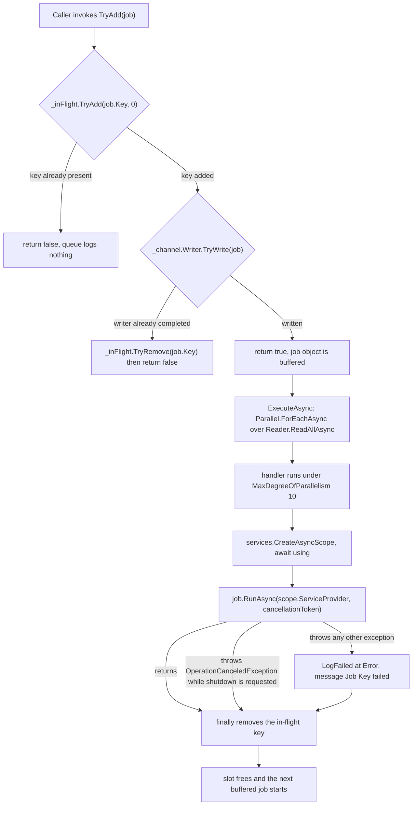
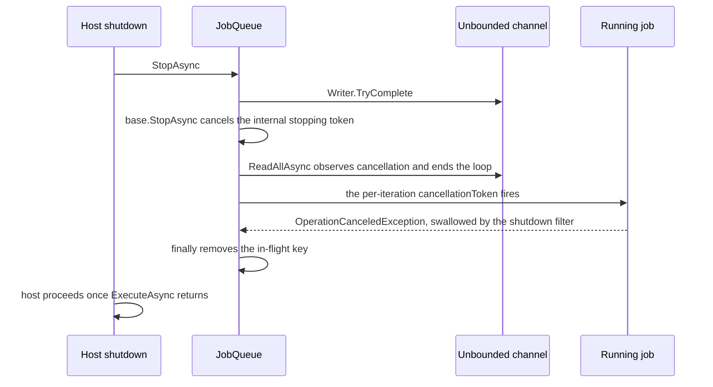

# Job Queue and Execution Semantics

`JobQueue` is the only place in Sebastian where work is allowed to happen after an HTTP response. It is also the smallest piece of infrastructure in the process — one class, two members of state, one interface — and it carries four responsibilities that are easy to conflate: **admission** (`TryAdd`), **ordering and buffering** (an unbounded channel), **concurrency** (a fixed degree of parallelism), and **failure containment** (a per-job `try`/`catch`/`finally`). Reading it as "a `BackgroundService` that runs jobs" loses the part that matters, because the same object is what the webhook path calls into; if those were two objects, `TryAdd` would write to a channel nobody reads. See [Startup, Composition, and Configuration Binding](../architecture/startup-and-composition.md) for the factory registration that keeps them one, and [System Overview and Runtime Topology](../architecture/overview.md) for where the queue sits in the process.

```csharp
internal interface IJob
{
    string Key { get; }

    Task RunAsync(IServiceProvider services, CancellationToken cancellationToken);
}
```

Two members, and both are semantics rather than plumbing: `Key` is the **admission token** (not an identifier that gets logged or persisted), and `RunAsync` receives a **service provider** (a per-job scope, not the root container) plus the **shutdown token**. `ImplementSpec` is the only production implementation, with `Key => $"{owner}/{repository}#{issueNumber}"`. The queue itself names no job type anywhere, which is what makes "new job kind" a matter of implementing `IJob` and calling `TryAdd`.

## Admission: the key is held from `TryAdd` until the job finishes

```csharp
private readonly Channel<IJob> _channel = Channel.CreateUnbounded<IJob>();
private readonly ConcurrentDictionary<string, byte> _inFlight = new(StringComparer.OrdinalIgnoreCase);

public bool TryAdd(IJob job)
{
    if (!_inFlight.TryAdd(job.Key, 0))
    {
        return false;
    }

    if (!_channel.Writer.TryWrite(job))
    {
        _inFlight.TryRemove(job.Key, out _);
        return false;
    }

    return true;
}
```

The dedupe contract lives in those fifteen lines, and it is worth stating as a contract because callers depend on each clause:

| Clause | Behavior | Why it matters |
| --- | --- | --- |
| `_inFlight` is keyed by `IJob.Key` | The key *is* the admission token — two jobs with the same `Key` are the same work | Dedupe scope is chosen by the job implementation, not by the queue; `ImplementSpec` keys per issue, so a re-label or edit of an issue cannot start a second run |
| `StringComparer.OrdinalIgnoreCase` | `Owner/Repo#1` and `owner/repo#1` collide | GitHub owner and repository names are case-insensitive, and the key is assembled from raw webhook strings |
| Insertion happens *before* the channel write | Concurrent `TryAdd` calls for one key race on the dictionary, and exactly one wins | No lock, no lost update; the winner is the only caller that reaches `TryWrite` |
| A failed write rolls the key back | `TryRemove` on the same path that returns `false` | The in-flight set cannot accumulate keys for jobs that were never queued — the only realistic failure here is a completed writer, i.e. shutdown |
| `false` is a normal answer, not an error | Nothing is thrown, and nothing is logged by the queue | A rejected event is expected traffic |
| Removal is in the job handler's `finally` | The key is held for the whole run, including failures | The next event *after* completion is admitted again |

Because the channel is unbounded, `TryWrite` only fails when the writer has been completed — so in practice `TryAdd` returns `false` for exactly two reasons: **that key is in flight**, or **the queue is shutting down**. There is no third "queue full" case to handle.

The caller's obligations follow from that. `GitHubWebhookProcessor` treats the boolean as informational:

```csharp
if (jobQueue.TryAdd(job))
{
    LogImplementationStarted(repositoryName, issueNumber);
}
else
{
    LogImplementationAlreadyRunning(repositoryName, issueNumber);
}
```

`LogImplementationStarted` is `Information`; `LogImplementationAlreadyRunning` is `Debug` with the message `Implementation already running for {Repository}#{Number}`. So a duplicate delivery produces a debug line and a normal webhook response — **callers must not treat `TryAdd == false` as a failure**, must not throw, and must not close or comment on the issue. The queue's only log statement at all is `Job {Key} failed`; the reject path is silent by design, which is the correct choice because the reject path is the common case for edited issues.

## The execution lifecycle



Every path a job can take from admission to in-flight-key removal. The only two exits from the handler body reach the same `finally`.

Two details the diagram makes explicit but the code only implies:

- **The handler runs at most once per queued object.** Nothing re-enqueues, so a job object that is buffered but never started at shutdown is simply abandoned. There is no dead-letter path.
- **The `finally` is the only writer-release site**, so any future early `return` added inside the handler body must not skip it.

## Concurrency: ten at a time, no backpressure

```csharp
private const int MaxConcurrentJobs = 10;
...
await Parallel.ForEachAsync(
    _channel.Reader.ReadAllAsync(stoppingToken),
    new ParallelOptions { MaxDegreeOfParallelism = MaxConcurrentJobs, CancellationToken = stoppingToken },
    async (job, cancellationToken) => { ... });
```

The cap is a `const`, not a configuration value: `SebastianConfig` has no queue section, so the number of concurrent agent runs can only be changed by editing the file and rebuilding. Ten is the hard ceiling for the process, and because each job is an agent run against an OpenAI-compatible endpoint, it is simultaneously a concurrency limit on the model provider and on the number of worktrees being built at once. The interaction with the single static `PrepareLock` in `ImplementSpec` is covered in [Git Mirror and Worktree Model](git-workspaces.md): ten jobs may be "running", but their workspace preparations are serialized one at a time.

The channel is `Channel.CreateUnbounded<IJob>()` with default options, and the consequences of that one word are operational, not cosmetic:

- **No backpressure at all.** `TryAdd` never blocks and never returns `false` for capacity. A burst of qualifying issue events — or a redelivery storm, or a label applied in bulk — enqueues one job object each, and the only bound is process memory. The HTTP intake path pays nothing for queuing.
- **Queue depth is invisible.** There is no count, no log of depth, and no metric. The observable signal that work is waiting is the absence of a "started" log line for that issue, and the practical symptom of a backlog is jobs sitting in memory until slots free.
- **Queued work is volatile.** The channel and the in-flight set are the only memory-resident state in the process, so a restart loses everything buffered; recovery is a redelivered or re-triggered event. That is stated as a design consequence in [System Overview and Runtime Topology](../architecture/overview.md) and [Failure Handling](../operations/failure-handling.md) covers the operator view.
- **Multi-writer safe.** `CreateUnbounded` does not set `SingleWriter`, so concurrent webhook requests calling `TryAdd` are supported by the channel itself; correctness of the dedupe still rests on the concurrent dictionary.
- **FIFO, not priority.** `ReadAllAsync` drains the channel in write order. There is no prioritization by issue age, label, or repository — and with one repository there is nothing to prioritize across.

## One DI scope per job

Each handler invocation does this before touching the job:

```csharp
var scope = services.CreateAsyncScope();
await using (scope.ConfigureAwait(false))
{
    await job.RunAsync(scope.ServiceProvider, cancellationToken).ConfigureAwait(false);
}
```

`services` is the root `IServiceProvider` injected into the `JobQueue` singleton, so these are root-level scopes, not webhook request scopes. The scope is created inside the handler — after the job is dequeued and after a concurrency slot exists — so ten concurrent jobs hold ten live scopes and a buffered job holds none. It is disposed with `await using` after `RunAsync` returns or throws, which means disposables a job creates from the scope are released on the failure path too, and before the `finally` that releases the key.

The important caveat is that the scope buys less isolation than it appears to. Every meaningful collaborator in this process is a root singleton — `Git`, `GitHubService`, `ProviderResolver`, `JobQueue` — so `ImplementSpec.RunAsync` resolving `Git` or `IOptions<SebastianConfig>` through the scope lands on exactly the same instances the webhook path uses. The scope's real contribution is scoped-lifetime services and deterministic disposal, both of which matter for per-job resources like the chat client. Do not put mutable per-job state into a singleton on the strength of the scope existing; if you need per-job state, hold it in the job object or in the scope.

## Failure isolation

The handler body is annotated rather than guarded by convention:

```csharp
[SuppressMessage("Design", "CA1031", Justification = "A failed job must not tear down the queue.")]
protected override async Task ExecuteAsync(CancellationToken stoppingToken)
```

Three nested layers, each with a different job:

1. **Per job, non-cancellation failures** → `catch (Exception exception) { LogFailed(exception, job.Key); }`. `LogFailed` is `Level = LogLevel.Error`, `Message = "Job {Key} failed"`, with the exception passed as the first parameter. Note what is *not* logged: the exception is on the record, but the queue adds no context beyond the key. The detail of why a job failed lives in whatever the job itself logged.
2. **Per job, shutdown races** → `catch (OperationCanceledException) when (stoppingToken.IsCancellationRequested) { }`. Filtered, not blanket: an `OperationCanceledException` thrown by a job that was *not* caused by shutdown falls into the general `catch` above and is logged as an error. That distinction is what keeps "the host is stopping" out of the error log without hiding a genuine cancellation bug.
3. **Around the loop** → the same filtered `catch` on `Parallel.ForEachAsync` itself, so a cancellation observed by the reader terminates `ExecuteAsync` normally instead of surfacing as an unobserved fault.

The result is the property the whole design leans on: **one failing job cannot stop the queue, and nothing in the intake path has to know that a job failed.** A failing job does not go back on the channel, does not get a retry count, and does not block its key. `ImplementSpec`'s two hard-failure modes — the mirror guards in `PrepareWorkspaceAsync` and a provider or agent exception mid-run — therefore surface as one Error line and a freed key, and the issue is retried only when GitHub sends another qualifying event. That "no retry" behavior is deliberate and is the sharpest operational edge on this page; see [Failure Handling](../operations/failure-handling.md).

## Shutdown: completion of the writer, then cancellation of everything

```csharp
public override async Task StopAsync(CancellationToken cancellationToken)
{
    _channel.Writer.TryComplete();
    await base.StopAsync(cancellationToken).ConfigureAwait(false);
}
```

The two calls look like "stop accepting, then drain", and the first half is exactly that. The second half is not a drain:



What `StopAsync` does to each class of work, in order. The writer completion prevents admission; the base-class cancellation prevents execution.

- **New admissions** are refused from the instant `TryComplete` runs: a fresh key is added to `_inFlight`, the write fails, the key is rolled back, and `TryAdd` returns `false`. Post-shutdown `TryAdd` therefore never leaks keys and never throws.
- **Buffered, not-yet-started jobs are abandoned.** `ReadAllAsync(stoppingToken)` would happily keep yielding buffered items after the writer completes, but `base.StopAsync` immediately cancels `stoppingToken`, and that token is both the reader's token and the `ParallelOptions.CancellationToken` linked into every handler's `cancellationToken`. So the loop ends rather than draining, and abandoned jobs never start — and therefore keep their in-flight keys, which is harmless because the writer is already completed and nothing can be admitted again. (It only becomes observable if the same `JobQueue` object outlives `StopAsync`, as the tests do.)
- **Running jobs observe cancellation.** The token handed to `RunAsync` fires, and `ImplementSpec` propagates it into `PrepareWorkspaceAsync`, the git commands (which kill the child process tree before rethrowing), and the agent run. A job that cooperates exits; a job that ignores the token keeps running for as long as the host's shutdown timeout allows, because `base.StopAsync` waits for `ExecuteAsync` bounded by the caller's cancellation token (the framework's default `HostOptions.ShutdownTimeout` applies — nothing in `Program.cs` overrides it).
- **Cancellation is never logged as a failure**, because of the `when (stoppingToken.IsCancellationRequested)` filters on both catches.
- **`ExecuteAsync` returns normally** once the loop ends, so a shutdown mid-job is an orderly stop from the host's point of view, not a faulted hosted service.

The practical reading: there is **no graceful drain**. Nothing in the design waits for the ten running agents to finish, and nothing saves the buffered ones. If losing in-flight agent work at shutdown is unacceptable, that is a change to `StopAsync` and to the shutdown timeout, and it must be made with the knowledge that agent runs are long — minutes, not milliseconds — while `ImplementSpec` holds `PrepareLock` for its preparation phase.

## What a reader or operator should take away

| Situation | What happens | Where to look |
| --- | --- | --- |
| Same issue event delivered twice | Second `TryAdd` returns `false`, one Debug line, no side effect | `GitHubWebhookProcessor` |
| Edited issue while its job still runs | Rejected for the duration of the run; admitted again on a later event | `_inFlight` + `finally` |
| Job throws | Error line `Job {Key} failed`, key released, loop continues, **no retry** | `LogFailed`, `finally` |
| Twelve jobs submitted at once | Ten start; the other two wait for a slot | `MaxConcurrentJobs` |
| Hundreds of jobs submitted | All buffered in memory; `TryAdd` still returns `true` immediately | unbounded channel |
| Host shut down mid-run | Admission closed, buffered jobs dropped, running jobs cancelled and swallowed | `StopAsync` |
| Host restarted | Channel and in-flight set are empty; only new events cause work | nothing persisted |

## Extending the queue

Adding a job kind is the second of the four extension seams in [System Overview and Runtime Topology](../architecture/overview.md), and it requires no change to `JobQueue`:

1. Implement `IJob` as `internal sealed` with a `Key` that is **stable and canonical** — the queue dedupes on string equality (case-insensitive), so a key containing a timestamp, a run id, or a delivery id silently disables dedupe.
2. Resolve everything from the `services` argument, not from captured state, since the scope is the only sanctioned way to reach collaborators and disposables.
3. Do not catch broadly inside `RunAsync` unless partial failure is meaningful; the queue already isolates and logs, and a swallowed exception there loses the `Job {Key} failed` record.
4. Enqueue from the intake path with `TryAdd` and treat `false` as "already running", not as an error.
5. If the new job mutates shared process state (git refs, files on disk), it must take its own serialization, as `ImplementSpec` does with `PrepareLock`. `JobQueue` serializes nothing except access to its own dictionary and channel.

The decision that is *not* available without editing this file is changing the concurrency cap or the queue's persistence properties. `MaxConcurrentJobs` is `private const` and the channel is created unbounded inline, so both are code changes; adding a configurable cap means a new `SebastianConfig` property (with validation, per the conventions in [Code Conventions and Build Constraints](codebase-conventions.md)) and reading it where the `ParallelOptions` is constructed.

## Tests

`tests/Sebastian.Tests/Jobs/JobQueueTests.cs` constructs `JobQueue` directly — `new JobQueue(new ServiceCollection().BuildServiceProvider(), NullLogger<JobQueue>.Instance)`, then `StartAsync` / `StopAsync` — with a local `TestJob` that exposes a completion `TaskCompletionSource`. The DI composition itself is never exercised; the three tests pin the queue's externally visible contract:

| Test | Pinned behavior |
| --- | --- |
| `RunsAtMostTenJobsConcurrently` | Twelve submitted jobs with a gated body: exactly **ten** are observed to have started before the gate is released, then twelve, then all twelve complete. This is the only evidence that `MaxDegreeOfParallelism = 10` is the effective cap rather than, say, an upper bound the runtime ignores. |
| `ContinuesAfterJobFailure` | A job whose body throws `InvalidOperationException` and a following job that completes — both completion sources are awaited, so the test fails if the exception escapes the handler or if the loop stops after the fault. |
| `RejectsDuplicateKeyWhileJobRuns` | `TryAdd` succeeds for a running key, returns `false` for the same key while it runs, and (via `SpinWait.SpinUntil`) succeeds again once the first job's completion has been signalled — pinning the `finally` timing, not just the dedupe. |

What is **not** covered, and therefore what to verify by hand when you touch `StopAsync` or the cancellation handling: no test asserts that `TryAdd` returns `false` after `StopAsync`; none asserts that a buffered job is abandoned rather than run at shutdown; none exercises the `OperationCanceledException` filter on either catch; and none asserts that a cancelled job is *not* logged as a failure. The shutdown path is the least-tested part of this file — the admission and failure-isolation paths are the well-covered ones.

If you change this file, the cheapest useful additions are the two shutdown tests (admission refused after `StopAsync`; a job that awaits the token completes rather than failing), because those are precisely the behaviors an operator relies on and no existing test would catch a regression in.
