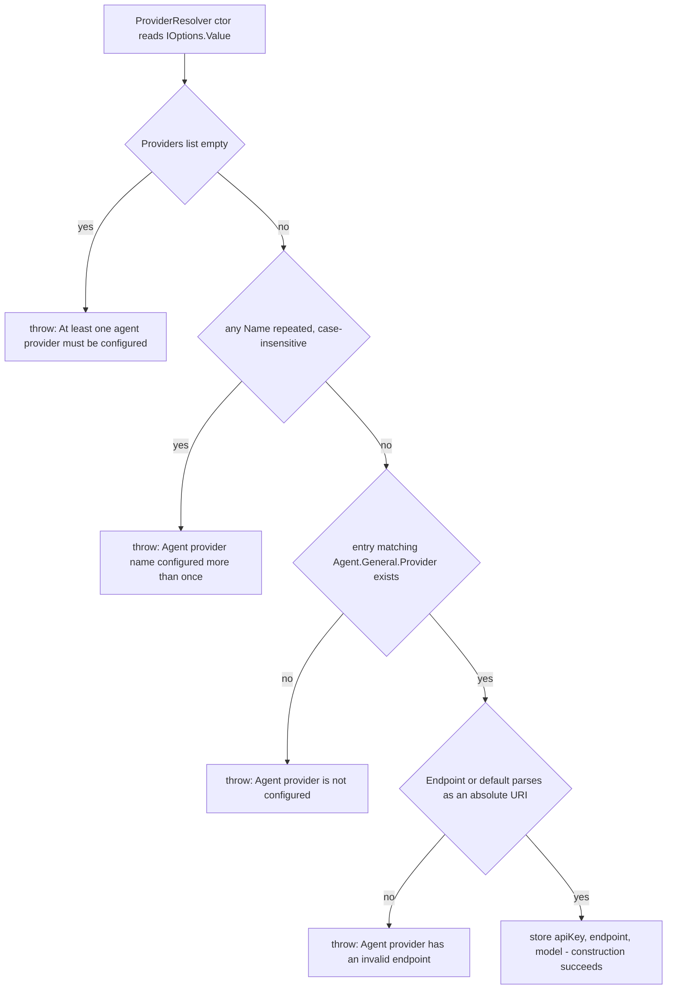
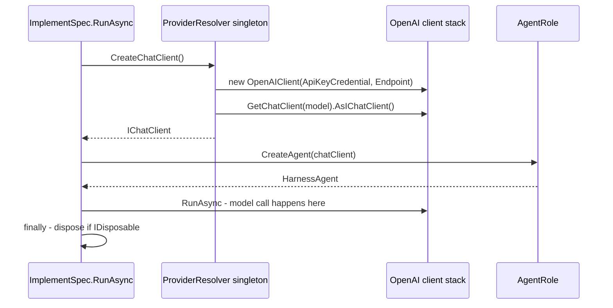

# Model Provider Resolution

`src/Agent/ProviderResolver.cs` is the single place where configuration becomes a model. It is small — one constructor, one factory method, three private fields — but it carries three separable responsibilities that are worth keeping apart:

1. **Admission** — is the provider list itself coherent (non-empty, uniquely named, containing the one entry the operator selected)?
2. **Selection** — resolve *which* provider, *which* endpoint, and *which* model id, exactly once, at startup.
3. **Client construction** — build an `IChatClient` on demand, once per job, from the already-resolved values.

Responsibilities 1 and 2 happen in the constructor and therefore at process startup; responsibility 3 happens inside a job. Splitting them this way is deliberate: a misconfigured provider list should stop the process from serving webhooks, while a wrong-but-well-formed API key should only fail the run that used it.

```csharp
internal sealed class ProviderResolver
{
    private const string DefaultEndpoint = "https://api.openai.com/v1";

    private readonly string _apiKey;
    private readonly Uri _endpoint;
    private readonly string _model;

    public ProviderResolver(IOptions<SebastianConfig> options) { /* validation + resolution */ }

    public IChatClient CreateChatClient() { /* new OpenAI client, per call */ }
}
```

Nothing else in the repository reads provider configuration. `ImplementSpec` is the only caller of `CreateChatClient`, and no other type touches `Agent:Providers` or `Agent:General:Model`. The file is also the only one that suppresses the OpenAI experimental-API analyzer warning (`OPENAI001`) in addition to `MEAI001`, which matters under this project's `TreatWarningsAsErrors` / `AnalysisLevel=latest-all` settings: it keeps the experimental OpenAI client surface pinned to one file instead of leaking it into the agent-harness code. See [Agent Roles, Tools, and Sandbox Boundaries](agent-execution.md) for what happens to the returned client, and [Startup, Composition, and Configuration Binding](../architecture/startup-and-composition.md) for how the resolver gets its options.

## The configuration surface

The keys are the property names on the config tree in `src/Configuration/SebastianConfig.cs`; a `List<ProviderConfig>` binds by numeric index, so the list members are `Agent:Providers:0:Name`, `Agent:Providers:1:ApiKey`, and so on (`__` instead of `:` in environment variables).

| Key | Type / rule | Consequence |
| --- | --- | --- |
| `Agent:General:Provider` | `string`, `[Required]` | Selection key. Matched case-insensitively against provider `Name`; it is **not** an index or a URL |
| `Agent:General:Model` | `string`, `[Required]` | Passed verbatim to `GetChatClient(_model)`. Single-valued for the whole process |
| `Agent:Providers:<i>:Name` | `string`, `[Required]` | Identity used for selection and the uniqueness check |
| `Agent:Providers:<i>:Endpoint` | `string?`, optional, no attribute | Base URL for the OpenAI-shaped client. Absent → `https://api.openai.com/v1` |
| `Agent:Providers:<i>:ApiKey` | `string`, `[Required]` | Becomes an `ApiKeyCredential`. Never logged, never re-read after startup |

`Agent` carries `[ValidateObjectMembers]` and `Agent.Providers` carries `[ValidateEnumeratedItems]`, so **every** element of the list is validated, not just the selected one. Practically: a second provider entry kept "for later" still needs a non-blank `Name` and `ApiKey`, or the process refuses to start. Its `Endpoint`, however, is never URI-checked unless it is the selected entry — that check lives in `ProviderResolver`, not in the config attributes.

`Endpoint` being `string?` interacts with the default in a way that is easy to get wrong: `selected.Endpoint ?? DefaultEndpoint` only falls back on `null`. An explicitly empty string is not `null`, so it reaches `Uri.TryCreate` and fails as an invalid endpoint rather than silently using the OpenAI default.

The shipped `appsettings.json` is the canonical example: one provider named `deepseek` with `Endpoint` set to `https://api.deepseek.com/v1`, its `ApiKey` bound from the `DEEPSEEK_API_KEY` environment placeholder, and `Agent:General:Provider` selecting `deepseek` — the same spelling as the entry, so the shipped defaults never exercise the case-insensitive path — with `Model` `deepseek-v4.1-flash`.

## The resolution ladder

The constructor's checks run in a fixed order, and the order is part of the contract — an operator fixing configuration sees the *first* problem only.



Constructor validation order: list non-empty, then name uniqueness, then selection, then endpoint shape. Only the last step touches the selected entry.

Three details in that ladder are load-bearing:

- **The duplicate check runs before selection**, and it groups with `StringComparer.OrdinalIgnoreCase`. Two entries named `DeepSeek` and `deepseek` are a startup failure even if the selected entry is unambiguous — the resolver refuses to leave a shadowed entry in place. The message interpolates the group *key*, which under `GroupBy` with an ignore-case comparer is the first spelling encountered.
- **Selection is case-insensitive** through `string.Equals(provider.Name, agent.General.Provider, StringComparison.OrdinalIgnoreCase)`, and takes the *first* match. Combined with the preceding uniqueness check, "first match" can never be ambiguous; the two checks are what make an `OrdinalIgnoreCase` lookup safe.
- **Endpoint validation is shape-only.** `Uri.TryCreate(value, UriKind.Absolute, ...)` accepts any absolute URI — `ftp://host`, `file:///x` — because no scheme or HTTP check exists. A syntactically valid but useless endpoint passes startup and fails at request time.

Once constructed, the resolver holds `_apiKey`, `_endpoint`, and `_model` in fields. There is no setter, no `IOptionsMonitor`, and no re-read: the model identity is fixed for the process lifetime, and changing it requires editing configuration and restarting.

## Failure modes: exact messages and when they fire

All four failures below are `InvalidOperationException` thrown from the constructor. Because `Program.cs` resolves `ProviderResolver` eagerly (`_ = app.Services.GetRequiredService<ProviderResolver>();`, immediately after `Build()` and before `RunAsync`), every one of them aborts startup rather than surfacing on the first webhook. Startup validation is also requested explicitly via `ValidateOnStart()` plus a registered `ValidateSebastianConfig` singleton.

| Failure | Message | Fires at |
| --- | --- | --- |
| `Agent:Providers` binds to an empty list | `At least one agent provider must be configured.` | Construction — startup |
| Two entries share a `Name` (case-insensitive) | `Agent provider '<name>' is configured more than once.` | Construction — startup |
| `Agent:General:Provider` matches no entry `Name` | `Agent provider '<name>' is not configured.` | Construction — startup |
| `Endpoint` present but not an absolute URI (includes the empty-string case) | `Agent provider '<name>' has an invalid endpoint.` | Construction — startup |
| Wrong/missing/revoked API key, unknown model id, unreachable host | no message from this class — the provider SDK's error | First agent run, caught by `JobQueue` and logged as `Job {Key} failed` |

The last row is the deliberate gap. `ProviderResolver`'s constructor does not contact the network and `CreateChatClient` does not either, so **credential validity and model existence are unproven until the first run actually talks to the endpoint**. That is a startup-versus-first-job tradeoff, not an oversight; the eager resolution exists to catch *shape* errors cheaply. The per-job failure is non-fatal to the service: `JobQueue.ExecuteAsync` wraps each job in a broad catch, logs `Job {Key} failed`, and removes the key from the in-flight set so the queue keeps draining.

### The validator fires before the constructor does

Blank-string rules are not the resolver's job. `[Required]` on a `string` rejects null, empty, and whitespace-only values, and the source-generated `ValidateSebastianConfig` enforces it. Because the constructor's first statement is `options.Value.Agent`, the options infrastructure runs the validators at that moment — and `Program.cs` has already read `.Value` for the webhook secret before the eager resolutions, so validation always precedes `ProviderResolver`.

`ProviderResolverTests.BlankApiKeyIsRejectedByGeneratedValidator` pins exactly this boundary: it validates a fully populated config (`valid.Failed == false`), sets `config.Agent.Providers[0].ApiKey = " "`, and asserts `invalid.Failed == true`. The evidence value is the ordering — a whitespace-only key never reaches the resolver, it is rejected on the `.Value` read. This matters when adding settings: values that are required but not structurally checked (like `Model`) need an attribute, because no code in `ProviderResolver` examines their content.

Note that the *generated options validator* and the *resolver's runtime checks* fail in different ways and on different inputs:

| Concern | Owner | Input that trips it | Surface |
| --- | --- | --- | --- |
| `Name`/`ApiKey`/`Provider`/`Model` null, empty, or whitespace | `ValidateSebastianConfig` (data annotations) | any element, selected or not | `OptionsValidationException` on `.Value`; with `ValidateOnStart()` it surfaces during host startup |
| No entries at all | `ProviderResolver` ctor | empty `Providers` list — which passes the `[Required]` list binding | `InvalidOperationException` with a Sebastian-specific message |
| Duplicate names | `ProviderResolver` ctor | any two entries sharing a name ignoring case | same |
| Selected name unknown | `ProviderResolver` ctor | `General.Provider` not present in the list | same |
| Malformed endpoint on the selected entry | `ProviderResolver` ctor | non-absolute URI or empty string | same |

Data annotations cannot express any of the last four rules, which is exactly why they live in code rather than as attributes.

## CreateChatClient: one client per job

```csharp
public IChatClient CreateChatClient()
{
    var client = new OpenAIClient(
        new ApiKeyCredential(_apiKey),
        new OpenAIClientOptions { Endpoint = _endpoint });

    return client.GetChatClient(_model).AsIChatClient();
}
```

The method is a pure factory over the three captured fields: no parameters, no caching, no reuse. Every call allocates a new `OpenAIClient`, a new chat client for `_model`, and a new `IChatClient` adapter over it.



Per-job client creation, and the model call that can first reveal a bad credential happening inside the run, not at startup.

This is the current model, and it has consequences worth stating plainly:

- **`ProviderResolver` is a singleton but `IChatClient` is not.** The selection is process-wide; the client is per-run. `ImplementSpec.RunAsync` calls `CreateChatClient()` after preparing the workspace, so a job that fails during workspace preparation never allocates a client at all.
- **No resilience knobs.** `CreateChatClient` sets only `Endpoint`. There is no retry, timeout, delegation handler, proxy, or custom `HttpClient`, and no logging hook — adding any of those means adding `OpenAIClientOptions` here, which affects every agent role at once.
- **No per-role or per-job model selection.** `_model` comes from one scalar (`Agent:General:Model`). A second role that wants a different model, or a cheap model for triage and an expensive one for implementation, cannot be expressed in configuration today; it needs a signature change here (for example `CreateChatClient(string model)`) or a second resolver.
- **The API key lives for the process lifetime** in a singleton field, even though it is only used when a job builds a client. It is never logged anywhere in the codebase, which is the property to preserve.

### The disposal contract is defensive, not guaranteed

`IChatClient` does not promise `IDisposable`, and this code does not assume it does. The caller guards:

```csharp
finally
{
    if (chatClient is IDisposable disposable)
    {
        disposable.Dispose();
    }
}
```

`ImplementSpec` disposes the client in a `finally` nested inside the `await using` on the role, so the client is released before the role (and its shell) is torn down, and it is released on exception too. The test carries the same `(client as IDisposable)?.Dispose()` shape, which is a hint about intent rather than a contract. Two things are *not* established by the code: whether the adapter actually propagates disposal to the `OpenAIClient`'s HTTP pipeline, and how long that pipeline survives. There is no test asserting that disposal reaches anything, so treat "client is disposed" as "the disposable handle returned by `CreateChatClient` is disposed", and nothing stronger.

## What is *not* validated — a checklist before blaming the provider

Reading the code as an exhaustive validation layer will mislead you. The resolver proves only that the configuration *has a shape* it can hand to the OpenAI SDK:

- **Nothing vendor-specific is known.** The code proves an API key plus a base-URL override plus a model id, using the OpenAI client stack. It does not prove that a given vendor accepts that URL shape, that its model ids are free-form, or that any particular vendor's `/v1` path is correct. The test fixture uses `https://api.deepseek.com/v1` with model `deepseek-v4.1-flash`, which demonstrates that a non-OpenAI base URL is *intended* to work — not that it does.
- **Provider names are free-form labels.** `Name` is only a selection key; nothing maps a name to a URL, a header, or a capability.
- **Non-selected providers are inert.** Their API keys are validated but never read, and their endpoints are never parsed. Keeping an unused entry costs a required secret and nothing else.
- **No cost, rate, or quota control exists** at this layer. The PRD's per-run and per-day cost bounds are not implemented in the provider path.

## Changing this safely

- **Adding a setting** means three coordinated edits: a bindable property on the config tree, a validation attribute if it is mandatory, and a read in `ProviderResolver` (or its caller). Prefer adding the check to the config attributes when possible — it then fires on `.Value`, earlier than the constructor.
- **Adding a per-vendor requirement** (custom headers, a different auth scheme, an API-version query parameter) is a change to `CreateChatClient`, because that is the only place an SDK options object exists. Do the work there rather than sprinkling provider branches into callers.
- **Making a client failure fail faster** is a tradeoff, not a free win: a probe call in the constructor or in the eager block would convert first-run failures into startup failures, but would also make startup depend on network reachability, which the current design explicitly avoids.
- **Tightening endpoint validation** (require an `http`/`https` scheme) is a small, safe change that converts a request-time failure into a startup failure and is not currently pinned by any test.
- **Never log the resolved `_apiKey`**, and do not add code that re-reads it per job — one read at startup is what keeps the secret surface small.

### Adding a provider or switching models without code changes

Both operations are configuration-only, and the drift-prone part is realising that the *selection string* and the *list entry* must agree:

1. **Add a second provider entry** — append an object to `Agent:Providers` with a `Name`, an `Endpoint` (or omit it to use the OpenAI default), and an `ApiKey` (typically `{env:VENDOR_API_KEY}`, expanded by `ExpandEnvironmentPlaceholders`). Because of `[ValidateEnumeratedItems]`, the entry must have a real `Name` and `ApiKey` even while unselected, and its `Name` must not collide case-insensitively with any existing entry.
2. **Switch to it** — set `Agent:General:Provider` to that entry's `Name` (case does not matter) and `Agent:General:Model` to a model id the vendor accepts. Restart the process; there is no live reload.
3. **Verify at startup** — a successful boot only means the list was coherent; the first issue-driven job is what proves the key and the model id.
4. **Rolling back** is the reverse edit plus a restart, which is why keeping the previous provider entry in the list is cheap: it costs one required secret and no runtime behavior.

In environment-variable or secret-manager deployments the same thing is expressed as `Agent__General__Provider`, `Agent__General__Model`, and `Agent__Providers__1__Name` / `__Endpoint` / `__ApiKey`.

## What the tests pin, and what they leave open

`tests/Sebastian.Tests/Agent/ProviderResolverTests.cs` builds a resolver directly with `Options.Create(config)` and never reaches the network:

- `MissingProviderFails`, `DuplicateProviderNamesFail`, and `EmptyProvidersFails` assert on distinctive fragments of the three constructor messages ("missing", "more than once", "At least one agent provider"), so a reordered or removed check is a visible break rather than a startup surprise. They pin the diagnostics, not the wording: a full-message edit that keeps the fragment survives.
- `SelectedProviderCreatesChatClient` asserts only `NotNull` on the result and disposes it defensively. Its real value is negative evidence: the whole test suite constructs the resolver and a chat client with no network available, which only works because neither validates reachability.
- `BlankApiKeyIsRejectedByGeneratedValidator` pins the validator-versus-constructor split described above.

Left unpinned: the default endpoint constant, the `has an invalid endpoint` message, the case-insensitive *selection* path, the model id actually passed to `GetChatClient`, and any assertion that disposal propagates. The duplicate fixture (`deepseek` alongside a second `deepseek`) does exercise case-insensitive grouping, but no test selects a provider whose configured spelling differs from `General.Provider`, so a regression that made selection case-sensitive would pass. Changes to any of those are unverified by the suite — see [Startup, Composition, and Configuration Binding](../architecture/startup-and-composition.md) for the full fail-fast inventory and [Running, Configuration, and Deployment](../operations/running-and-deployment.md) for the operator checklist that consumes these messages.

## Related

- [Startup, Composition, and Configuration Binding](../architecture/startup-and-composition.md) — why the resolver is a singleton resolved eagerly, and the whole fail-fast table.
- [Agent Roles, Tools, and Sandbox Boundaries](agent-execution.md) — what the `IChatClient` is wrapped into, and the exact disposal ordering inside a run.
- [Job Queue and Execution Semantics](job-queue.md) — where a request-time model failure ends up (per-job catch and log).
- [Running, Configuration, and Deployment](../operations/running-and-deployment.md) — the operator view of the keys and the startup failure texts.
