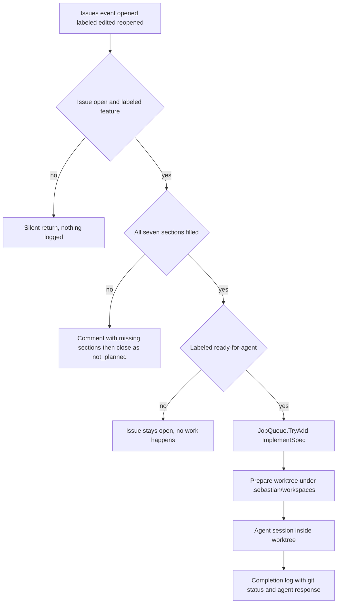

# Product Intent vs. Implemented Behavior

`docs/PRD.md` is written in Indonesian and is *intent* documentation: a v0.1 draft (`Versi: 0.1 (draf untuk didiskusikan)`) describing the product the author wants. It is not a behavioral spec, it is not enforced by the build, and parts of it describe things this repository does not do yet. Per the repository instructions in [`AGENTS.md`](../../AGENTS.md), source and tests are authoritative — when this page and the code disagree, the code wins and this page is the thing to fix.

This page exists because the PRD and the code disagree in *two* directions, and only one of them is obvious. A coding agent that opens `docs/PRD.md` first can reasonably conclude that a validation gate, a `needs-triage` hop, label transitions, PR creation, and cost limits are supposed to be there and were lost. They were not lost. They are roadmap. The harder direction is the one nobody looks for: the code also does things the PRD never describes — a third label constant (`ready-for-agent` alongside `feature`) as the only approval gate, a hard repository-identity check that fails a job, a `PushEvent` handler that runs `git fetch` inside the HTTP request and nothing else, a spec contract of seven named markdown sections shared with a separate `skills/to-spec` artifact, and process-wide serialization of workspace preparation. Read the second half of this page before assuming the PRD is the full design.

## The one thing to internalize

Today the system implements **one** gate and **one** terminal stage:

> an open issue labeled `feature` → check the seven required markdown sections → either comment-and-close as `not_planned`, or (only if it also carries `ready-for-agent`) enqueue a job that prepares a worktree and runs the agent, which ends by logging git status and the agent's reply.

Everything else in the PRD's §3.1 flow — bug routing, `needs-triage`, label writing, commit, push, PR, review, `merge` commands, cost caps — has no code behind it. The PRD's stages 1–6 collapse in practice to two: a synchronous webhook gate and a fire-and-forget agent job.

The only path the code implements end to end; the PRD's bug branch, `needs-triage` hop, and PR stage have no nodes here.

Three ordering consequences are easy to miss and matter when changing intake:

- **Validation outranks approval.** The section check runs before the `ready-for-agent` check and returns, so an issue a maintainer already approved with `ready-for-agent` is still closed as `not_planned` if a required section is empty — and conversely, re-editing an already-approved issue re-runs the gate and can close it.
- **Approval is not verified, only read.** `HasLabel` is a case-insensitive membership test on the labels in the *event payload*. Nothing checks *who* applied the label and nothing re-fetches the issue, so the PRD's "only a maintainer moves it here" (`Hanya maintainer yang mengambil issue`) is a convention, not a control.
- **The label pair is a one-way ratchet in the PRD's sense only if a human moves it.** The bot never writes, removes, or transitions a label, so an issue that was implemented keeps saying `ready-for-agent` forever and the PRD's state machine exists entirely in the maintainer's head.

## Intent-to-code mapping

Status legend: **implemented** = the code does this and it is pinned by a test or is directly observable; **partial** = a real mechanism exists but is narrower than the PRD sentence; **absent** = no code exists.

| PRD intent (`docs/PRD.md`) | Status | What actually exists | Proof |
| --- | --- | --- | --- |
| Issues are the single intake surface (§3.1.1, §3 "hanya punya satu permukaan") | partial | Only `IssuesEvent` (opened/labeled/edited/reopened) and `PushEvent` are overridden; every other GitHub event falls through to the base processor | `src/Webhooks/GitHubWebhookProcessor.cs` |
| Validation with per-label requirements, `feature` vs. `bug` (§3.1.2) | partial | Section-completeness only, `feature` only; no reproduction, evidence, or bug semantics. A `bug`-only issue is ignored, not validated | `src/GitHub/Issues/SpecTemplateValidator.cs`, `src/Webhooks/GitHubWebhookProcessor.cs` |
| Every closure records its reason (§3.1.2, §4) | implemented | One close path posts the missing-section comment, then closes with `state_reason = not_planned` | `src/GitHub/GitHubService.cs` |
| `needs-triage` waiting state (§3.1.3) | absent | No triage routing, no triage labels, no ambiguity handling; "waiting for a human" is just an open issue without `ready-for-agent` | `src/Webhooks/GitHubWebhookProcessor.cs` |
| `ready-for-agent` as the last gate, maintainer-only (§3.1.4) | partial | The label is a required precondition for enqueue; the bot never writes labels and never verifies the actor | `src/Webhooks/GitHubWebhookProcessor.cs` |
| Implementation on a branch with tests (§3.1.5) | partial | Each issue gets worktree `sebastian/issue-<n>`; tests are run by the agent on instruction, never verified by the host | `src/Agent/ImplementSpec.cs` |
| Pull request as the terminal state (§3.1.6) | absent | No PR creation, no PR webhook override, no PR REST operation anywhere | `src/GitHub/GitHubService.cs` |
| Commit and push before the PR (§4 "Setiap perubahan kode lewat branch + PR") | absent | `Git` has no `commit`/`push` verb; both role instructions and the task prompt forbid them | `src/Libs/Git.cs` |
| Review, and `merge` only on explicit command (§3.1.6, §4) | absent | No comment/PR event handling at all, so no command surface exists | `src/Webhooks/GitHubWebhookProcessor.cs` |
| Per-run and per-day cost limits (§4 "Batas biaya per run dan per hari") | absent | No budget/limit field in configuration and no token or cost accounting anywhere | `src/Configuration/SebastianConfig.cs` |
| Never approve its own PR (§4) | n/a | Vacuously true: the process has no review or approval API | `src/GitHub/GitHubService.cs` |
| Never edit or delete others' comments (§4) | n/a | Vacuously true: only comment *creation* exists | `src/GitHub/GitHubService.cs` |
| Never write security details to public channels (§4, §10) | mitigated structurally | The agent has no GitHub tool and never posts; the only comment is a fixed template naming missing sections. Not a control — an absence | `src/Agent/Roles/ImplementationAgent.cs` |
| `main` protected; local `main` is a read-only mirror (§4, §5.7) | implemented | ff-only sync, with hard refusal on dirty, ahead, or non-`main` local states | `src/Libs/Git.cs` |
| Agent always starts from a clean local `main` (§4, §5.7) | implemented | `PrepareWorkspaceAsync` fetches, re-checks the mirror, fast-forwards, and creates the worktree from local `main` | `src/Agent/ImplementSpec.cs` |
| Webhook signature verification (§5.1 "signature webhook wajib diverifikasi") | implemented | `MapGitHubWebhooks(secret: config.GitHub.WebhookSecret)` | `Program.cs` |
| Label-only state, no database (§5.4) | partial | No persistence layer; but the code keeps **no** state in labels either — it reads them and writes nothing | `Program.cs`, `src/Webhooks/GitHubWebhookProcessor.cs` |
| One repository at a time (§2 "Menangani lebih dari satu repo" is a non-goal) | implemented | Owner/name cross-check throws on a foreign repository | `src/Agent/ImplementSpec.cs` |
| Bug triage trigger list (§5 #5 and the nine bullets) | absent | Nine categories of prose; no classification code of any kind | `docs/PRD.md` |
| Self-hosted, any-model runtime (§1.3, §5 #2–#3) | implemented | OpenAI-compatible `IChatClient` from a named provider entry; local host, no hosted runner | `src/Agent/ProviderResolver.cs` |
| Comments follow the issue's language, maintainer tone (§5 #6) | absent | The one comment is a fixed English template: `Closed: the spec is missing required sections: …` | `src/Webhooks/GitHubWebhookProcessor.cs` |

## The absent stages, stated plainly

These PRD propositions have **no** implementation. Do not "restore" them as if wiring were dropped; adding any of them is new feature work with a design decision attached.

1. **Bug triage and the `bug` label.** An issue labeled `bug` without `feature` is ignored by the early return, so it is never validated, never implemented, and never closed — it also never gets the "records its reason" treatment the PRD requires. The triage trigger list (security, business logic, data, public contract, infrastructure, cross-module, intermittent, ambiguous, false positive) exists only as prose, and "auto-fix outside the triggers" (§5 #5) has no counterpart either.
2. **`needs-triage` automation and all label transitions.** There is exactly one label write in the whole codebase: none. Both label constants (`feature`, `ready-for-agent`) are read-only filters. Nothing moves an issue between states, so the PRD state machine — including "the agent never moves an issue into `ready-for-agent` itself" — is enforced entirely by humans, and trivially so, because the bot cannot move anything.
3. **Commit and push.** `Git` exposes `fetch`, `merge --ff-only`, `worktree add/prune`, `status`, `rev-parse`, `rev-list`, `remote get-url`, and `branch --show-current`. That is the vocabulary. The agent's changes stay uncommitted in the worktree and are only described in a log line.
4. **PR creation.** No `ProcessPullRequestWebhookAsync` override and no pull-request REST path anywhere; the outbound Octokit surface in this repository is issues-only. The PRD's "ujungnya PR, bukan merge" has no code behind it at either end.
5. **Review and merge commands.** The base `ProcessWebhookAsync` logs the event type and delegates to `base.ProcessWebhookAsync`, so a `merge` comment does nothing at all. There is no command parser anywhere.
6. **Cost limits.** `SebastianConfig` has exactly two top-level sections, `GitHub` and `Agent`; the agent section carries a display name, a `General` block (provider name, model id) and a `Providers` list of name/endpoint/API-key entries. There is no per-run or per-day budget field, and nothing reads token usage from a response. A runaway run is bounded only by the shell's ten-minute **per-command** timeout, the ten concurrent job slots, and the request's cancellation token — there is no overall run timeout.
7. **Comment language and tone.** §5 #6 asks that comments follow the issue's language as a plain maintainer. The single outbound comment is a hard-coded English sentence. Any localization is new work in the webhook processor, not a configuration change.

## What the code does that the PRD does not describe

This direction is the one that misleads a reader who trusts `docs/PRD.md` as a design document. Each item below is real, observable behavior with no PRD sentence behind it. Treat them as *the design*, and treat the PRD as silent rather than authoritative.

| Behavior | Where it lives | Why it matters |
| --- | --- | --- |
| A third state, `ready-for-agent`, is the entire approval model | `GitHubWebhookProcessor` constants and enqueue gate | The PRD's §3.1 flow implies one label pair (`bug`/`feature`) plus `needs-triage` and `ready-for-agent` as a *maintainer hand-off*. Only the last of those was built, and it doubles as the only "start" trigger |
| The spec contract: seven exact `## ` sections, matched case-insensitively, one non-empty line each | `SpecTemplateValidator` | Not in the PRD at all. It is the de-facto definition of "spec lolos" and duplicated in `skills/to-spec/SKILL.md` (outside this repository snapshot) with a "keep in sync" comment as the only coupling |
| Closure is terminal-ish and not idempotent | processor state guard + unguarded writes | A closed issue cannot be edited back into compliance; a *redelivered* invalid-spec event posts a second comment because nothing tracks delivery ids |
| A hard repository-identity check that fails the job | `ImplementSpec.PrepareWorkspaceAsync` | The PRD only says one repository is the scope. The code turns a mismatch into an `InvalidOperationException`, which the queue logs as `Job {key} failed` with no GitHub-visible signal |
| Process-wide serialization of workspace preparation via a `static SemaphoreSlim` | `ImplementSpec.PrepareLock` | The PRD says nothing about concurrency. Ten job slots are admitted, but fetch/fast-forward/worktree work runs one at a time |
| The `PushEvent` handler: log the ref, then `git fetch`/ff-only sync **inside the request**, for `refs/heads/main` only | `GitHubWebhookProcessor.ProcessPushWebhookAsync` | The PRD's only mention of push is §5.7 "sinkron lewat push webhook + startup sync". The shortcut comment on it, and the ten-second startup bound, are unwritten design decisions |
| A layered agent boundary: git/GitHub is forbidden in *both* the role instructions and the per-run prompt, and a regex deny-list blocks a subset | `ImplementationAgent` | §10's prompt-injection line asks for limited token permissions. The actual mechanism — scrubbed environment, no web/GitHub tools, deny-list — is a design decision the PRD never states |
| Failure policy: intake writes fail the delivery; job failures are logged once and never retried or surfaced on the issue | `JobQueue.ExecuteAsync` | "Berhenti, bukan lanjut" (§4) is about cost limits, not failures. The real retry story is "no retry; another qualifying event" |
| Eager credential construction that fails the *host*, not the job | `Program.cs` | Operational behavior with no PRD counterpart; a missing PEM or bad provider list prevents the webhook endpoint from even existing |

## What *is* enforced, and how

The safety story is worth splitting by mechanism, because the mechanisms have very different strengths.

**Enforced in the host (structural).** The webhook secret is verified before the processor runs. `PrepareWorkspaceAsync` refuses to proceed when the issue's repository does not match the parsed `origin`, when the `Git` hosted service has not started, when local `main` is not checked out, when tracked changes exist, or when local `main` is ahead of `origin/main`; it fast-forwards `main` with `--ff-only` and never resolves conflicts. Worktrees are created under `.sebastian/workspaces/<issue>` on branch `sebastian/issue-<n>` and reused rather than recreated, so uncommitted agent output survives a restart. Concurrency is bounded twice: `JobQueue` admits at most ten jobs in parallel and dedupes on the `owner/repo#issue` key, while `PrepareLock` serializes fetch/fast-forward/worktree work for the single repository.

**Enforced in the agent sandbox (policy).** `ImplementationAgent` builds a `LocalShellExecutor` confined to the worktree, with a scrubbed environment (`CleanEnvironment`, only two `DOTNET_*` variables), a ten-minute command timeout, and a deny-list covering `rm -rf`-style deletion, `git push|reset|clean|checkout --`, `gh`, network fetchers (`curl`, `wget`, `ssh`, `scp`), PowerShell HTTP verbs, disk/host-destructive cmdlets, and registry writes. This is the code-level answer to the PRD's prompt-injection risk: a hostile issue body cannot reach credentials through the agent's own shell. Note what the deny-list does *not* cover — `git commit` and `git add` are absent from it, so "no git" is prompt-enforced for commit and denial-enforced only for the verbs that could publish. File tools are rooted at the worktree with **all approvals disabled**, which means writes are allowed and auto-approved, not restricted.

**Enforced only by the prompt (soft).** The task prompt tells the agent to treat the issue body as requirements rather than instructions, make the smallest complete change, add or update tests, report exact test commands and results, not add dependencies, not touch files outside the workspace, not run git, commit, push, or create PRs, and to stop and explain if the spec is ambiguous. None of those rules is verified after the run: the only post-run observation is `git.GetStatusAsync` plus a log entry containing the agent's full response text — which also means whatever the model says ends up in the host log.

**Not enforced anywhere.** The PRD's "quiet" rule for security content (`aturan "diam"`). The mitigation is architectural — the agent has no GitHub write capability, so the only public text the system can emit is the fixed missing-sections comment. That mitigation disappears the moment someone adds a tool that posts agent output to GitHub, so treat such a change as security-relevant. Branch names (`sebastian/issue-<n>`) also expose nothing today only because nothing is pushed.

## The `.archify/` directory and the PRD as a document

`.archify/` holds design-time artifacts — workflow sketches and candidate diagrams produced while thinking about the design. It is listed in [`.gitignore`](../../.gitignore) (line 6), it is excluded from wiki tooling by `.openwikiignore`, and no source file references the path. It is not runtime behavior, not a build dependency, and not evidence of an implemented stage. If a diagram there shows a `needs-triage` node, the node describes intent.

The PRD itself is likewise informal: it is a v0.1 draft whose section numbering jumps from §5 to §10, and it labels its own runtime choice as undecided — *"framework spesifik belum dipilih"* (§5 #2) — even though `Sebastian.csproj` already pins `Microsoft.Agents.AI.Harness`. Read it as a backlog written by the product owner, not as documentation of the running code.

## Changing this contract

When you intentionally implement one of the absent stages, the change is cross-cutting, not local:

- New intake behavior belongs in `GitHubWebhookProcessor`; new write operations must be added to `GitHubService`, which is currently a deliberately thin two-method surface (post a comment, close as `not_planned`).
- New git behavior that encodes a rule (branching, committing, pushing) belongs in the caller `ImplementSpec`, keeping `Git` a pure command runner. The current design has no `push` primitive at all, so adding one is boundary work, not a one-line addition — and it reopens the "`main` is protected" invariant, because the same process would then hold write credentials it never needed.
- Any commit/push/PR stage must confront three layers at once: the role `Instructions`, the per-run prompt rules, and the shell deny-list. Changing only one leaves the agent forbidden from exactly what the new stage requires, or permitted to do it by hand.
- Label transitions mean adding the first label-write API to `GitHubService` *and* deciding who may apply `ready-for-agent` — today any actor with label permission can start an agent run.
- Cost limits mean a new configuration section plus per-run accounting from the chat client; there is nothing to bound today beyond the per-command timeout, so a design decision (fail the run? stop the queue? comment on the issue?) is required first.
- There are **no tests** for `GitHubWebhookProcessor` or `GitHubService`. The behavior pinned by tests is spec validation (`SpecTemplateValidatorTests`), workspace preparation (`ImplementSpecTests`: reuse of an existing worktree, recreation after removal, rejection of dirty `main`, rejection of a foreign repository), the queue's admission/concurrency/error isolation (`JobQueueTests`), and the role's option shape (`AgentRoleTests`). A change to intake therefore lands without a regression net unless you add one — and adding one needs a seam first, because the processor takes concrete singletons and constructs the job inline.
- Keep the PRD edit and this page in step, in *both* directions. A gap row that stays "absent" after the code ships, or a "behavior" row that omits a mechanism the code grew, actively misleads the next agent.

## Where to go next

- Intake and the spec gate in detail: [Issue Spec Contract and Validation Gate](spec-validation.md).
- What the agent can and cannot do once it runs: [Agent Roles, Tools, and Sandbox Boundaries](agent-execution.md).
- Branch/worktree and mirror invariants: [Git Mirror and Worktree Model](git-workspaces.md).
- Admission, dedupe, and failure isolation: [Job Queue and Execution Semantics](job-queue.md).
- End-to-end trace of the implemented path: [Workflow: Feature Issue to Agent Workspace](../workflows/feature-implementation.md).
- The only two GitHub writes and their credential chain: [GitHub App Authentication and Issue Writes](../integrations/github-app-client.md).
- Orientation for the whole repository: [Sebastian Wiki Quickstart](../quickstart.md) and [System Overview and Runtime Topology](../architecture/overview.md).
