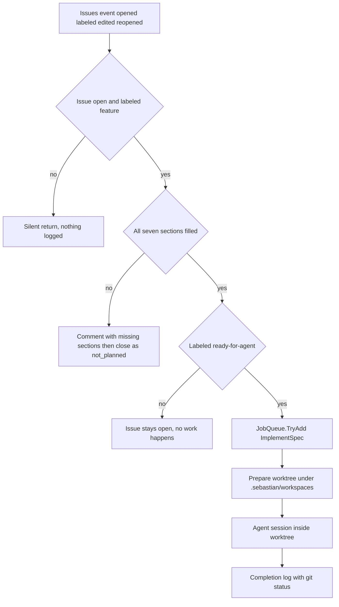

# Product Intent vs. Implemented Behavior

`docs/PRD.md` is written in Indonesian and is *intent* documentation: a v0.1 draft describing the product the author wants. It is not a behavioral spec, it is not enforced by the build, and parts of it describe things this repository does not do yet. Per the repository instructions in [`AGENTS.md`](../../AGENTS.md), source and tests are authoritative — when this page and the code disagree, the code wins and this page is the thing to fix.

This page exists because the PRD and the code disagree in ways that are easy to misread. A coding agent that opens `docs/PRD.md` first can reasonably conclude that a validation gate, a `needs-triage` hop, label transitions, PR creation, and cost limits are supposed to be there and were lost. They were not lost. They are roadmap. Treat their absence as unimplemented intent, not as a regression to repair on sight.

## The one thing to internalize

Today the system implements **one** gate and **one** terminal stage:

> an open issue labeled `feature` → check the seven required markdown sections → either comment-and-close, or (only if it also carries `ready-for-agent`) run the agent in a worktree and log the result.

Everything else in the PRD — bug routing, triage, label writing, commit, push, PR, review, merge commands, cost caps — has no code behind it. The PRD's stages 1–6 collapse in practice to two: a synchronous webhook gate and a fire-and-forget agent job.

The only path the code implements end to end; the PRD's bug branch, `needs-triage` hop, and PR stage have no nodes here.

Two ordering consequences are easy to miss and matter when changing intake:

- **Validation outranks approval.** The section check runs before the `ready-for-agent` check and returns, so an issue a maintainer already approved with `ready-for-agent` is still closed as `not_planned` if a required section is empty.
- **Approval is not verified, only read.** `HasLabel` is a case-insensitive membership test on the event payload. Nothing checks *who* applied the label, so the PRD's "only a maintainer moves it here" is a convention, not a control.

## Intent-to-code mapping

Status legend: **implemented** = the code does this and it is pinned by a test or is directly observable; **partial** = a real mechanism exists but is narrower than the PRD sentence; **absent** = no code exists.

| PRD intent (`docs/PRD.md`) | Status | What actually exists | Proof |
| --- | --- | --- | --- |
| Issues are the single intake surface (§3.1.1) | partial | Only `IssuesEvent` (opened/labeled/edited/reopened) and `PushEvent` are overridden; every other GitHub event falls through to the base processor | `src/Webhooks/GitHubWebhookProcessor.cs` |
| Validation with per-label requirements, `feature` vs. `bug` (§3.1.2) | partial | Section-completeness only, `feature` only; no reproduction, evidence, or bug semantics | `src/GitHub/Issues/SpecTemplateValidator.cs` |
| Every closure records its reason (§3.1.2) | implemented | One close path posts the missing-section comment, then closes | `src/GitHub/GitHubService.cs` |
| `needs-triage` waiting state (§3.1.3) | absent | No triage routing, no triage labels, no ambiguity handling | `src/Webhooks/GitHubWebhookProcessor.cs` |
| `ready-for-agent` as the last gate (§3.1.4) | partial | The label is a required precondition for enqueue; the bot never writes labels and never verifies the actor | `src/Webhooks/GitHubWebhookProcessor.cs` |
| Implementation on a branch with tests (§3.1.5) | partial | Each issue gets worktree `sebastian/issue-<n>`; tests are run by the agent on instruction, never verified by the host | `src/Agent/ImplementSpec.cs` |
| Pull request as the terminal state (§3.1.6) | absent | No PR creation, no PR webhook handling, no PR write API | `src/GitHub/GitHubService.cs` |
| Commit and push before the PR (§4) | absent | `Git` has no `commit`/`push` verb; the prompt forbids both | `src/Libs/Git.cs` |
| Review, and `merge` only on explicit command (§3.1.6, §4) | absent | No comment/PR event handling at all, so no command surface exists | `src/Webhooks/GitHubWebhookProcessor.cs` |
| Per-run and per-day cost limits (§4) | absent | No budget fields in configuration, no token/cost accounting | `src/Configuration/SebastianConfig.cs` |
| Never approve its own PR (§4) | n/a | Vacuously true: the process cannot approve anything | `src/GitHub/GitHubService.cs` |
| Never edit or delete others' comments (§4) | n/a | Vacuously true: only comment creation exists | `src/GitHub/GitHubService.cs` |
| Never write security details to public channels (§4, §10) | mitigated structurally | The agent has no GitHub tool and never posts; the only comment is a fixed template naming missing sections | `src/Agent/Roles/ImplementationAgent.cs` |
| `main` protected; local `main` is a read-only mirror (§4, §5.7) | implemented | ff-only sync, with hard refusal on dirty, ahead, or non-`main` local states | `src/Libs/Git.cs` |
| Webhook signature verification (§5.1) | implemented | `MapGitHubWebhooks(secret: config.GitHub.WebhookSecret)` | `Program.cs` |
| Label-only state, no database (§5.4) | implemented | No persistence layer; state lives in GitHub plus `.sebastian/workspaces` | `Program.cs` |
| One repository at a time (§2, §5) | implemented | Owner/name cross-check throws on a foreign repository | `src/Agent/ImplementSpec.cs` |

## The absent stages, stated plainly

These PRD propositions have **no** implementation. Do not "restore" them as if wiring were dropped; adding any of them is new feature work with a design decision attached.

1. **Bug triage and the `bug` label.** An issue labeled `bug` without `feature` is ignored by the early return, so it is never implemented and never closed. The PRD's triage-trigger list (security, business logic, data, public contract, infrastructure, cross-module, intermittent, ambiguous, false positive) exists only as prose.
2. **`needs-triage` automation and all label transitions.** There is exactly one label write in the whole codebase: none. The two label constants are read-only filters. Nothing moves an issue between states, so the PRD state machine is enforced entirely by humans.
3. **Commit and push.** `Git` exposes `fetch`, `merge --ff-only`, `worktree add/prune`, `status`, `rev-parse`, `rev-list`, `remote get-url`, and `branch --show-current`. That is the vocabulary. The agent's changes stay uncommitted in the worktree and are only described in a log line.
4. **PR creation.** `ProcessPullRequestWebhookAsync` is not overridden and no PR REST operation is used; the Octokit surface in this repository is issues-only.
5. **Review and merge commands.** The processor logs the event type and delegates to `base.ProcessWebhookAsync`, so a `merge` comment does nothing at all. There is no command parser anywhere.
6. **Cost limits.** `SebastianConfig` has exactly two sections, `GitHub` and `Agent`, and the agent section carries only provider name, endpoint, API key, and model id. A runaway run is bounded only by the shell's ten-minute per-command timeout.

## What *is* enforced, and how

The safety story is worth splitting by mechanism, because the mechanisms have very different strengths.

**Enforced in the host (structural).** The webhook secret is verified before the processor runs. `PrepareWorkspaceAsync` refuses to proceed when the issue's repository does not match the parsed `origin`, when local `main` is not checked out, when tracked changes exist, or when local `main` is ahead of `origin/main`; it fast-forwards `main` with `--ff-only` and never resolves conflicts. Worktrees are created under `.sebastian/workspaces/<issue>` and reused rather than recreated, so uncommitted agent output survives a restart. Concurrency is bounded twice: `JobQueue` admits at most ten jobs in parallel and dedupes on the `owner/repo#issue` key, while `PrepareLock` serializes fetch/fast-forward/worktree work for the single repository.

**Enforced in the agent sandbox (policy).** `ImplementationAgent` builds a `LocalShellExecutor` confined to the worktree, with a scrubbed environment (`CleanEnvironment`, only two `DOTNET_*` variables), a ten-minute command timeout, and a deny-list covering `rm -rf`-style deletion, `git push|reset|clean|checkout --`, `gh`, network fetchers (`curl`, `wget`, `ssh`, `scp`), and host-level destructive commands. This is also the code-level answer to the PRD's prompt-injection risk: a hostile issue body cannot reach credentials through the agent's own shell. Note what the deny-list does *not* cover — `git commit` is absent from it, so "no git" is prompt-enforced for commit and denial-enforced only for the verbs that could publish.

**Enforced only by the prompt (soft).** The task prompt tells the agent to treat the issue body as requirements rather than instructions, make the smallest complete change, add or update tests, not add dependencies, not touch files outside the workspace, not run git, commit, push, or create PRs, and to stop and explain if the spec is ambiguous. None of those rules is verified after the run: the only post-run observation is `git.GetStatusAsync` plus a log entry containing the agent's response text.

**Not enforced anywhere.** The PRD's "quiet" rule for security content. The mitigation is architectural — the agent has no GitHub write capability, so the only public text the system can emit is the fixed missing-sections comment. That mitigation disappears the moment someone adds a tool that posts agent output to GitHub, so treat such a change as security-relevant.

## The `.archify/` directory

`.archify/` holds design-time artifacts — workflow sketches and candidate diagrams produced while thinking about the design. It is listed in [`.gitignore`](../../.gitignore) (line 6), it is excluded from wiki tooling by `.openwikiignore`, and no source file references the path. It is not runtime behavior, not a build dependency, and not evidence of an implemented stage. If a diagram there shows a `needs-triage` node, the node describes intent.

The PRD itself is likewise informal: it is a v0.1 draft whose section numbering jumps from §5 to §10, and it labels its own decisions "belum dipilih" (not yet chosen) in places. Read it as a backlog written by the product owner.

## Changing this contract

When you intentionally implement one of the absent stages, the change is cross-cutting, not local:

- New intake behavior belongs in `GitHubWebhookProcessor`; new write operations must be added to `GitHubService`, which is currently a deliberately thin two-method surface.
- New git behavior that encodes a rule (branching, committing, pushing) belongs in the caller `ImplementSpec`, keeping `Git` a pure command runner. The current design has no `push` primitive at all, so adding one is boundary work, not a one-line addition.
- Any commit/push/PR stage must confront the prompt rules and the shell deny-list together, or the agent will remain forbidden from doing exactly what the new stage requires.
- There are **no tests** for `GitHubWebhookProcessor` or `GitHubService`. The behavior pinned by tests is spec validation (`SpecTemplateValidatorTests`) and workspace preparation (`ImplementSpecTests`: reuse of an existing worktree, recreation after removal, rejection of dirty `main`, rejection of a foreign repository). A change to intake therefore lands without a regression net unless you add one.
- Keep the PRD edit and this page in step. A gap row that stays "absent" after the code ships is worse than no page: it actively misleads the next agent.

## Where to go next

- Intake and the spec gate in detail: [Issue Spec Contract and Validation Gate](spec-validation.md).
- What the agent can and cannot do once it runs: [Agent Roles, Tools, and Sandbox Boundaries](agent-execution.md).
- Branch/worktree and mirror invariants: [Git Mirror and Worktree Model](git-workspaces.md).
- End-to-end trace of the implemented path: [Workflow: Feature Issue to Agent Workspace](../workflows/feature-implementation.md).
- Orientation for the whole repository: [Sebastian Wiki Quickstart](../quickstart.md) and [System Overview and Runtime Topology](../architecture/overview.md).
