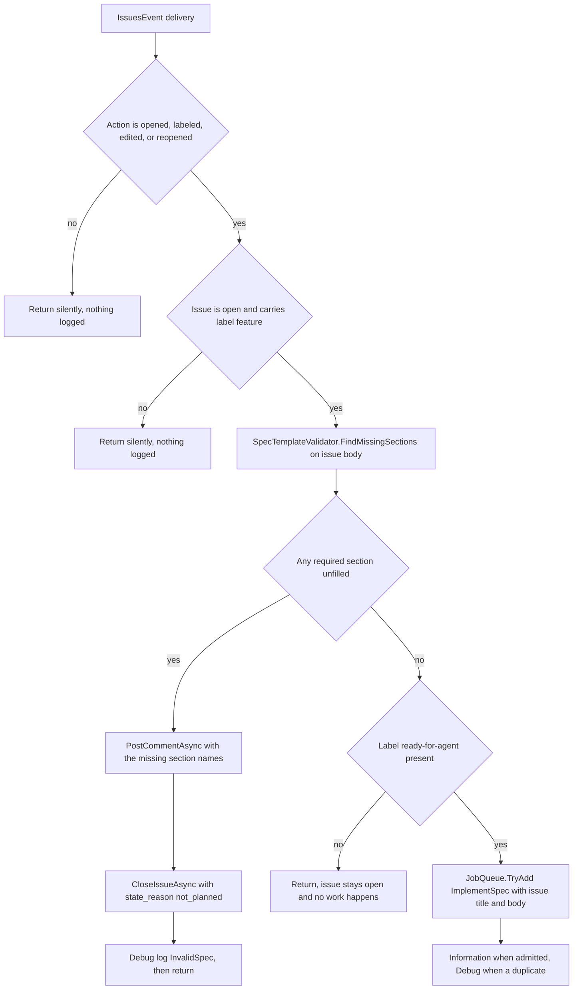

# Issue Spec Contract and Validation Gate

Sebastian has exactly one input contract: a `feature` issue body must fill seven named markdown sections, and an issue that does not is **closed as `not_planned` with a comment naming the missing sections**. There is no retry, no triage hop, and no request for more information.

The gate is small and split across two files with different jobs:

- [`src/GitHub/Issues/SpecTemplateValidator.cs`](../../src/GitHub/Issues/SpecTemplateValidator.cs) is a **pure function over a markdown string**. It knows the section list and the "is this line content" rules, and nothing about GitHub.
- `GitHubWebhookProcessor.ProcessIssuesWebhookAsync` is the **policy**: which deliveries reach the validator, what happens when sections are missing, and what happens when they are not.

Read the split as "where a change goes". Changing the list of required sections is a one-array edit in the validator; changing *when* an issue is checked, or what an invalid issue costs, is webhook-processor work. For where these fit in the wider process, see [System Overview and Runtime Topology](../architecture/overview.md); for the surrounding event routing, see [Webhook Intake and Event Routing](../integrations/github-webhooks.md).

## Scope: open `feature` issues only

The gate runs from a single override, `ProcessIssuesWebhookAsync`, and it is guarded twice before any validation happens.

| Guard | Accepted values | Otherwise |
| --- | --- | --- |
| `IssuesAction` | `Opened`, `Labeled`, `Edited`, `Reopened` | Silent `return` — no log, no comment, no state change |
| Payload issue state + labels | `IssueState.Open` **and** a label named `feature` (`OrdinalIgnoreCase`) | Silent `return` — no log |

Both constants are read-only filters: `FeatureLabel = "feature"` and `ReadyForAgentLabel = "ready-for-agent"`. Nothing in this codebase writes a label, so the whole state machine — including who is allowed to apply `ready-for-agent` — is enforced by humans. That gap is documented at length in [Product Intent vs. Implemented Behavior](product-intent-and-gaps.md).

Three consequences follow from the guards, and they are the ones that surprise people:

- **This gate is `feature`-only.** The PRD (§3.1.2) describes validation "with per-label requirements" covering reproduction, template completeness, and evidence, with `bug` routed to implementation or closure and anything ambiguous to `needs-triage`. None of that exists. An issue labeled `bug` without `feature` hits the label guard and returns, so it is never validated, never implemented, and never closed. Do not treat that as a regression to repair on sight; adding it is new feature work.
- **A closed issue can never be re-validated.** After the close path below runs, later `edited` deliveries carry `state = closed` and return at the state guard. Recovery therefore requires a `reopened` (or a re-label) event, not an edit.
- **Validation runs again on every matching delivery.** Labeling, editing, and reopening all re-enter the gate, so a spec that loses a section after approval is closed on the next event, even though it was implementable a minute earlier.

## The contract: seven sections

`RequiredSections` is a static array, and its **declaration order is observable** — it is the order of the missing list, which is the order of the names in the closure comment.

| # | Section heading (as required) | Filled by the `to-spec` template? |
| --- | --- | --- |
| 1 | `Problem Statement` | yes |
| 2 | `Solution` | yes |
| 3 | `User Stories` | yes |
| 4 | `Tech Stack` | yes |
| 5 | `Implementation Decisions` | yes |
| 6 | `Testing Decisions` | yes |
| 7 | `Out of Scope` | yes |

The template also ends with `Further Notes`, which is deliberately **not** required and is proved optional by a test. Extra sections are ignored entirely: they are tracked like any other heading but never queried, so a spec may add whatever headings it likes.

## The validation algorithm, as implemented

```csharp
public static IReadOnlyList<string> FindMissingSections(string? body)
{
    var filledSections = new HashSet<string>(StringComparer.OrdinalIgnoreCase);
    string? currentSection = null;

    foreach (var rawLine in (body ?? string.Empty).Split('\n'))
    {
        var line = rawLine.Trim();

        if (line.StartsWith("## ", StringComparison.Ordinal))
        {
            currentSection = line[3..].Trim();
            continue;
        }

        if (currentSection is null || IsEmptyContent(line))
        {
            continue;
        }

        filledSections.Add(currentSection);
    }

    return RequiredSections.Where(section => !filledSections.Contains(section)).ToArray();
}

private static bool IsEmptyContent(string line) =>
    line.Length == 0 ||
    line.StartsWith("<!--", StringComparison.Ordinal) ||
    string.Equals(line, "_No response_", StringComparison.OrdinalIgnoreCase);
```

Step by step, the semantics a reader must internalize:

1. **Split on `\n` and `Trim` every line.** The trim is what makes CRLF bodies work (the trailing `\r` disappears), and it also means leading indentation does not hide a heading.
2. **A heading is a line whose trimmed form starts with `"## "` — exactly two hashes and a space.** The section name is the remainder, trimmed. This is ordinal: `## ` matches, `### ` does not, `# ` does not.
3. **`filled` is a set of section *names*, not positions.** Membership is `OrdinalIgnoreCase`, so `## tech stack` satisfies `Tech Stack`, and a required section appearing twice counts as filled if *either* occurrence has content.
4. **A section is filled by any single non-empty line under it.** There is no minimum length, no structure check, and no inspection of what the line says. One character of text is enough.
5. **Content before the first `## ` heading is discarded** (`currentSection is null`), so a preamble or a template header line cannot fill anything.
6. **The result is `RequiredSections` minus `filled`, in declaration order.** A null body splits into one empty line, so all seven are reported missing.

### What counts as empty content

`IsEmptyContent` is applied to the already-trimmed line, which collapses several cases into one:

| Line (after trim) | Treated as |
| --- | --- |
| empty string, or whitespace only | empty |
| starts with `<!--`, e.g. `<!-- none -->` | empty |
| equals `_No response_` (any casing) | empty |
| anything else, including a single word | **content — the section is filled** |

These are the exact rules the tests pin, and each corresponds to a real template artifact: GitHub issue forms emit `_No response_` for skipped optional fields, and template authors leave `<!-- ... -->` guidance comments that must not be mistaken for answers.

### Sharp edges worth knowing before you touch this

The parser is a line scanner, not a markdown parser, and that has four consequences that decide whether a change is safe:

- **Only the line that *opens* an HTML comment is ignored.** Every continuation line of a multi-line comment counts as content, so a section holding nothing but a multi-line `<!-- ... -->` block passes validation. Fixing that requires tracking comment state, not adding another prefix test.
- **Fenced code blocks are not tracked.** A line beginning with `## ` inside a ``` fence is taken as a real section heading. That ends the enclosing section early (possibly reporting a required section as missing) and can attribute code-block text to a bogus section. Spec bodies that quote markdown are the realistic trigger.
- **`#` and `###` headings do not open a section.** A spec that writes `# Problem Statement` fills nothing, and its body is credited to whatever section preceded it — the test `SubheadingsAndExtraSections_AreIgnored` shows the intended behavior for `### Details` (content stays with the enclosing `##` section), but that is also why a single-hash spec fails wholesale.
- **`_No response_` is an exact match.** `_No response_.` or `_No Response_ ` with a trailing period is content. The comparison is case-insensitive but not fuzzy.

## The invalid outcome: comment, then close, then stop

When `FindMissingSections` returns anything, the processor performs a fixed two-call terminal sequence and returns:

```csharp
var sections = string.Join(", ", missingSections);
var comment = $"Closed: the spec is missing required sections: {sections}.";

await gitHubService.PostCommentAsync(owner, name, issueNumber, comment, cancellationToken);
await gitHubService.CloseIssueAsync(owner, name, issueNumber, cancellationToken);

LogInvalidSpec(repositoryName, issueNumber, sections);
return;
```



The full decision flow: two silent guards, the section gate, then the approval gate that only a valid spec ever reaches.

The side effects are user-visible behavior, so treat each as part of the contract:

| Effect | Detail |
| --- | --- |
| Comment body | Exactly `Closed: the spec is missing required sections: <a, b, c>.` — names joined with `", "` in `RequiredSections` order, **not** document order, ending in a period |
| Comment authorship | The GitHub App itself, via the installation token in [GitHub App Authentication and Issue Writes](../integrations/github-app-client.md) |
| Close state | `state = closed` with `state_reason = not_planned` — not `completed` |
| Ordered, not atomic | The comment is posted *first*, so the reason is on the issue and remains visible after closure. There is no `try`/`catch` around either call, so a GitHub API failure on the comment propagates out of the webhook handler and leaves the issue untouched; a failure on the close propagates too and leaves the comment posted on a still-open issue |
| No further work | The `return` follows the close, so an invalid spec is never enqueued — even when `ready-for-agent` is present |
| Logging | A single `Debug` line, `Issue {Repository}#{Number} closed; missing spec sections: {Sections}`. Nothing at `Information` |

**Validation outranks approval.** The section check and its `return` come *before* the `ready-for-agent` check in the same method. An issue a maintainer already approved with `ready-for-agent` is still closed as `not_planned` if a required section is empty. That ordering is the single easiest thing to break in this file, and it has no test protecting it.

## The valid outcome

A complete spec falls through to the approval gate. Without `ready-for-agent` the method simply returns: the issue stays open and nothing happens, which is the intended "waiting for a human" state. With the label present, the processor constructs an `ImplementSpec(owner, name, issueNumber, title, body)` job — the issue title and body are read from the **webhook payload**, not re-fetched — and offers it to the queue:

```csharp
if (jobQueue.TryAdd(job))
{
    LogImplementationStarted(repositoryName, issueNumber);
}
else
{
    LogImplementationAlreadyRunning(repositoryName, issueNumber);
}
```

Admission is informational only: `true` logs `Information` (`Started implementation for {Repository}#{Number}`), `false` logs `Debug` (`Implementation already running for ...`). A rejected add is normal traffic — an issue that is labeled, then edited, then reopened produces several valid deliveries for one job key — and the processor neither throws nor comments on it. See [Job Queue and Execution Semantics](job-queue.md) for why in-flight keys behave that way, and [Workflow: Feature Issue to Agent Workspace](../workflows/feature-implementation.md) for what happens after admission.

Note the shape of the contract as a whole: **validation decides whether the issue may be implemented, and the label decides whether it will be, right now.** Both are read from one payload snapshot, so a delivery that carries a complete spec and `ready-for-agent` starts work immediately; the gate never re-reads the issue.

## Maintenance: the section list is duplicated in three places

The one-line comment above the array is a real constraint, not decoration:

```csharp
// Keep in sync with skills/to-spec/SKILL.md.
private static readonly string[] RequiredSections = [ ... ];
```

[`skills/to-spec/SKILL.md`](../../skills/to-spec/SKILL.md) is the spec-authoring skill. Its `<spec-template>` block lists the seven headings — `Problem Statement`, `Solution`, `User Stories`, `Tech Stack`, `Implementation Decisions`, `Testing Decisions`, `Out of Scope` — plus `Further Notes`, and its process step applies the `feature` label when it publishes the issue with `gh`. The hash characters in front of each heading are part of that template, which is exactly what the `"## "` heading test matches.

So the contract is authored in markdown and enforced in C#, and nothing couples them:

| If you change… | Effect |
| --- | --- |
| A heading in the skill template only (rename, reorder, add) | Every newly authored spec misses the old name. The validator reports that section missing and every such issue is closed as `not_planned`. Intake silently breaks with no build or test failure. |
| `RequiredSections` only (add a section) | The skill never fills it, so every spec published by the skill fails validation. |
| `RequiredSections` only (remove or rename one) | The gate quietly weakens: specs missing the removed section pass. No error anywhere. |

There is no test that reads the skill file, and the skill is authored in a different language of artifact (markdown), so no analyzer can see the mismatch. The `SpecTemplateValidatorTests` file additionally **duplicates the seven names as its own literal array** and asserts both directions (a complete spec yields nothing; a null body yields the whole list). That duplication is useful — it means most edits to `RequiredSections` fail a test — but it pins the validator to *itself*, not to the skill. Editing the array therefore requires editing the tests, and editing either still requires a human to read the template.

If the volume of intake ever justifies it, the cheapest real fix is a test that parses the `<spec-template>` block from `skills/to-spec/SKILL.md` and compares its `## ` headings with `RequiredSections`. Until then, the comment is the only guard.

## What the tests actually pin

`tests/Sebastian.Tests/GitHub/Issues/SpecTemplateValidatorTests.cs` covers the validator, all through `BuildSpec` helpers that join `## <name>` sections:

| Test | Invariant |
| --- | --- |
| `CompleteSpec_HasNoMissingSections` | All seven filled → empty result |
| `MissingSection_IsReported` | An absent heading is reported by name |
| `EmptySection_IsReported` | A heading with a blank line counts as missing |
| `NoResponsePlaceholder_IsReported` | `_No response_` is not an answer |
| `HtmlCommentOnly_IsReported` | `<!-- none -->` is not an answer |
| `LowercaseHeadings_AreAccepted` | Matching is case-insensitive on both sides |
| `CrlfLineEndings_AreAccepted` | Windows line endings survive the split-and-trim |
| `SubheadingsAndExtraSections_AreIgnored` | `### ` does not open a section; unknown `## ` sections are harmless |
| `FurtherNotes_IsOptional` | The template's trailing section is not required |
| `NullBody_ReportsAllRequiredSections` | A bodyless issue reports all seven |

What is **not** pinned: nothing tests `GitHubWebhookProcessor`, so the guards, the ordering of validation before approval, the exact comment string, the `not_planned` reason, and the enqueue path all rest on review alone. A change to intake behavior — including the multi-line-comment and fenced-code sharp edges above — has no regression net unless you add one; see [Testing Strategy and Harness](../testing/test-strategy.md).

## Where to go next

- Why so much of the PRD's validation story is missing: [Product Intent vs. Implemented Behavior](product-intent-and-gaps.md).
- The events and routes that reach this gate: [Webhook Intake and Event Routing](../integrations/github-webhooks.md).
- The two write operations used here: [GitHub App Authentication and Issue Writes](../integrations/github-app-client.md).
- What a validated, approved issue turns into: [Workflow: Feature Issue to Agent Workspace](../workflows/feature-implementation.md).
