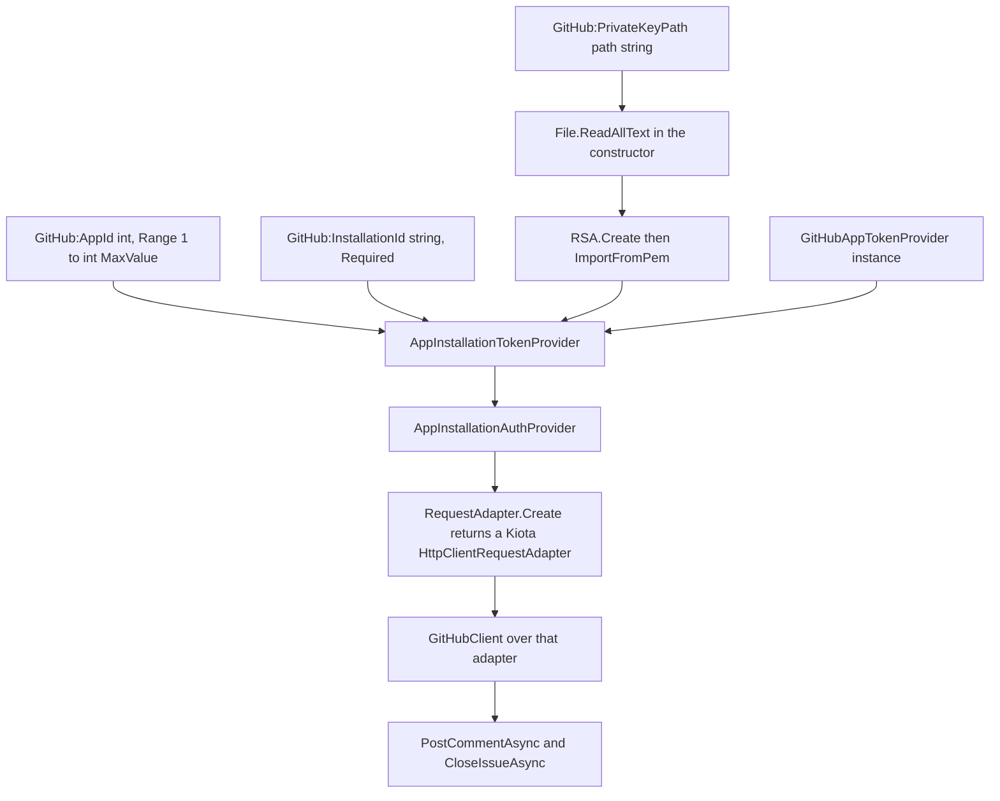
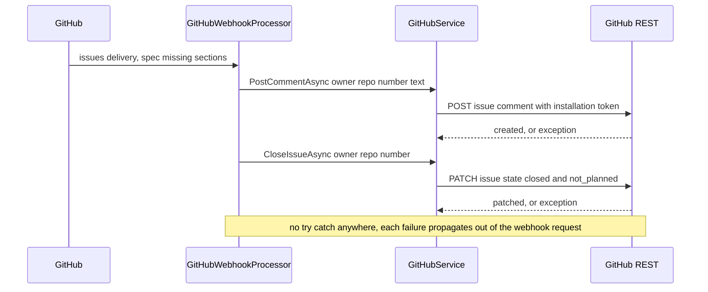

# GitHub App Authentication and Issue Writes

Sebastian has exactly one outbound GitHub surface, and it is not a wrapper library: `src/GitHub/GitHubService.cs` is a single `internal sealed` class of about seventy lines that builds an authenticated client in its constructor and exposes two methods. Everything the process writes to GitHub today goes through those two methods — an issue comment and an issue close. Reading the class is therefore the whole story of "how Sebastian authenticates to GitHub and what it is allowed to do", and the two-method surface is a deliberate design boundary rather than an unfinished one.

The inbound side is a different library entirely. Webhook models and signature verification come from `Octokit.Webhooks.AspNetCore`, while outbound REST calls use the Kiota-generated `GitHub.Octokit.SDK` client over `Microsoft.Kiota.Bundle`. Two GitHub SDKs coexist in one process — see [Webhook Intake and Event Routing](github-webhooks.md) for the inbound stack.

## The credential chain, end to end

Construction is the authentication design. `GitHubService`'s constructor performs five steps, and each one consumes a specific piece of `GitHubConfig`:

```csharp
_privateKey = RSA.Create();
_privateKey.ImportFromPem(File.ReadAllText(config.PrivateKeyPath));

var tokenProvider = new GitHubInstallationTokenProvider(
    config.AppId,
    _privateKey,
    config.InstallationId,
    new GitHubAppTokenProvider());

_adapter = GitHubRequestAdapter.Create(new GitHubAppAuthProvider(tokenProvider));
_client = new GitHubClient(_adapter);
```



The chain from configuration to an authenticated client: the PEM supplies the signing key, the installation token provider combines it with the app id and installation id, and the Kiota adapter carries that auth provider for every request.

| Step | Type | Configuration it needs | What it does |
| --- | --- | --- | --- |
| 1. Read key material | `File.ReadAllText` | `GitHub:PrivateKeyPath` — a **path**, not key text | Reads the PEM once, at construction; the path is not normalized or resolved against the content root |
| 2. Import | `RSA.Create()` + `RSA.ImportFromPem` | the PEM file contents | Produces the signer; the `RSA` instance is stored in a field and lives for the whole process |
| 3. Installation token provider | `GitHub.Octokit.Client.Authentication.AppInstallationTokenProvider` | `GitHub:AppId` (`int`, `[Range(1, int.MaxValue)]`), `GitHub:InstallationId` (`string`, `[Required]`), the key, and an `AppTokenProvider` | Couples the app identity (`AppId`) and the target installation (`InstallationId`) to the signer; this is what turns an app-level credential into an installation-scoped token |
| 4. Auth provider | `AppInstallationAuthProvider` | nothing of its own | Attaches the token provider as the request authenticator |
| 5. Request adapter | `GitHub.Octokit.Client.RequestAdapter.Create(...)` returns `Microsoft.Kiota.Http.HttpClientLibrary.HttpClientRequestAdapter` | nothing | Owns the HTTP pipeline; the returned adapter is Kiota's, which is why the field is typed as the Kiota type |
| 6. Client | `GitHub.GitHubClient` | nothing | Typed request builder used through `_client.Repos[owner][repository].Issues[number]` |

Two details of this chain matter operationally:

- **`InstallationId` is a `string`, not an `int`.** `AppId` gets numeric range validation; the installation id only gets `[Required]`, so `GitHub:InstallationId="abc"` binds and validates cleanly. There is no parse of that value anywhere in Sebastian — whatever is wrong with it surfaces when the SDK first needs a token, not at startup.
- **The `RSA` key is a long-lived field, and is disposed only at shutdown.** The key is imported once and never re-read, so rotating the app private key requires a process restart. The credential chain therefore describes the *entire* lifetime of the process, not just its first minute.

### What fails at startup, and what does not

`Program.cs` resolves `GitHubService` eagerly right after `Build()` — `_ = app.Services.GetRequiredService<GitHubService>();` under the comment *"Construct the services now so missing credentials fail at startup."* Because the constructor is the authentication work, eager resolution converts construction failures into deployment failures:

| Failure | Where it throws | Timing | Symptom |
| --- | --- | --- | --- |
| `PrivateKeyPath` missing, unreadable, or a directory | `File.ReadAllText` in the ctor | eager resolution after `Build()` | file-system exception (`FileNotFoundException` / `UnauthorizedAccessException`) |
| File exists but carries no usable PEM key | `RSA.ImportFromPem` | eager resolution | crypto exception from the import |
| Blank `PrivateKeyPath` / `InstallationId`, `AppId` below 1 | generated `ValidateSebastianConfig` | first `IOptions.Value` read, before the ctor runs | `OptionsValidationException` |
| `AppId` / `InstallationId` / key do not belong together, or the token request is rejected | inside the token provider, on the first request | **first GitHub write** | exception thrown by the SDK during a webhook handler |

There is no network call during construction, so a well-formed-but-wrong credential set is exactly the class of failure that eager construction *cannot* catch. See [Startup, Composition, and Configuration Binding](../architecture/startup-and-composition.md) for the full fail-fast contract and where `GitHubService` sits in it.

Secret hygiene is handled outside this class: `PrivateKeyPath` is a path precisely so key material never appears in configuration, and `.gitignore` excludes `*.pem`, `*.key`, `*.pfx`, `*.p12`, `*.snk`. Because it is a bare path, `File.ReadAllText` resolves it against the process working directory, not `IHostEnvironment.ContentRootPath` — for this app both are the repository root, but that assumption is implicit in the code.

## The two write operations

Both methods are thin adapters over generated request builders. Neither validates its arguments, formats text, checks the target repository against the local clone, or catches anything.

```csharp
public async Task PostCommentAsync(string owner, string repository, int issueNumber, string comment, CancellationToken cancellationToken)
{
    var issue = _client.Repos[owner][repository].Issues[issueNumber];

    await issue.Comments.PostAsync(
        new IssueCommentBody { Body = comment },
        cancellationToken: cancellationToken).ConfigureAwait(false);
}

public async Task CloseIssueAsync(string owner, string repository, int issueNumber, CancellationToken cancellationToken)
{
    var issue = _client.Repos[owner][repository].Issues[issueNumber];

    await issue.PatchAsync(
        new IssueUpdateBody
        {
            State = IssueUpdateState.Closed,
            StateReason = IssueUpdateStateReason.Not_planned,
        },
        cancellationToken: cancellationToken).ConfigureAwait(false);
}
```

| Method | REST intent | Payload | Author |
| --- | --- | --- | --- |
| `PostCommentAsync` | create an issue comment | `{ body: <comment> }`, forwarded verbatim | the GitHub App, via the installation token |
| `CloseIssueAsync` | patch the issue | `state: closed` **and** `state_reason: not_planned` | the GitHub App, via the installation token |

**The `not_planned` reason is a user-visible contract, not a detail.** `IssueUpdateStateReason.Not_planned` is the Kiota enum member whose wire value is `not_planned`; it is deliberately *not* `completed`. Anyone who "simplifies" the payload to just `state: closed` changes what every maintainer sees in the issue timeline, and there is no test that would fail.

**The comment text is not this class's business.** `GitHubService` posts whatever string it is handed. The only caller, `GitHubWebhookProcessor`, composes `Closed: the spec is missing required sections: {sections}.` and orders the two calls comment-then-close so the reason stays visible on the issue after closure. Both the wording and the ordering belong to intake, not the client; see [Issue Spec Contract and Validation Gate](../concepts/spec-validation.md). Changing either end is user-visible behavior with no regression net.



The intake close path through the client: two sequential authenticated calls, no retry and no compensation between them.

### Failure and lifetime semantics to preserve

- **No error handling, no retry, no logging.** `GitHubService` takes no `ILogger`, wraps nothing in `try`/`catch`, and has no idempotency key. A non-success response surfaces as an SDK exception that propagates through `GitHubWebhookProcessor` (which also has no `try`/`catch`) and fails the webhook request. Retrying a comment POST inside this class would be unsafe without a dedupe check, because comment creation is not idempotent: a redelivered webhook runs the same two calls again.
- **Partial outcomes are possible in both directions.** A failure on the comment leaves the issue open and untouched; a failure on the close leaves a posted comment on an open issue. Nothing reconciles the two.
- **The caller's `CancellationToken` is forwarded**, so a client-aborted webhook delivery can cancel a write in flight — a third way to end up with one of the two effects applied.
- **The class is a root singleton**, constructed once (`AddSingleton<GitHubService>()`) and shared by every webhook request. Background jobs get a per-job `IServiceScope`, but scopes resolve from the same root provider, so any job that needed the client would land on that same instance. There is one `HttpClientRequestAdapter` for the whole process — and today `GitHubWebhookProcessor` is its only consumer; `ImplementSpec` and `JobQueue` never resolve it.
- **Disposal releases the adapter, then the key:**

  ```csharp
  public void Dispose()
  {
      _adapter.Dispose();
      _privateKey.Dispose();
      GC.SuppressFinalize(this);
  }
  ```

  `_client` is not disposed separately — the adapter is the transport object, and disposing it is the step that releases the HTTP pipeline. The container owns the lifecycle: because `GitHubService` is registered as a singleton and implements `IDisposable`, the host disposes it as the service provider shuts down.

## The thin surface, and how it extends

There is no interface, no repository abstraction, and no owner/name defaulting: every call passes `owner`, `repository`, and `issueNumber` explicitly, taken from the *webhook payload* by the processor. The client is therefore scoped to the app **installation**, not to the one repository this process mirrors. `ImplementSpec.PrepareWorkspaceAsync` is where `owner/repository` is cross-checked against the parsed `origin` and a foreign repository throws — but that check happens on the *implementation* path, after intake has already been allowed to comment on and close whichever issue the delivery named. Treat that asymmetry as the current design, and as a reason not to hand this client more powerful operations casually.

What does not exist anywhere in the codebase, and cannot be reached by configuration:

- **Label writes.** Both labels (`feature`, `ready-for-agent`) are read-only filters in `GitHubWebhookProcessor`; nothing moves an issue between states.
- **Pull request operations of any kind.** No PR creation, no PR comments, no PR review, no merge. Sebastian never overrides a pull-request handler, and no pull-request REST path is used. The PRD's "PR is the terminal state" stage is absent from the code, not misconfigured — see [Product Intent vs. Implemented Behavior](../concepts/product-intent-and-gaps.md).
- **Comment editing or deletion.** Only creation exists, which is what makes the PRD's "never edit or delete others' comments" vacuously true.

Adding any of these means changing at least two things together: new methods (and new payload types) in `GitHubService`, and the caller in `GitHubWebhookProcessor` — plus the intake gate that decides when the new operation should fire, since today that decision is a handful of early `return`s in `ProcessIssuesWebhookAsync`. There is also no test seam: the class is `internal sealed` with no `IGitHubService`, and no test in the suite references it. Extracting an interface or injecting the transport is a prerequisite for unit-testing new write behavior, not a follow-up step — and it touches `Program.cs` (factory registration) and the `WebhookEventProcessor` factory at the same time.

`Program.cs` needs no change for new methods: `GitHubService` is resolved by the container and passed into the `WebhookEventProcessor` factory, so the dependency graph only changes if the new write needs a collaborator this class does not have today.

One reason not to widen this surface casually: the only thing standing between a bad payload and an unhandled exception is the ordering of the method body. Both writes are `await`-ed directly with no surrounding `try`, which is what makes the exception travel all the way out of the webhook endpoint — always a failing delivery, never a swallowed error.

### Why the file is full of `global::` aliases

The type names at the top of the file are not style:

```csharp
using GitHubAppAuthProvider = global::GitHub.Octokit.Client.Authentication.AppInstallationAuthProvider;
using GitHubAppTokenProvider = global::GitHub.Octokit.Client.Authentication.GitHubAppTokenProvider;
using GitHubClient = global::GitHub.GitHubClient;
using GitHubHttpAdapter = global::Microsoft.Kiota.Http.HttpClientLibrary.HttpClientRequestAdapter;
using GitHubInstallationTokenProvider = global::GitHub.Octokit.Client.Authentication.AppInstallationTokenProvider;
using GitHubRequestAdapter = global::GitHub.Octokit.Client.RequestAdapter;
using IssueCommentBody = global::GitHub.Repos.Item.Item.Issues.Item.Comments.CommentsPostRequestBody;
using IssueUpdateBody = global::GitHub.Repos.Item.Item.Issues.Item.WithIssue_numberPatchRequestBody;
using IssueUpdateState = global::GitHub.Repos.Item.Item.Issues.Item.WithIssue_numberPatchRequestBody_state;
using IssueUpdateStateReason = global::GitHub.Repos.Item.Item.Issues.Item.WithIssue_numberPatchRequestBody_state_reason;
```

The file's own namespace is `Sebastian.GitHub`, so inside it the bare identifier `GitHub` binds to `Sebastian.GitHub` and a plain `using GitHub.Octokit...` would not resolve to the SDK at all. Every SDK type is therefore reached through `global::`, and the aliases give the generated, deeply nested body types (`CommentsPostRequestBody`, `WithIssue_numberPatchRequestBody`) readable local names. Reuse the aliases when extending the file; adding an inline fully qualified `global::GitHub.Repos...` reference works but makes the two payloads hard to compare. The aliases also disambiguate the two similarly named SDK types (`GitHubAppTokenProvider` vs `AppInstallationTokenProvider`), which differ by exactly one word and have different roles.

### AOT and reflection: only what the code shows

`Sebastian.csproj` sets `PublishAot`, `InvariantGlobalization`, and `EnableConfigurationBindingGenerator`, whose inline comment scopes the AOT work to configuration binding: *"Reflection binding is not AOT-safe; generated binder needs non-required properties (CS9035)."* `GitHubService` itself contains **no** AOT accommodation: no `DynamicDependency`, no `JsonSerializerContext`, no `RequiresUnreferencedCode` suppression, no trimming roots anywhere in the repository. The SDK is consumed as-is — `GitHub.Octokit.SDK` 0.0.31 and `Microsoft.Kiota.Bundle` 1.22.2 — and serialization of the two request bodies is the generated client's responsibility. Keep it that way: hand-written `JsonSerializer`-based request building or reflection over the generated types would be the first thing on this path to break under AOT, and nothing here currently establishes a pattern for it.

A second project convention applies to any new code here: `AnalysisLevel` is `latest-all` with `TreatWarningsAsErrors`, so a new method or field in this class must be analyzer-clean — `CA1812` and `CA1031` are suppressed only where they were deliberately chosen (the options types, and the job loop that must not tear down the queue), not globally.

Note also that `Sebastian.csproj` declares `<InternalsVisibleTo Include="Sebastian.Tests" />`, so `internal sealed GitHubService` *is* visible to the test assembly. The absence of tests for it is a gap in coverage, not a language or visibility barrier — a test could construct it today with `Options.Create(config)` and a real PEM path.

## Tests

Nothing pins this class. `tests/Sebastian.Tests` contains no reference to `GitHubService`, `PostCommentAsync`, or `CloseIssueAsync` — its only `GitHubConfig` reference is blank-API-key validation inside `ProviderResolverTests` (a test whose real subject is the agent provider, using a valid GitHub config as filler) — while the spec-template tests pin the *input* to the close path. That the class is reachable from the test assembly (`InternalsVisibleTo`) only sharpens the point: the gap is coverage, not accessibility. The consequence is specific: the `not_planned` reason, the comment ordering, and the absence of retry all rest on review alone, and any change to them — or to how the two calls fail — needs manual verification against a real installation.

## Where to go next

- The inbound stack and which deliveries reach these writes: [Webhook Intake and Event Routing](github-webhooks.md).
- When the close path runs and the exact comment text: [Issue Spec Contract and Validation Gate](../concepts/spec-validation.md).
- Where eager construction and fail-fast sit in composition: [Startup, Composition, and Configuration Binding](../architecture/startup-and-composition.md).
- Operating the app: the PEM file, environment variable names, and restart requirements in [Running, Configuration, and Deployment](../operations/running-and-deployment.md).
