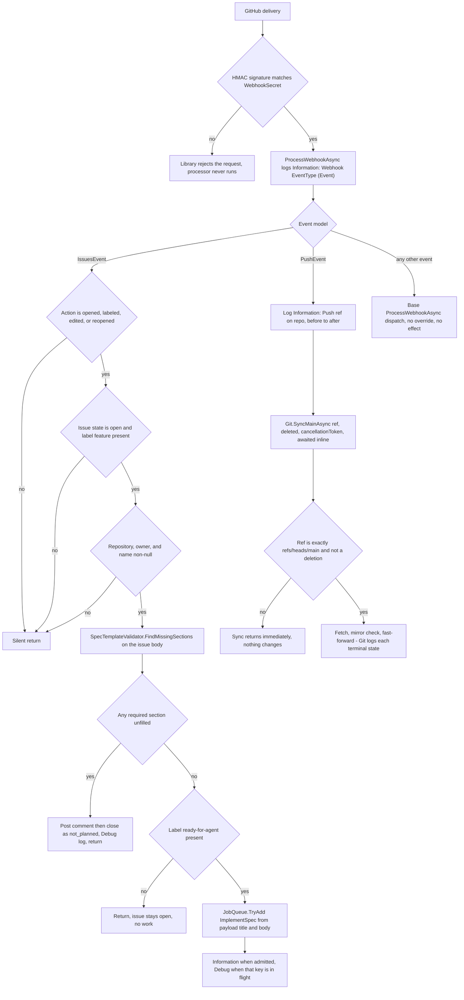
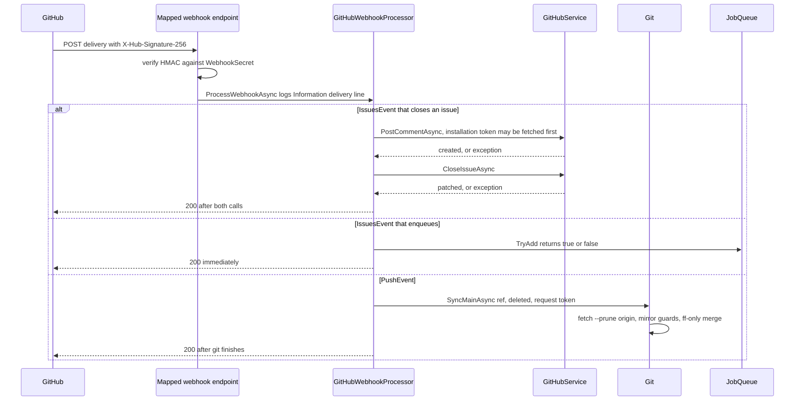

# Webhook Intake and Event Routing

Sebastian has exactly one inbound integration: a GitHub App posts deliveries to an endpoint, and one class decides what each delivery means. [`src/Webhooks/GitHubWebhookProcessor.cs`](../../src/Webhooks/GitHubWebhookProcessor.cs) is about 130 lines, derives from `Octokit.Webhooks.WebhookEventProcessor`, and overrides only two handlers — `ProcessIssuesWebhookAsync` and `ProcessPushWebhookAsync`. Every other GitHub event type reaches the library's base dispatch and does nothing.

The page is worth reading as three separate contracts that happen to live in one file:

1. **Trust** — how a request becomes a verified delivery, and what the secret does and does not cover.
2. **Policy** — which `(event, action, state, labels)` combinations produce a side effect, and which are dropped with no trace beyond the delivery line.
3. **Latency** — everything runs synchronously inside the HTTP request, so the handler's cost is the webhook response time, and GitHub redelivers what it considers failed.

The *content* of the issue path — the seven required sections, the exact close message, `not_planned` — belongs to [Issue Spec Contract and Validation Gate](../concepts/spec-validation.md). The two write calls belong to [GitHub App Authentication and Issue Writes](github-app-client.md). This page covers how deliveries get to those places.

## The endpoint and how the processor is constructed

`Program.cs` mounts two things and nothing else:

```csharp
app.MapGet("/health", () => "ok");
app.MapGitHubWebhooks(secret: config.GitHub.WebhookSecret);
```

`MapGitHubWebhooks` comes from `Octokit.Webhooks.AspNetCore`. Only the secret argument is supplied, so the route itself is the library default and does not appear anywhere in this repository — read the library, not the code, if you need the path. Two properties follow from the call shape:

- **No authentication middleware exists anywhere in the host.** The webhook route is anonymous; the HMAC secret from `GitHub:WebhookSecret` is the entire trust boundary. Signature verification happens inside the endpoint before dispatch, so `GitHubWebhookProcessor` only ever sees deliveries that matched the secret. A wrong or missing signature is rejected by the library and the processor is never invoked — that rejection is invisible in Sebastian's own logs.
- **The secret is read once, at composition time**, and configuration is frozen for the process lifetime. Changing `GitHub:WebhookSecret` requires a restart; a running process keeps verifying against the value it started with. See [Startup, Composition, and Configuration Binding](../architecture/startup-and-composition.md) for why `IOptionsMonitor` is deliberately absent.

Registration is a factory over the public base type:

```csharp
// Factory, not AddSingleton<TService, TImpl>: internal processor is unknown to DI's reflection path.
builder.Services.AddSingleton<WebhookEventProcessor>(
    services => new GitHubWebhookProcessor(
        services.GetRequiredService<ILogger<GitHubWebhookProcessor>>(),
        services.GetRequiredService<GitHubService>(),
        services.GetRequiredService<JobQueue>(),
        services.GetRequiredService<Git>(),
        ));
```

The four dependencies are `ILogger<GitHubWebhookProcessor>`, `GitHubService`, `JobQueue`, and `Git` — all root singletons, so the git mirror and the queue the webhook path touches are the same instances jobs use. Note the lifetime asymmetry with the credentials: `GitHubService` and `ProviderResolver` are resolved eagerly right after `Build()`, but `WebhookEventProcessor` is a lazy singleton constructed on the **first delivery**. An exception thrown in the processor's construction (or in the lazy construction of a new collaborator added to this factory) is therefore a failed webhook request, not a failed deployment. If you add a fifth dependency, extend this factory call rather than switching to `AddSingleton<WebhookEventProcessor, GitHubWebhookProcessor>()`, which would hand the internal type to the container's reflection-based activator.

## The one line every delivery emits

Before any filtering, the processor overrides the dispatch entrypoint:

```csharp
public override ValueTask ProcessWebhookAsync(
    WebhookHeaders headers, WebhookEvent webhookEvent, CancellationToken cancellationToken = default)
{
    LogReceived(webhookEvent.GetType().Name, headers.Event);
    return base.ProcessWebhookAsync(headers, webhookEvent, cancellationToken);
}
```

`LogReceived` is `Information` with the template `Webhook {EventType} ({Event})` — the deserialized Octokit model type name (for example `IssuesEvent`) and the `X-GitHub-Event` header value (for example `issues`). This is the only universal trace in the system: every verified delivery, including every one that is subsequently ignored, leaves exactly one line.

What the line deliberately does **not** contain is as important as what it does:

- no action, repository, issue number, or label;
- no `X-GitHub-Delivery` id, and nothing in the process records delivery ids.

So from logs alone you can tell *that* a delivery arrived and *what kind*, but not which issue it was about, and a GitHub redelivery is indistinguishable from a fresh event. The branches below that log nothing are readable only from this line plus whatever the resulting side effect produced.

## Issue routing: three guards, then the spec gate

`ProcessIssuesWebhookAsync` is a sequence of early returns. In order:

| # | Guard | Accepted | Otherwise |
| --- | --- | --- | --- |
| 1 | Action | `Opened`, `Labeled`, `Edited`, `Reopened` | silent `return` |
| 2 | Payload issue state **and** labels | `IssueState.Open` **and** a label named `feature` (`OrdinalIgnoreCase`) | silent `return` |
| 3 | Repository identity in the payload | `Repository`, `Owner.Login`, and `Name` all non-null | silent `return` |
| 4 | Spec completeness | `SpecTemplateValidator.FindMissingSections` returns nothing | comment + close, `Debug` log, `return` |
| 5 | Approval label | `ready-for-agent` present | return with no side effect |

The labels are two `const` strings in the class — `FeatureLabel = "feature"` and `ReadyForAgentLabel = "ready-for-agent"` — and they are **read-only filters**. Nothing in this codebase writes a label, so who may move an issue into `ready-for-agent` is enforced entirely by humans. The gate also never verifies *who* applied the label: any actor able to label the issue can start an agent run.

Guard 3 is defensive rather than semantic. It cannot fire for a well-formed GitHub payload; it exists so the two calls that follow can be given non-null `owner`/`name` without null-forgiving operators. Note the asymmetry it creates in logging: `repository.FullName ?? "unknown"` is used for the log lines, so an exotic payload would log `unknown` rather than throwing.

Ordering matters and is easy to break: **the spec check and its `return` come before the `ready-for-agent` check.** An issue a maintainer already approved is still closed as `not_planned` if a later `edited` delivery leaves a required section empty. Nothing tests this.

### Why the first three guards log nothing

The silence is a deliberate filter decision, not an oversight, and the reasoning is worth keeping if you extend the method:

- **The delivery line already proved arrival.** `Webhook IssuesEvent (issues)` at `Information` is the per-delivery record; a branch-level skip would add a second line saying only "and then nothing".
- **Skip traffic dominates.** Issue events fire on every label change, title edit, milestone, assignment, and comment-free edit across the installation. Logging each rejection would make the interesting lines — a closure, an enqueue — unfindable.
- **A skip is not an error.** No exception, no retry, no state change; nothing an operator must act on.

The price is auditing: when an issue that "should have been picked up" was not, the log shows only that an `IssuesEvent` arrived. Answering "why didn't the agent start" means re-reading the payload conditions against the code, not searching logs. If that becomes a real operational need, add a `Debug` line per guard rather than promoting any of them to `Information`.

The *outcome* lines are split by level, which is the other thing to internalize: at the default `Information` level, the only visible outcomes in the whole intake path are "a delivery arrived" and "implementation started". Every failure-to-progress outcome — a duplicate-suppressed enqueue, and the closure of an issue with an invalid spec — is `Debug`.

```csharp
if (jobQueue.TryAdd(job))
{
    LogImplementationStarted(repositoryName, issueNumber);      // Information
}
else
{
    LogImplementationAlreadyRunning(repositoryName, issueNumber); // Debug
}
```

`TryAdd` returning `false` is normal traffic (an issue labeled, then edited, then reopened produces several qualifying deliveries for one key), so the processor neither throws nor comments on it. Why the key behaves that way is [Job Queue and Execution Semantics](../concepts/job-queue.md).

### The routing flow, end to end



Every path a verified delivery can take. The only three branches that touch anything external are the two GitHub writes, the queue admission, and the inline git sync.

### Decision table

| Event | Action | Issue state | Labels | Outcome |
| --- | --- | --- | --- | --- |
| `issues` | `opened`, `labeled`, `edited`, `reopened` | `open` | `feature`, spec incomplete | Comment naming missing sections, then close as `not_planned`; `Debug` log; never enqueued even if `ready-for-agent` is present |
| `issues` | same four | `open` | `feature` + `ready-for-agent`, spec complete | `ImplementSpec` from the payload's title and body; `Information` when admitted, `Debug` when that key is already in flight |
| `issues` | same four | `open` | `feature`, spec complete, no `ready-for-agent` | Nothing — the intended "waiting for a human" state; silent |
| `issues` | same four | `open` | no `feature` (even with `ready-for-agent`) | Nothing; silent. `bug`-only issues are therefore never validated, implemented, or closed |
| `issues` | same four | `closed` | any | Nothing; silent — a closed issue cannot be re-validated, so recovery needs `reopened` or a re-label |
| `issues` | `closed`, `deleted`, `transferred`, `assigned`, `milestoned`, … | any | any | Nothing; silent |
| `issues` | same four | `open` | `feature` | Nothing; silent defensive return (payload had no repository, owner, or name) |
| `push` | n/a | n/a | n/a | `Information` log line, then `SyncMainAsync` awaited inline; actual mirror update only for `refs/heads/main` |
| `push` (any other branch, or a branch deletion) | n/a | n/a | n/a | `Information` log line, then an immediate no-op inside `Git` — branch pushes, including `sebastian/issue-<n>`, never update the mirror |
| `pull_request`, `issue_comment`, `ping`, `workflow_run`, … | n/a | n/a | n/a | One `Information` delivery line, then base dispatch with no override: no effect. There is no command surface anywhere |
| any event | n/a | n/a | n/a | Rejected by the library before the processor if the signature does not match `GitHub:WebhookSecret` |

Two entries in that table are consequences of reading the payload rather than re-fetching GitHub state, and both surprise people:

- **A redelivery of an invalid-spec delivery repeats both writes.** The guard evaluates the `state` carried in the *payload*, so a redelivered "open, missing sections" event passes the state guard again and posts a second comment on the (now closed) issue. Comment creation is not idempotent and nothing dedupes on delivery id.
- **A redelivery after a job finishes starts a second run.** `TryAdd` only rejects while that key is in flight; once the run completes the key is released, so the same delivery arriving later enqueues a fresh `ImplementSpec`.

## Push routing: the documented synchronous exception

```csharp
var repositoryName = pushEvent.Repository?.FullName ?? "unknown";
LogPushReceived(repositoryName, pushEvent.Ref, pushEvent.Before, pushEvent.After);

// shortcut: synchronous fetch in the webhook; move to a background queue if delivery latency becomes a problem.
await git.SyncMainAsync(pushEvent.Ref, pushEvent.Deleted, cancellationToken).ConfigureAwait(false);
```

This is the only place in the codebase where git work happens on a request thread. `LogPushReceived` is `Information` with the template `Push {RefName} on {Repository}: {Before} -> {After}`, which is genuinely useful: it records the ref and both SHAs, so the log identifies exactly which push caused (or did not cause) a mirror update.

The three-argument `SyncMainAsync` is a ref filter first and a sync second: a deletion, or any ref that is not exactly `refs/heads/main` (`Ordinal`), returns before touching git. That means the log line and the side effect are decoupled — a push to a feature branch produces an `Information` line and no work whatsoever. The state machine, the three mirror guards, the `--ff-only` merge, and the `index.lock` race with workspace preparation are covered in [Git Mirror and Worktree Model](../concepts/git-workspaces.md).

Two failure properties of this call are specific to the webhook path:

- **The sync swallows its own failures.** `SyncMainAsync` catches `InvalidOperationException` (a non-zero git exit → `Warning`) and `OperationCanceledException` (`Debug`), so a failed fetch or a rejected fast-forward does not fail the webhook request and produces a warning at most. Exceptions outside those two types — for example a parse failure on `rev-list --count` output — would propagate out of the handler, because the processor itself has no `try`/`catch` anywhere.
- **The bound is the request, not a timer.** The startup call site wraps the same sync in a linked `CancellationTokenSource` with `CancelAfter(TimeSpan.FromSeconds(10))`; the push call site does not. Its only limits are the request's `cancellationToken` and whatever timeout the HTTP server and the git process themselves impose, so a slow `git fetch --prune origin` is time added directly to the delivery's response. A client disconnect cancels the fetch mid-flight and is logged at `Debug` only, i.e. invisibly at default levels.

## Latency and redelivery are the design constraint for anything added here

Everything above runs before the HTTP response. Nothing is queued except the `ImplementSpec` job, and the queue's admission call returns immediately. The following sequence is the whole cost profile of a delivery:



Where a delivery spends its time. Only the `IssueEvent` enqueue branch returns without waiting on a network call.

Why this matters when you add work:

- **GitHub gives the endpoint a short budget and redelivers on failure or timeout.** A slow handler does not merely delay Sebastian — it produces a second delivery of the same event, which re-runs the same non-idempotent writes (another comment, another enqueue once the previous run finished). There is no delivery-id tracking to suppress the duplicate.
- **The two GitHub writes are sequential, and the first can include an installation-token exchange.** Nothing in this path is retried, so a failed comment leaves the issue open and untouched, while a failed close leaves a comment on a still-open issue. See [GitHub App Authentication and Issue Writes](github-app-client.md).
- **The push path is the only unbounded one.** It runs a real `git fetch` against `origin` inside the request with no `CancelAfter`.
- **A throw becomes a failed request, not a retried operation.** The processor has no `try`/`catch`; every exception from `GitHubService`, `Git`, or `SpecTemplateValidator` propagates through the endpoint. `JobQueue` is the only error-isolating boundary in the process, and it is downstream of this file.

The escape hatch is already the right one: `JobQueue` is *the* place work may happen after the response. Moving the push sync behind an `IJob`, or making the issue close asynchronous, means implementing `IJob` and calling `TryAdd` — not adding a `Task.Run` here.

## Extending the routing

- **New event type.** Override another `Process*WebhookAsync` (the base class provides one virtual per event model). Put the type/action filter first and return silently on a miss, so the delivery line stays the only per-delivery record. Forward `cancellationToken` to anything you call — the processor's token is the client's request lifetime.
- **New slow work.** Convert it into an `IJob` in `src/Jobs` and admit it through `JobQueue.TryAdd`, following `ImplementSpec`. Keep the handler's own work to validation and admission.
- **New dependency.** Add it to the `WebhookEventProcessor` factory in `Program.cs`; the registration is a factory precisely so the internal type never participates in reflection-based construction.
- **New GitHub write.** It belongs in `GitHubService`, which is a deliberately narrow two-method surface; the caller here composes the text and the ordering.
- **New label semantics.** The two label constants are read-only filters and the codebase writes no labels. Adding a state transition is new feature work, described in [Product Intent vs. Implemented Behavior](../concepts/product-intent-and-gaps.md).

The `// shortcut:` comment on the push handler is a recorded decision, not a defect: there are exactly three such markers in the repository (`Git.StartAsync`, `Git.SyncMainAsync`, and this one), and each names the condition that would justify upgrading it. Removing the behavior without replacing the comment destroys the only record of why the code deliberately blocks a request. See [Codebase Conventions and Change Checklist](../concepts/codebase-conventions.md).

## Log line reference

| Level | Template | Emitted when |
| --- | --- | --- |
| `Information` | `Webhook {EventType} ({Event})` | every verified delivery, before dispatch |
| `Information` | `Push {RefName} on {Repository}: {Before} -> {After}` | every `PushEvent`, including pushes that change nothing |
| `Information` | `Started implementation for {Repository}#{Number}` | `TryAdd` admitted a job |
| `Debug` | `Implementation already running for {Repository}#{Number}` | `TryAdd` rejected the key |
| `Debug` | `Issue {Repository}#{Number} closed; missing spec sections: {Sections}` | after both writes of the invalid-spec close path |

Every template is a `[LoggerMessage]` partial method on the `partial` class, per the project's logging convention. `Information` is the effective default, so the three outcome lines that matter most for diagnosis are the two `Debug` ones; enabling `Debug` for `Sebastian.Webhooks` is what makes intake auditable. The git sync contributes its own lines through `Git`, documented in [Git Mirror and Worktree Model](../concepts/git-workspaces.md).

## What is not tested

Nothing in the suite exercises this file. `tests/Sebastian.Tests` contains no reference to `GitHubWebhookProcessor`, no `WebApplicationFactory`, and no integration test of `Program.cs`, so every guard, the action list, the label comparisons, the ordering of validation before approval, the silent returns, and the inline push sync rest on review alone. The nearest coverage is indirect: `SpecTemplateValidatorTests` pins the validator's input contract, and `JobQueueTests` pins that a duplicate key is rejected while a job runs — both are dependencies of branches here, not tests of them.

Practical consequence for a change to this page's behavior: verify manually against a real installation, sending each delivery kind (`opened`, `labeled`, `edited`, `reopened`, an unrelated action, a non-`main` push, a `main` push) and watching for the expected log line and side effect. Adding a test means first introducing a seam — the processor takes concrete singletons (`GitHubService`, `Git`, `JobQueue`) and constructs `ImplementSpec` directly, so there is no interface to substitute. See [Testing Strategy and Harness](../testing/test-strategy.md).

## Where to go next

- What the issue path validates and exactly what it writes: [Issue Spec Contract and Validation Gate](../concepts/spec-validation.md).
- The two write operations and their credential chain: [GitHub App Authentication and Issue Writes](github-app-client.md).
- What `TryAdd`'s boolean means and what happens after admission: [Job Queue and Execution Semantics](../concepts/job-queue.md).
- The mirror sync the push handler triggers: [Git Mirror and Worktree Model](../concepts/git-workspaces.md).
- The end-to-end trace from delivery to agent workspace: [Workflow: Feature Issue to Agent Workspace](../workflows/feature-implementation.md).
