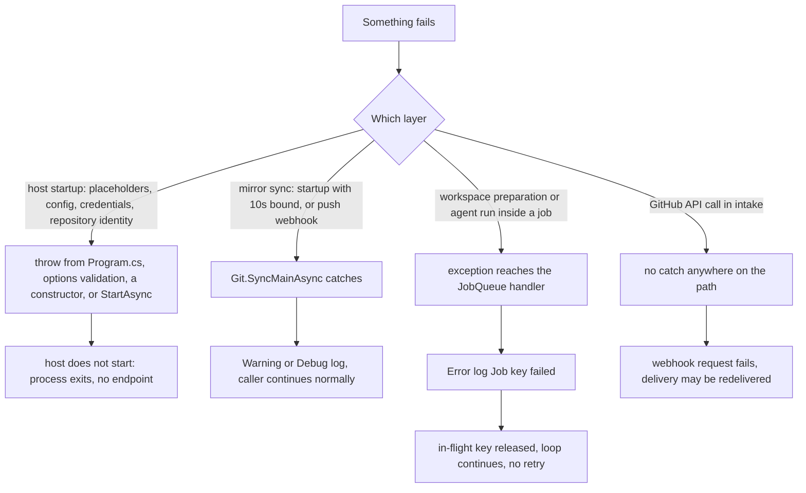
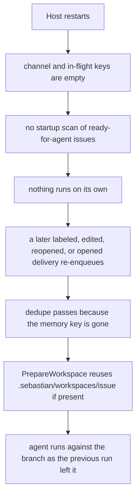

# Failure Handling, Restart Behavior, and Known Races

Sebastian has no supervisor, no retry loop, no dead-letter queue, and no database. What it has is three different failure policies applied at three different layers, chosen deliberately and stated in comments where the code diverges from the obvious. Almost every operational surprise in this process traces back to knowing which of the three applies to the code path you are looking at:

| Policy | Where it applies | What the user sees |
| --- | --- | --- |
| **Fail the host** | environment placeholders, configuration validation, credentials, provider selection, repository identity — all before or during `IHostedService.StartAsync` | process exits, no `/health`, no webhook endpoint |
| **Log and continue** | the mirror sync (`Git.SyncMainAsync`) on startup and on push deliveries, and every `git` process kill on cancellation | a `Warning` or `Debug` line; the webhook response is still a success |
| **Throw to the queue** | workspace preparation and the agent run inside a job | one `Error` line `Job {key} failed`, in-flight key released, **no retry and no comment on the issue** |
| **Nothing** (by omission) | the two GitHub REST calls in intake | exception escapes the webhook handler; the delivery fails |



Failure classification: which layer owns the exception decides whether the host dies, the log absorbs it, or the job dies alone.

The rest of this page walks each layer in that order, then covers the two things that are not exceptions at all — a rejected duplicate and a restart — and finishes with the races the code knowingly accepts.

## Layer 1: failures that abort the host

These are preconditions, and each one throws rather than degrading. The reasoning is uniform: there is no safe half-running Sebastian, because a half-running instance would take issue events and then fail them silently.

| Trigger | Handler | User-visible effect | How to verify |
| --- | --- | --- | --- |
| A `{env:NAME}` placeholder whose variable is unset or blank | `ExpandEnvironmentPlaceholders`, the third statement in `Program.cs`, before anything is bound | process exits with `InvalidOperationException`: `Environment variable '<NAME>' for configuration key '<key>' is not set.` | unset `GITHUB_WEBHOOK_SECRET` and start |
| Missing/blank required configuration | `AddOptions<SebastianConfig>().Bind(...).ValidateOnStart()` plus the source-generated `ValidateSebastianConfig` — fails when `Program.cs` reads `IOptions.Value` right after `Build()`, and again at host start | process exits with `OptionsValidationException` naming the member | start with an empty `Agent__Providers` |
| Content root ≠ `git rev-parse --show-toplevel` | `Git.EnsureRepositoryAsync` throws `InvalidOperationException`: `"Sebastian must run from the repository root. Content root is '<path>', git root is '<path>'."` | host start fails; exception text names both paths | start the binary from a subdirectory |
| `origin` remote missing or unparsable | `RepositoryIdentity.Parse` returns `null` → `"Could not parse the origin remote URL."` (a missing remote fails earlier as `git remote get-url origin failed: <stderr>`) | host start fails | `git remote -v` in the content root |
| Unreadable or malformed PEM at `GitHub.PrivateKeyPath` | `GitHubService` constructor: `File.ReadAllText` then `ImportFromPem` | host start fails | point `PrivateKeyPath` at a non-PEM file |
| No providers, duplicate provider names, unknown `Agent.General.Provider`, unparsable endpoint | `ProviderResolver` constructor throws `InvalidOperationException` with a message naming the offender | host start fails | configure `Agent:General:Provider` to a name absent from `Agent:Providers` |

The last two rows are enforced at startup *by construction time*, not by first use: `Program.cs` resolves both services eagerly after `builder.Build()` specifically so a missing credential fails the start rather than the first job. Because their constructors validate, resolution *is* the validation — nothing else in the graph would force either type to be built before traffic arrives.

```csharp
var app = builder.Build();

var config = app.Services.GetRequiredService<IOptions<SebastianConfig>>().Value;

// Construct the services now so missing credentials fail at startup.
_ = app.Services.GetRequiredService<GitHubService>();
_ = app.Services.GetRequiredService<ProviderResolver>();

app.MapGet("/health", () => "ok");
app.MapGitHubWebhooks(secret: config.GitHub.WebhookSecret);

await app.RunAsync().ConfigureAwait(false);
```

Read that block as the startup-failure ladder, because the order is the order in which each gate fires. Line 43's `IOptions.Value` read materializes the options factory once and runs the generated validator with it, so a broken configuration dies *before* the eager resolutions above it — and the webhook secret that `MapGitHubWebhooks` captures on line 50 is the already-validated value. Hosted services start later still, in registration order: `Git` (line 29) before `JobQueue` (line 31), so the repository invariant is checked before the queue begins consuming, and neither can be dodged by an early delivery. `GitHubWebhookProcessor` is constructed on the first request, because its registration is a factory that the Octokit endpoint resolves per delivery — worth knowing, since a throw there is a failed delivery rather than a failed deployment.

One asymmetry inside `Git.StartAsync` is worth knowing before you debug a host that will not come up:

```csharp
public async Task StartAsync(CancellationToken cancellationToken)
{
    await EnsureRepositoryAsync().ConfigureAwait(false);

    // Best-effort, bounded: a missed push webhook must not prevent the app from starting.
    // shortcut: push + startup sync only; add a periodic fetch if missed push webhooks become a problem.
    using var timeout = CancellationTokenSource.CreateLinkedTokenSource(cancellationToken);
    timeout.CancelAfter(TimeSpan.FromSeconds(10));
    await SyncMainAsync(timeout.Token).ConfigureAwait(false);
}
```

`EnsureRepositoryAsync` calls every git command with `CancellationToken.None` — deliberately, because this is not cancellable startup work. **The ten-second bound covers only the sync, not the identity checks.** A `git rev-parse` that hangs (a stale NFS mount, a credential helper waiting on a lock file) blocks host startup indefinitely with no timeout anywhere in the process. That is the only unbounded wait in the failure surface; see [Startup, Composition, and Configuration Binding](../architecture/startup-and-composition.md) for the composition ordering that puts `StartAsync` on the critical path and [Running, Configuration, and Deployment](running-and-deployment.md) for the operator checklist.

## Layer 2: the bounded, non-fatal mirror sync

`SyncMainAsync` is the one place in the codebase where exceptions are caught and turned into log lines on purpose. It has two callers — `Git.StartAsync` under the ten-second bound, and `GitHubWebhookProcessor.ProcessPushWebhookAsync` inline inside the request — and both depend on the same guarantee: **it never throws.**

```csharp
if (deleted ||
    !string.Equals(refName, $"refs/heads/{BaseBranch}", StringComparison.Ordinal))
{
    return;
}

// shortcut: worktree prep can run during a fast-forward; worst case the prep fails on git's index.lock, the repo stays consistent.
try
{
    LogSyncFetching();
    await FetchAsync("origin", cancellationToken).ConfigureAwait(false);

    var problem = await FindMirrorProblemAsync(cancellationToken).ConfigureAwait(false);
    if (problem is not null)
    {
        LogSyncSkipped(problem);
        return;
    }
    ...
}
catch (InvalidOperationException exception)
{
    LogSyncFailed(exception);
}
catch (OperationCanceledException)
{
    LogSyncCancelled();
}
```

| Trigger | Handler | User-visible effect | How to verify |
| --- | --- | --- | --- |
| Push to any ref other than exactly `refs/heads/main`, or a branch deletion | early `return` before the `try` | no fetch, no log of a skip; only the `Push {RefName} on {Repository}` Information line | push a topic branch and watch the log |
| Local `main` is dirty, on another branch, or ahead of `origin/main` | `FindMirrorProblemAsync` returns a reason → `LogSyncSkipped(problem)` at **Warning**, message `Skipped local main sync: <reason>` | the mirror silently stays stale; **the push webhook still returns 200** | commit to local `main` and push to `origin/main` |
| `fetch`, `rev-list`, `rev-parse`, or `merge --ff-only` exits non-zero | `catch (InvalidOperationException)` → `LogSyncFailed` at **Warning**, message `Local main sync failed` with the exception | same as above: stale mirror, successful delivery | point `origin` at an unreachable URL and push |
| The ten-second startup bound fires, or host shutdown during the sync | `catch (OperationCanceledException)` → `LogSyncCancelled` at **Debug** | at default log level: **completely invisible** | start the host with a slow remote and no `Debug` sink attached |

Two consequences to hold on to. First, because the cancellation catch is `Debug`, a startup whose sync was cut off by the ten-second bound looks identical to a clean startup at the default `Information` level — the mirror may be stale and nothing says so. Second, because the push path is inline and unfailing, **a webhook can be acknowledged while the mirror it was supposed to update did not move**; the next `PrepareWorkspaceAsync` re-fetches, so the practical effect is a slower job, not a wrong one — see [Git Mirror and Worktree Model](../concepts/git-workspaces.md).

The same `FindMirrorProblemAsync` result is consumed with the opposite policy one layer down: `PrepareWorkspaceAsync` rethrows it so no agent starts on a questionable base. One predicate, two policies, chosen by caller.

### The deliberate and accidental swallow points in the git runner

There are two `catch` blocks below `SyncMainAsync`, and they are of different kinds.

```csharp
try
{
    await process.WaitForExitAsync(cancellationToken).ConfigureAwait(false);
    var stdout = await stdoutTask.ConfigureAwait(false);
    var stderr = await stderrTask.ConfigureAwait(false);

    if (process.ExitCode != 0)
    {
        throw new InvalidOperationException($"git {string.Join(' ', arguments)} failed: {stderr.Trim()}");
    }

    return stdout;
}
catch (OperationCanceledException)
{
    TryKill(process);
    throw;
}
```

- **Deliberate — `RunAsync`'s cancellation catch.** It does not swallow; it kills `entireProcessTree: true` and rethrows, so the caller decides. This is what guarantees a cancelled job does not leave an orphan `git fetch` mutating the mirror after the job is gone. Note that `GIT_TERMINAL_PROMPT=0` is set on every child process, so a credential prompt fails fast instead of hanging a request until the host gives up.
- **Deliberate but narrow — `TryKill`.** It guards only `InvalidOperationException` ("process already exited"), which is the expected race between `WaitForExitAsync` throwing and the process dying on its own. Every other `Kill` failure (`Win32Exception` for a permission problem, for example) would escape the cancellation handler as a different exception type and land in `JobQueue`'s general catch instead of the shutdown filter — i.e. get logged as a job failure during shutdown. This is the codebase's one arguably *accidental* swallow boundary; it is not covered by a test.

Killing a `git` child mid-write is also the only plausible source of a stale `.git/index.lock` outside the documented race — the process is killed wherever it happens to be, and git does not remove its own lock file on `SIGKILL`. (That last sentence is an inference about git's behavior, not something the code states or handles; the recovery is manual, and the symptom is a preparation failure identical to the documented race below.)

## Layer 3: failures that belong to one job

Once a job starts, everything that goes wrong is scoped to that job. There are two distinct hard-failure modes and one soft one.

### Hard: workspace preparation refuses to start an agent

`PrepareWorkspaceAsync` is all policy, and its three throws exist because there is no degraded mode — an agent started on a questionable base silently corrupts the only artifact the system produces.

| Trigger | Message | Test that pins it |
| --- | --- | --- |
| `Git.Repository` is `null` (the `Git` hosted service never started) | `"Git repository is not initialized. The Git hosted service has not started."` | — |
| Issue owner/repository differ from the parsed `origin` | `"Issue repository '<owner>/<repo>' does not match local origin '<owner>/<repo>'."` | `RejectsForeignRepository` |
| Local `main` is not the checked-out branch / is dirty / is ahead of `origin/main` | `FindMirrorProblemAsync`'s exact remediation strings, rethrown as `InvalidOperationException` | `RejectsDirtyMain` (one of three guards) |
| `fetch`, `merge --ff-only`, `worktree add`, or `prune` exits non-zero | `git <args> failed: <stderr>` from `Git.RunAsync` | `RecreatesWorktreeWhenDirectoryWasRemoved` exercises the `-B` path |

All of these surface identically to the queue: one `Error` line, key released, nothing else. Note what is *not* here — a missing remote, a detached HEAD, an in-progress rebase, a repo whose default branch is not `main`. `FindMirrorProblemAsync` is a three-way gate, not a repository health check.

### Hard: the agent run throws

`ImplementSpec.RunAsync` has no `catch` at all. The token flows into every await — preparation, the git commands, `CreateSessionAsync`, `RunAsync`, `GetStatusAsync` — and any exception, including cancellation, unwinds through two `finally` blocks (chat client disposal, then the `await using` on the role) and out to the queue.

```csharp
var response = await agent
    .RunAsync(BuildPrompt(workspacePath), session, cancellationToken: cancellationToken)
    .ConfigureAwait(false);

var status = await git.GetStatusAsync(workspacePath, cancellationToken).ConfigureAwait(false);
LogCompleted(logger, repository, issueNumber, workspacePath, status, response.Text);
```

The consequence is small but worth stating: **`LogCompleted` is a success-only record.** A run that gets a model response but fails on the following `git status` produces the failure line and no completion line, even though the agent did work. The work is still on disk in the worktree; only the log record is missing.

### Soft: job isolation in `JobQueue`

The queue is the containment boundary, and it is three clauses of policy wrapped in a method-level `[SuppressMessage("Design", "CA1031", Justification = "A failed job must not tear down the queue.")]` — the suppression is the design statement, recorded rather than inferred:

```csharp
catch (OperationCanceledException) when (stoppingToken.IsCancellationRequested)
{
}
catch (Exception exception)
{
    LogFailed(exception, job.Key);
}
finally
{
    _inFlight.TryRemove(job.Key, out _);
}
```

| Trigger | Handler | User-visible effect | How to verify |
| --- | --- | --- | --- |
| Any non-cancellation exception from `RunAsync` | `catch (Exception)` → `LogFailed` at **Error**: `Job {Key} failed`, exception attached | one Error log line naming `owner/repo#issue`; **no comment, no label, no close** on GitHub | `ContinuesAfterJobFailure` in `JobQueueTests`; in production, make `main` dirty and re-label an issue |
| `OperationCanceledException` **while** `stoppingToken` is cancelled | filter matches → swallowed silently | nothing logged | shut the host down mid-run |
| `OperationCanceledException` from any other cause (a timeout in the agent harness, an `HttpClient` timeout surfacing as OCE) | filter does not match → falls into the general catch | logged as `Job {Key} failed` — the only way to tell a genuine cancellation bug from a shutdown | — |
| `finally` | `_inFlight.TryRemove` | the key is released immediately, even on failure | `RejectsDuplicateKeyWhileJobRuns` |

The `finally` is also the only writer-release site. `IJob.RunAsync` receives an `IServiceProvider` and a token and nothing else — there is no acknowledgement callback, so a job cannot report partial success and cannot hand work back — and the queue re-enqueues nothing, which is why "no retry" is structural rather than a missing feature flag.

Three operational facts follow, and they are the sharpest edges in the whole design:

1. **There is no retry.** A failed job does not go back on the channel, gets no attempt count, and leaves no dead-letter record. Recovery requires GitHub to send another qualifying `issues` delivery — a re-label, an edit, a reopen. If nothing touches the issue, nothing runs. See [Job Queue and Execution Semantics](../concepts/job-queue.md).
2. **A failed job is invisible to the issue author.** `ImplementSpec` resolves `Git`, `IOptions<SebastianConfig>`, `ProviderResolver` and `ILogger<ImplementSpec>` but never `GitHubService`; nothing in the job path posts a comment or changes a label. The only two GitHub writes in the codebase both live in the intake path, for invalid specs. So a job that fails on a dirty mirror, a broken `origin`, or an exhausted model quota leaves the issue sitting in `ready-for-agent` forever with a single Error line in the log as evidence. This is the most important blast-radius fact on this page.
3. **The Error line carries nothing but the key.** `LogFailed` passes the exception but adds no context; the reason lives in whatever the job logged before throwing, which for a mirror guard is *nothing* — the guard message is only in the exception. Reading `Job owner/repo#1 failed` therefore always requires the exception detail from the log sink.

### Intake: the unguarded path

Nothing on the intake side catches anything. `GitHubWebhookProcessor` has no `try`/`catch`, and `GitHubService` has none either — it takes no logger and wraps nothing.

| Trigger | Handler | User-visible effect | How to verify |
| --- | --- | --- | --- |
| `PostCommentAsync` or `CloseIssueAsync` returns non-success (auth expiry, permissions, rate limit, 5xx) | none — SDK exception propagates out of `ProcessIssuesWebhookAsync` | the webhook request fails, so GitHub records a failed delivery and may redeliver | revoke the App installation and open a spec-less `feature` issue |
| Comment succeeds, close fails | none — the two calls are sequential with no compensation | issue left **open** with a "Closed: …" comment on it: the visible state contradicts the comment | remove `issues: write` between the calls |
| Redelivery after a partial success | none — comment creation is not idempotent | a **second** identical comment | redeliver the failed delivery from the GitHub UI |
| Webhook signature mismatch | the Octokit webhook middleware rejects the request before the processor runs | 4xx, no processor log line at all | send a delivery with a wrong secret |

The invalid-spec close is itself a failure path, and a deliberate one: a `feature` issue whose body is missing required sections is commented and closed as `not_planned`, logged at **Debug**. Two orderings matter for operators — the spec check runs *before* the `ready-for-agent` check, so a later `edited` delivery can close an issue that was already approved; and because the outcome is `Debug`, a closure at default log verbosity is only visible on GitHub, not in the log. See [Issue Spec Contract and Validation Gate](../concepts/spec-validation.md).

### Duplicate suppression is normal traffic, not a failure

`TryAdd` returning `false` means "that key is in flight" or "the queue is shutting down", and never means "queue full" — the channel is unbounded.

```csharp
if (jobQueue.TryAdd(job))
{
    LogImplementationStarted(repositoryName, issueNumber);   // Information
}
else
{
    LogImplementationAlreadyRunning(repositoryName, issueNumber); // Debug
}
```

| Trigger | Handler | User-visible effect | How to verify |
| --- | --- | --- | --- |
| A second qualifying delivery for an issue whose job is running | `_inFlight.TryAdd` fails → `TryAdd` returns `false` → one **Debug** line, no throw, no comment | the event is **dropped, not queued**; the running job continues with the title and body it captured at enqueue time | label, then edit, then reopen one issue; all three collapse into one run |
| `TryAdd` after `StopAsync` | `_inFlight` gains the key, the channel write fails, the key is rolled back | `false`, no leaked key | no test covers this |

The dropped-not-queued behavior is the subtle one. `ImplementSpec`'s `owner`, `repository`, `issueNumber`, `title`, and `body` are primary-constructor parameters — a **snapshot** taken from the webhook payload. An edit delivered during the run is discarded entirely, so the agent works from the pre-edit body. Picking up the edit requires yet another qualifying delivery *after* the run finishes and the key is released. Combine that with the absence of retry and the practical rule for operators is: **if a run needs to happen, the last qualifying event on the issue must arrive after every earlier run has finished.**

## Restart semantics: GitHub is the only durable state

Everything the queue knows is two fields on a singleton:

```csharp
private readonly Channel<IJob> _channel = Channel.CreateUnbounded<IJob>();
private readonly ConcurrentDictionary<string, byte> _inFlight = new(StringComparer.OrdinalIgnoreCase);
```

Both live in process memory only. There is no persistence, no journal, no startup reconciliation, and no code that inspects `ready-for-agent` issues at boot — `Program.cs` has no hook between `Build()` and `RunAsync` that could do it, and none of the hosted services scan GitHub.

| Survives a restart | Does not survive |
| --- | --- |
| The GitHub issue: labels, body, comments, open/closed state | The channel contents — every buffered, not-yet-started job |
| `.sebastian/workspaces/<issue>`: the worktree directory and every uncommitted file the agent produced | `_inFlight` — in which case a re-label is admitted immediately instead of being suppressed |
| Local `main` (fast-forwarded, as of the last successful sync) | In-flight agent runs — killed with the process, mid-write, with no resume |
| `sebastian/issue-<n>` branches and their commits | The `LogCompleted` record for a run that never finished |
| | Any knowledge that a job was ever queued — the next delivery after boot is indistinguishable from a first delivery |



Recovery after a restart: re-delivery is the only path, and a reused worktree is not a reset.

Because the dedupe key lives only in memory, restarting is itself a way to force a re-run: the same issue can be admitted again with no manual cleanup, which is what makes "re-label the issue" the standard operator remedy. (Re-applying an identical label that is already present does not produce a GitHub `labeled` delivery — remove and re-add it, or edit the body.)

### A reused worktree is not a fresh one

This is the failure-adjacent consequence of the reuse rule that makes restarts safe:

```csharp
if (Directory.Exists(worktreePath))
{
    // Reuse it: the previous run may hold uncommitted agent work that must not be deleted.
    return worktreePath;
}
```

On a retry or a post-restart re-run, preparation still fetches and fast-forwards local `main`, but the worktree is returned untouched. Nothing rebases it, nothing resets `sebastian/issue-<n>` to the new `main`, and nothing clears files the previous run left behind. So a retry can start the agent on a **stale base plus the previous run's partial work** — which is the intended tradeoff (deleting the directory would destroy the only copy of that work) but means "re-label after fixing the problem" does not give you the clean slate it sounds like. The branch is only re-pointed at `main` when the directory is missing, via `worktree add -B`. Removing `.sebastian/workspaces/<issue>` is therefore a destructive but sometimes necessary step, and it is the only way to reset a run. Pinned by `ReusesExistingWorktreeAndKeepsUncommittedWork` and `RecreatesWorktreeWhenDirectoryWasRemoved`; the lifecycle table is in [Git Mirror and Worktree Model](../concepts/git-workspaces.md).

### Shutdown is not a drain

`StopAsync` completes the writer and then delegates, which cancels the loop rather than draining it.

| Work class | What happens | Logged |
| --- | --- | --- |
| New `TryAdd` after `StopAsync` | key added, write fails, key rolled back, returns `false` | the processor's **Debug** "already running" line |
| Buffered, never started | **abandoned** — the reader's token is cancelled, so the loop ends instead of draining | nothing |
| Running, cooperative | per-iteration token fires; `ImplementSpec` propagates it into git calls, which kill their child process trees, and into the agent | nothing — both catches are filtered on `stoppingToken.IsCancellationRequested` |
| Running, ignoring the token | keeps running until the framework's `HostOptions.ShutdownTimeout` expires; `Program.cs` does not configure it (no `Configure<HostOptions>` anywhere in the composition root), so the framework default applies | nothing |

Buffered jobs are abandoned *while still holding their in-flight keys* — harmless in production (the writer is complete, so nothing can be admitted) and only observable in a test that reuses the same `JobQueue` instance after `StopAsync`. There is no test for any row of this table; see [Job Queue and Execution Semantics](../concepts/job-queue.md) for why those are the two additions worth making first.

## Known races the code accepts

### The index.lock race (`PrepareLock` vs. the push webhook)

`PrepareLock` serializes *preparation against preparation* — it is `static`, so it covers every `ImplementSpec` instance across all ten queue slots. It does **not** serialize preparation against `SyncMainAsync`, which runs on a webhook request thread and takes no semaphore. The code says so and accepts the cost:

```
// shortcut: worktree prep can run during a fast-forward; worst case the prep fails on git's index.lock, the repo stays consistent.
```

| Trigger | Handler | User-visible effect | How to verify |
| --- | --- | --- | --- |
| A push to `main` arrives while a job is inside `PrepareWorkspaceAsync` between the fetch, the fast-forward, and `worktree add` | none — whichever git process loses the `index.lock` exits non-zero | the **job** fails (`git <args> failed: … index.lock …`, one Error line, no retry); the **webhook** may fail with the same exception, or proceed if it won | hard to reproduce on demand; force it by holding `.git/index.lock` and re-labeling an issue |

The blast radius is contained by design: the repository stays consistent because git's own locking guarantees it, and the victim is a job that a later event can re-run. Closing the race means taking `PrepareLock` in `SyncMainAsync`, which would park a webhook request behind up to ten job preparations — a worse trade. If you do close it, take the lock on the sync side, not by dropping it from preparation.

### The two other accepted gaps

- **No cross-process serialization.** `PrepareLock` is per-process; running two Sebastian instances against one clone gives you two semaphores, one index, and a much wider `index.lock` window.
- **The agent is outside the lock.** Once `PrepareWorkspaceAsync` returns, the semaphore is released and the agent works in its own worktree. Two agents editing at once is intended; the single-repository invariant means only mirror operations needed serializing in the first place.

## Deliberate swallows vs. accidental ones

Read this table before changing any `catch` block. Everything in the first column is a decision with a stated rationale; everything in the second is a gap.

| Deliberate — do not "fix" without changing the contract | Accidental or unguarded — a real gap |
| --- | --- |
| `SyncMainAsync`'s `InvalidOperationException` → Warning (a stale mirror must not fail startup or a delivery) | Intake GitHub writes: no catch, no retry, no idempotency; comment-then-close is not atomic and redelivery duplicates comments |
| `SyncMainAsync`'s `OperationCanceledException` → Debug (the ten-second bound and shutdown are expected) | `TryKill` guards only `InvalidOperationException`, so other `Kill` failures surface as job failures during shutdown |
| `JobQueue`'s filtered cancellation catch (a shutdown is not an incident) | `LogSyncCancelled` at Debug makes a truncated startup sync indistinguishable from a clean one at default verbosity |
| `JobQueue`'s `catch (Exception)` → one Error line (a failed job must not tear down the queue) | No GitHub-visible signal for a failed job: the issue stays in `ready-for-agent` with no comment |
| `TryAdd == false` → Debug only (duplicate deliveries are the common case, not an error) | Buffered jobs abandoned at shutdown with keys never released, and no test pinning any of it |
| Silent returns for the first three intake guards (the delivery line already proved arrival) | `EnsureRepositoryAsync` runs with `CancellationToken.None`, so startup has no timeout at all |
| Reusing an existing worktree instead of recreating it (it holds the only copy of the agent's work) | A reused worktree is never rebased onto the refreshed `main` |

### Change discipline

Any change to a `catch` block, a `when` filter, or a cancellation path is **behavior-changing**, not a refactor, and needs a test. The current suite pins the two policies that matter most and nothing else:

- `tests/Sebastian.Tests/Jobs/JobQueueTests.cs` — `ContinuesAfterJobFailure` proves a throwing job neither escapes the handler nor stops the loop; `RejectsDuplicateKeyWhileJobRuns` proves the key is held for the run and released in the `finally`; `RunsAtMostTenJobsConcurrently` proves the concurrency cap.
- `tests/Sebastian.Tests/Agent/ImplementSpecTests.cs` — `RejectsDirtyMain` and `RejectsForeignRepository` prove two of the three preparation throws; the two reuse tests pin the restart-safe worktree behavior. Both preparation tests depend on `git.StartAsync` having populated `Git.Repository`, so the null-repository throw is the untested one.
- The startup gates have unit cover but not composition cover: `EnvironmentPlaceholdersTests.MissingEnvironmentVariableFails` pins the placeholder failure message, `ProviderResolverTests` pins the four constructor throws, and `RepositoryIdentityTests` pins URL parsing. Nothing exercises `Program.cs` end to end, so the eager-resolution block and the options-validation ordering are review-only.

Not covered by anything, and therefore manual-verification-only: every path in `SyncMainAsync` (the ref filter, the three guard branches, the warning swallows, the ten-second bound), both `JobQueue` cancellation filters, admission-refused-after-`StopAsync`, the abandonment of buffered jobs, the intake GitHub calls, and the whole webhook processor. See [Testing Strategy and Harness](../testing/test-strategy.md).

## Reading the logs

At the default `Information` level the complete set of visible lines is small, which makes the presence or absence of a line the primary diagnostic:

| Line | Level | Means |
| --- | --- | --- |
| `Webhook {EventType} ({Event})` | Information | a delivery arrived and passed signature verification |
| `Using repository {Owner}/{Repository} on {BaseBranch}` | Information | the repository identity check passed — the last startup proof before traffic |
| `Syncing local main from origin` | Information | the mirror sync began (startup or a push delivery) |
| `Local {BaseBranch} already matches {BaseRef}` | Information | the sync ran and there was nothing to fast-forward |
| `Fast-forwarded local {BaseBranch} from {Before} to {After}` | Information | the mirror genuinely moved |
| `Push {RefName} on {Repository}: {Before} -> {After}` | Information | a push delivery arrived |
| `Started implementation for {Repository}#{Number}` | Information | the job was admitted — the last proof the job existed |
| `Implementation completed for {Repository}#{IssueNumber} at {Path}. Git status: {Status}. Agent response: {Response}` | Information | the run finished **and** the status call succeeded |
| `Job {Key} failed` | Error | the job died; the exception on the record is the only reason you get |
| `Skipped local main sync: <reason>` | Warning | the mirror is stale and something is wrong with the local clone |
| `Local main sync failed` | Warning | a git command in the sync path failed |
| `Implementation already running for {Repository}#{Number}` | Debug | an event was dropped as a duplicate |
| `Issue {Repository}#{Number} closed; missing spec sections: <sections>` | Debug | the issue was closed as `not_planned` |
| `Local main sync cancelled` | Debug | the ten-second bound or shutdown cut the sync short |

The three sync lines are the important addition to the usual "started / completed / failed" triad: at `Information` a healthy mirror announces itself (`already matches` or `Fast-forwarded`), so **a sync that produced none of the three sync lines either returned early on a non-`main` ref or was absorbed by one of the two warning catches**. Startup with no sync line at all and no Warning means the push was not to `refs/heads/main`.

So "started" without "completed" and without "failed" means the process died mid-run. "Started", then "failed" means look at the exception. Neither line at all, on an issue that visibly carries `ready-for-agent`, means the event was filtered before enqueue (wrong action, closed issue, missing `feature`) or suppressed as a duplicate — and at `Information` level none of those branches says anything.

The end-to-end path that produces these lines is traced in [Workflow: Feature Issue to Agent Workspace](../workflows/feature-implementation.md).
