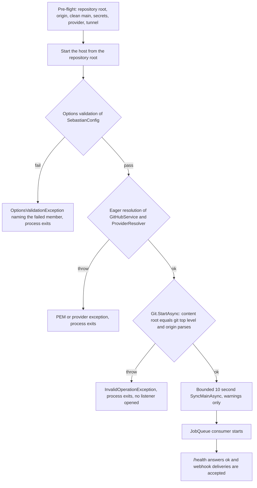

# Running, Configuration, and Deployment

Sebastian is one long-lived process, started by hand on a machine that stays up, pointed at one clone of one repository. There is no installer, no container image, no systemd unit, no Helm chart, and no deploy pipeline in this repository — the only workflow under `.github/workflows` is a documentation job (see [the scheduled OpenWiki workflow](#the-scheduled-openwiki-workflow-is-documentation-only)). Everything an operator needs to supply is therefore either **configuration**, **a git checkout in a specific shape**, or **a process supervisor** they choose themselves.

This page is the operational view: what to check before starting, what the process tells you when a check fails, how deliveries reach it from GitHub, what it writes to disk, and what you must not delete.



The operator-visible startup path, in the order the gates fire. Every failure above `/health` is a process that never accepts a delivery.

## Pre-flight checklist

Each row is enforced by code, so a missing item is not a matter of opinion. The right-hand column is what the process does about it — either at startup (recoverable by restarting correctly) or per job (silent from GitHub's point of view).

| Prerequisite | Why the code needs it | If it is wrong |
| --- | --- | --- |
| `git` on `PATH` | `Git` shells out to a real `git` binary for every repository operation; the runner sets `GIT_TERMINAL_PROMPT=0` so credential prompts fail fast instead of hanging | every git call throws; the host fails in `Git.StartAsync`, or every job fails |
| Start from the repository root | the content root must equal `git rev-parse --show-toplevel`; all later paths derive from it | `InvalidOperationException`: `Sebastian must run from the repository root. Content root is '<path>', git root is '<path>'.` |
| Remote named `origin`, `owner/repo`-shaped | `origin`'s URL is parsed into `RepositoryIdentity` and cross-checked against every issue event | `git remote get-url origin failed: <stderr>` or `Could not parse the origin remote URL.` |
| `origin` is the repository the GitHub App serves | `PrepareWorkspaceAsync` rejects an issue whose repository does not match the parsed origin | `Issue repository '<owner>/<repo>' does not match local origin '<owner>/<repo>'.` — every job fails |
| Read access to `origin` | the mirror is fast-forwarded from `origin/main` at startup and per job; nothing is ever pushed | fetch fails; startup only warns, jobs fail at preparation |
| `main` checked out locally | `Git.BaseBranch`/`Git.BaseRef` are hardcoded to `main`; any other default branch needs a code change | `Local main is not checked out (current branch: '<branch>'). Run Sebastian from main.` |
| No tracked changes in `main` | the mirror is treated as read-only; agent work happens in worktrees | `Local main has uncommitted tracked changes. Commit or stash them, or move them to a branch.` |
| No local-only commits on `main` | the base must be the reviewed `origin/main`, and there is no merge strategy | `Local main has <n> commit(s) not on origin/main. Move them to a branch: git branch wip/local && git reset --hard origin/main` |
| `GitHub:AppId` ≥ 1 | used by the installation token provider; `[Range(1, int.MaxValue)]` | validation failure (an absent value binds to `0`) |
| `GitHub:InstallationId` | string-valued in the token provider — configure it as a string, not a number | validation failure when blank |
| `GitHub:PrivateKeyPath` | a **path** to the App's private key PEM; it is read with `File.ReadAllText` and imported with `ImportFromPem` | file or crypto exception during eager resolution |
| `GitHub:WebhookSecret` | the HMAC verification secret passed to `MapGitHubWebhooks`; the entire trust boundary | validation failure when blank; a mismatch later rejects every delivery |
| At least one provider with `ApiKey` | `ProviderResolver` refuses an empty list, and `ApiKey` is `[Required]` (whitespace rejected) | `At least one agent provider must be configured.` at startup |
| `Agent:General:Provider` names a configured provider | selection is case-insensitive by `Name`; duplicate names are rejected | `Agent provider '<name>' is not configured.` or `Agent provider '<name>' is configured more than once.` |
| `Agent:General:Model` | passed unchanged to `GetChatClient`; never validated against the endpoint | startup succeeds; the first job fails |
| A publicly reachable webhook URL | GitHub must be able to POST deliveries; the PRD's first decision is "webhook + tunnel", with the PC and the tunnel up 24/7 and signatures mandatory | deliveries never arrive; nothing in the log says so |

Two of these are only *shape*-checked at startup. The App id / installation id / private key combination is exercised for the first time on the first GitHub REST call, and the API key and model id for the first time inside the first agent run — see [Why `/health` cannot be a readiness check](#health-is-liveness-not-readiness).

## Configuration: one bound tree, supplied from the environment

Configuration is a single options object, `SebastianConfig`, bound with `.Bind(builder.Configuration).ValidateOnStart()` and validated by a source-generated validator built from DataAnnotations attributes on the tree. The property names *are* the keys, so the key tree is fixed at compile time:

| Key path | Rule |
| --- | --- |
| `GitHub:WebhookSecret` | `[Required]` string |
| `GitHub:AppId` | `int`, `[Range(1, int.MaxValue)]` |
| `GitHub:PrivateKeyPath` | `[Required]` string — a path, never key material |
| `GitHub:InstallationId` | `[Required]` string |
| `Agent:Name` | `[Required]` string — the agent's display name |
| `Agent:General:Provider` | `[Required]` string, matched case-insensitively against provider names |
| `Agent:General:Model` | `[Required]` string |
| `Agent:Providers:<index>:Name` | `[Required]`, unique case-insensitively |
| `Agent:Providers:<index>:Endpoint` | optional, must be an absolute URI, defaults to `https://api.openai.com/v1` |
| `Agent:Providers:<index>:ApiKey` | `[Required]` |

Nested sections carry `[ValidateObjectMembers]` and the provider list carries `[ValidateEnumeratedItems]`, so a missing section or a bad list element is reported as a validation failure on the parent rather than surfacing as a null dereference later.

**How to supply it.** The host uses the stock `WebApplication.CreateBuilder(args)` stack. This repository commits **no `appsettings.json`**, no `appsettings.{Environment}.json`, and no `launchSettings.json`, so the values must arrive as environment variables, user secrets, or command-line arguments. Environment variables use `__` as the section separator and a numeric segment for list indices:

```
# Derived from the binding tree in src/Configuration/SebastianConfig.cs.
# No settings file exists in this repository; supply these in the process environment
# (or user secrets / command line) before starting the host.
GitHub__WebhookSecret=<hmac-secret>
GitHub__AppId=<app-id>
GitHub__PrivateKeyPath=<absolute-or-relative-path-to-pem>
GitHub__InstallationId=<installation-id-as-string>
Agent__Name=Sebastian
Agent__General__Provider=<provider-name>
Agent__General__Model=<model-id>
Agent__Providers__0__Name=<provider-name>
Agent__Providers__0__ApiKey=<api-key>
Agent__Providers__0__Endpoint=<https://host/v1>
```

That block is illustrative of the key shape only — nothing in the repository enumerates variable names. Two operational consequences are worth stating plainly:

- **A `.env` file does nothing.** `.gitignore` lists `.env` and `.env.*` (allowing `.env.example` back in), but no env-file package is referenced and nothing in code loads one. Values must actually be present in the process environment.
- **Key material is ignored by extension**, not by directory: `*.pem`, `*.key`, `*.pfx`, `*.p12`, `*.snk`, `*.user`, plus `appsettings.Development.json`. That is exactly why `GitHub:PrivateKeyPath` is a path rather than an inline key.
- **Configuration is frozen for the process lifetime.** Nothing injects `IOptionsMonitor<T>` or `IOptionsSnapshot<T>`, and the webhook secret is read once at composition time. Changing any value, including the secret, requires a restart; a running process keeps verifying against the value it started with.

Add a new setting as a three-part change: a bindable property on the tree, a validation attribute if it is mandatory, and a consumer that reads it from `IOptions<SebastianConfig>`. Do not introduce a second options type bound by reflection — the project publishes AOT and relies on the generated binder.

## Startup sequence and what a failed start looks like

The order is not cosmetic: each gate runs before the previous one's consumer can observe anything, and the process only reaches `app.RunAsync()` — which is what opens the listener — after every gate has passed.

1. **Options validation.** `ValidateOnStart()` is registered, and `Program.cs` additionally reads `IOptions<SebastianConfig>.Value` immediately after `Build()`, so validation runs before any hosted service. A blank required member or an `AppId` below 1 produces an `OptionsValidationException` that names the failed member(s) — there is no partial start.
2. **Eager credential resolution.** Two lines resolve `GitHubService` and `ProviderResolver` before endpoints are mapped, with the comment *"Construct the services now so missing credentials fail at startup."* Both validate by construction: `GitHubService` reads and imports the PEM and builds the token provider; `ProviderResolver` admits the provider list, selects one entry, and parses the endpoint.
3. **Repository identity.** `Git.StartAsync` runs as the first hosted service and enforces the clone's shape. These checks are not cancellable — they are called with `CancellationToken.None` — so a hanging `git` here blocks startup with no timeout.
4. **Bounded mirror sync.** `git fetch --prune origin`, the mirror guards, and a `merge --ff-only origin/main` under a linked token cancelled after ten seconds.
5. **Queue and endpoints.** `JobQueue` starts consuming the channel; `app.RunAsync()` binds and serves `/health` plus the webhook route.

Failure messages an operator will actually see, verbatim from the code:

| Symptom | Source | Timing |
| --- | --- | --- |
| `OptionsValidationException` naming the member (blank `WebhookSecret`, `PrivateKeyPath`, `InstallationId`, `Name`, `Provider`, `Model`, provider `Name`/`ApiKey`; `AppId` < 1) | generated `ValidateSebastianConfig` | before any hosted service |
| File-system exception from `File.ReadAllText` at `PrivateKeyPath` | `GitHubService` constructor | eager resolution |
| `CryptographicException` from `ImportFromPem` on a non-RSA / malformed PEM | `GitHubService` constructor | eager resolution |
| `At least one agent provider must be configured.` | `ProviderResolver` constructor | eager resolution |
| `Agent provider '<name>' is configured more than once.` | `ProviderResolver` constructor | eager resolution |
| `Agent provider '<name>' is not configured.` | `ProviderResolver` constructor | eager resolution |
| `Agent provider '<name>' has an invalid endpoint.` | `ProviderResolver` constructor | eager resolution |
| `Sebastian must run from the repository root. Content root is '<path>', git root is '<path>'.` | `Git.EnsureRepositoryAsync` | hosted service start |
| `git remote get-url origin failed: <stderr>` | the generic git command runner | hosted service start |
| `Could not parse the origin remote URL.` | `Git.EnsureRepositoryAsync` + `RepositoryIdentity.Parse` | hosted service start |

Note the asymmetry between step 1 and the rest: validation failures are reported as one aggregated options error, while every other gate is a raw exception that ends the process. Both look the same from outside — a non-zero exit and a stack trace on stderr with no listener — and both require fixing the configuration or the checkout and starting again. The composition-level reasoning behind the ordering lives in [Startup, Composition, and Configuration Binding](../architecture/startup-and-composition.md); the provider rules are in [Model Provider Resolution](../concepts/model-providers.md) and the credential chain in [GitHub App Authentication and Issue Writes](../integrations/github-app-client.md).

### What a successful start does *not* guarantee

The ten-second startup sync is deliberately best-effort: `SyncMainAsync` catches its own failures and only logs them, because a missed push delivery must never prevent boot. A host that starts cleanly can therefore still be wrong in three ways that matter operationally:

- **Stale mirror.** If the sync was skipped (dirty `main`, wrong branch, local commits) you get `Skipped local main sync: <reason>` at **Warning**. If the fetch or fast-forward failed you get `Local main sync failed` at **Warning**. If the ten-second bound fired or the host was shutting down, you get `Local main sync cancelled` at **Debug** — invisible at the default log level. A truncated sync and a clean one look identical.
- **Every job rejected.** The same three mirror guards are re-run per job in `PrepareWorkspaceAsync`, and there they *throw* instead of warning. So `main` left dirty after startup keeps the process healthy while failing every job.
- **Unproven credentials.** Nothing contacts GitHub or the model endpoint during startup.

## `/health` is liveness, not readiness

```csharp
app.MapGet("/health", () => "ok");
```

The endpoint returns a constant. It does not inspect the mirror's freshness, the queue depth, the number of in-flight jobs, whether the last sync succeeded, or whether either credential chain actually works. Its only meaningful signal is "the process is up far enough to serve HTTP" — which, because of the fail-fast gates, does mean configuration validated and the repository shape was accepted at start.

Treat it accordingly: point a supervisor's liveness probe at `/health`, do **not** treat it as proof that the agent can work. Concretely, all of the following can be true while `/health` returns `ok`:

- the mirror is stale because the startup sync was truncated or skipped;
- `main` is dirty or on the wrong branch, so every job fails at preparation;
- the App id / installation id / PEM combination does not authorize anything (the first proof is the first GitHub REST call, made only when an invalid-spec issue is commented and closed);
- the API key or model id is wrong (proof arrives inside the first agent run);
- the public tunnel is up but pointed at the wrong port, so no delivery ever arrives.

There is no readiness endpoint, no metrics endpoint, and no dashboard; the log and GitHub itself are the only observability surfaces.

## Bringing it up: a verification sequence

Each step below is checkable against a log line or a GitHub effect, without inventing any tooling that the repository does not have.

1. **Check the checkout before starting.** `git rev-parse --show-toplevel` must print the directory you will run from; `git remote -v` must show `origin`; `git branch --show-current` must print `main`; `git status --porcelain --untracked-files=no` must be empty; `git rev-list --count origin/main..main` must be `0`. `.sebastian/` being present and untracked is fine — the dirty check deliberately ignores untracked files.
2. **Start the host with the working directory set to that root**, with the configuration present in its environment.
3. **Confirm the identity line** `Using repository {owner}/{repository} on main` at Information. Its absence means step 3 of the sequence above (repository identity) did not complete.
4. **Confirm mirror state.** Either `Local main already matches origin/main` or `Fast-forwarded local main from <before> to <after>`. A `Skipped local main sync: …` or `Local main sync failed` warning means the host is up on a mirror you should inspect by hand.
5. **Confirm liveness** by requesting `/health` through the same public URL the webhook will use — that single check verifies the tunnel and the port mapping at once.
6. **Smoke-test intake** with a `feature`-labeled issue whose body is missing required sections. Correct behavior is a comment listing the missing sections, the issue closed as `not_planned`, and `Webhook {EventType} ({Event})` in the log. This also proves the GitHub App credentials, because the comment and close are the first REST calls the process makes. The spec contract itself belongs to [Issue Spec Contract and Validation Gate](../concepts/spec-validation.md).
7. **Smoke-test the agent path** by adding `ready-for-agent` to a complete feature issue, then watching `Started implementation for {Repository}#{Number}` (Information) and `Implementation completed for {Repository}#{IssueNumber} at {Path}. Git status: {Status}. Agent response: {Response}` (Information). A `Job {Key} failed` line at **Error** with no comment on the issue is the agent-path failure signature; see [Failure Handling, Restart Behavior, and Known Races](failure-handling.md).

## Webhook delivery through a public tunnel

Sebastian has no authentication middleware. The webhook endpoint is anonymous, and every delivery is verified against the HMAC secret passed to `MapGitHubWebhooks(secret: config.GitHub.WebhookSecret)` before the processor runs. The secret is the entire trust boundary; a wrong signature is rejected by the endpoint middleware and never reaches Sebastian's own logging.

Operationally that means:

- **The process must be reachable from the internet.** The PRD's first decision is webhook + tunnel, on the explicit condition that the machine and the tunnel stay up around the clock with signature verification mandatory. There is no polling, no scheduled reconciliation, and no fallback transport in the code.
- **The route path is not defined here.** `MapGitHubWebhooks` is called with only the secret, so the path is whatever the `Octokit.Webhooks.AspNetCore` library maps. Read the library (or its documentation) to configure the App's webhook URL; the repository contains no route template to copy. Also note that no listening address (`UseUrls`, a Kestrel endpoint, or a launch profile) is configured anywhere, so the port comes from the standard ASP.NET Core hosting configuration for that environment.
- **Subscribe the App to at least `issues` and `push`.** Those are the only two handlers the processor overrides; `push` is what keeps the mirror fresh between restarts, and `issues` is the only trigger for agent work.
- **A failed delivery is retried by GitHub, not by Sebastian.** Intake has no `try`/`catch` and no idempotency: a comment that succeeds followed by a close that fails leaves an open issue carrying a "Closed: …" comment, and a redelivery posts a second identical comment. Any exception on the intake path makes the delivery fail.
- **Webhook latency is design-relevant.** Push deliveries run `git fetch` and a possible fast-forward synchronously inside the request, so a slow remote shows up as a slow delivery.
- **Changing the secret requires a restart**, since it is captured at composition time.

Delivery routing and the label gates are documented in [Webhook Intake and Event Routing](../integrations/github-webhooks.md).

## Runtime state on disk

The process owns two kinds of filesystem state inside the clone, and only one of them is durable output.

```
<repository root>/                     # must equal git rev-parse --show-toplevel
├── .git/                              # the clone's object store and refs
├── main working tree                  # the read-only mirror, fast-forwarded to origin/main
└── .sebastian/
    └── workspaces/
        └── <issueNumber>/             # one git worktree per issue, branch sebastian/issue-<n>
```

| Path | What it is | Survives restart | Safe to delete |
| --- | --- | --- | --- |
| `.git/` + `main` working tree | the single clone; `main` is only ever fast-forwarded to `origin/main` | yes | no |
| `.sebastian/workspaces/<issueNumber>` | a git worktree on branch `sebastian/issue-<n>`, created with `git worktree add -B <branch> <path> main` and **reused in place** on later runs | yes | **only if you accept losing the agent's work** |
| `.sebastian/workspaces` itself | created on demand by `Directory.CreateDirectory`; nothing pre-creates it | yes | yes, regenerated |

The layout is `Path.Combine(git.Root, ".sebastian", "workspaces")` plus the invariant-culture issue number, and `.gitignore` lists `.sebastian/` so the whole tree stays out of the mirror and out of the dirty-check (which uses `--untracked-files=no`). Each worktree is a full checkout of the files but shares the object store with the clone, so its incremental disk cost is the working files plus whatever the agent created — which for a build-heavy run includes restore and build output.

**The deletion rule is the one operational fact that cannot be recovered.** Nothing in the pipeline commits, pushes, or opens a pull request: a run's product is the uncommitted state of that worktree, reported through `git -C <worktree> status --short` and written into the completion log line. Deleting `.sebastian/workspaces/<issue>` therefore destroys the only copy of that work — there is no git history to restore it from. The same rule in the other direction: because an existing worktree is returned untouched, removing the directory is also the only supported way to reset a run that is stuck on a stale base.

Other ignored paths an operator may want to know about: `bin/`, `obj/`, `tests/**/bin`, `tests/**/obj`, and `.archify/` (design-time). Restart, shutdown, and reuse semantics are covered in detail in [Failure Handling, Restart Behavior, and Known Races](failure-handling.md) and [Git Mirror and Worktree Model](../concepts/git-workspaces.md).

## Logs to watch

Logging is source-generated (`[LoggerMessage]`) and configured by nothing in this repository — no logging section, no sinks, no file target. The default host logging therefore writes to the console, which means process stdout captured by your supervisor is the log file. At the default `Information` level these are the lines that matter:

| Level | Line | Meaning |
| --- | --- | --- |
| Information | `Using repository {Owner}/{Repository} on {BaseBranch}` | identity gate passed; `origin` parsed |
| Information | `Syncing local main from origin` | startup or push-delivery sync started |
| Information | `Local {BaseBranch} already matches {BaseRef}` | mirror was already current |
| Information | `Fast-forwarded local {BaseBranch} from {Before} to {After}` | mirror moved; `{Before}`/`{After}` are the audit trail |
| Warning | `Skipped local main sync: {Reason}` | mirror unusable; host still serving |
| Warning | `Local main sync failed` (with exception) | fetch or fast-forward failed |
| Information | `Webhook {EventType} ({Event})` | one line per accepted delivery, before any filtering |
| Information | `Push {RefName} on {Repository}: {Before} -> {After}` | push delivery received |
| Information | `Started implementation for {Repository}#{Number}` | job admitted to the queue |
| Information | `Implementation completed for {Repository}#{IssueNumber} at {Path}. Git status: {Status}. Agent response: {Response}` | the run's only artifact record |
| Error | `Job {Key} failed` (with exception) | a job died; no retry, and nothing is written to the issue |

Three lines are **Debug** and therefore invisible at default verbosity, which is worth remembering before concluding that an event was ignored: `Local main sync cancelled` (a truncated startup sync), `Implementation already running for {Repository}#{Number}` (a duplicate delivery dropped rather than queued), and `Issue {Repository}#{Number} closed; missing spec sections: {Sections}` (an invalid spec closed without any Information-level trace). Raising verbosity is a configuration change on the default host logging stack (the standard `Logging:*` keys, e.g. `Logging__LogLevel__Default=Debug` in the environment) — no such section is committed here.

## Concurrency and resource limits

Useful when sizing a machine or diagnosing a stall:

| Limit | Value | Where |
| --- | --- | --- |
| Concurrent jobs | 10 (`MaxConcurrentJobs`) | `JobQueue` |
| Mirror + worktree preparation | strictly serialized process-wide by a `static SemaphoreSlim` | `ImplementSpec.PrepareLock` |
| Startup mirror sync | 10 seconds, then abandoned | `Git.StartAsync` |
| Per-shell-command timeout inside a run | 10 minutes | `ImplementationAgent.CommandTimeout` |
| Shell working directory | confined to the issue worktree, clean environment | `LocalShellExecutorOptions` |
| Job queue capacity | unbounded channel; `TryAdd` fails only on duplicate key or shutdown | `JobQueue` |

Ten jobs can be running agents at once, but only one of them can be fetching, fast-forwarding, or creating a worktree at any moment; the rest queue on `PrepareLock`. Because the semaphore is `static`, running two Sebastian processes against one clone gives you two semaphores and one git index — do not.

## Build and publish posture

`Sebastian.csproj` is the deployment contract, and it is stricter than a typical web project:

- `PublishAot` with `IlcOptimizationPreference=Size` — the supported artifact is a native AOT binary. That also switches on the trim/AOT analyzers, so reflection-based patterns are build errors rather than runtime surprises.
- `EnableConfigurationBindingGenerator` — configuration binding is source-generated because reflection binding is not AOT-safe; the properties carry `= null!;` initializers instead of `required` for the same reason (a generated binder needs non-required settable members).
- `InvariantGlobalization` — no globalization data is needed at runtime, and culture-invariant behavior is assumed (the code formats issue numbers with `CultureInfo.InvariantCulture`).
- `TreatWarningsAsErrors`, `AnalysisLevel=latest-all`, `EnforceCodeStyleInBuild` — any new analyzer or style diagnostic fails the build. There is no "just ship it" path.
- `DefaultItemExcludes=…;tests/**` — the web project never compiles `tests/**`; the test project is a separate, deliberately less strict project, so publishing does not validate or run tests.

No publish command is documented in the repository. Publishing natively follows from the project file rather than from a script here: `PublishAot` applies at publish time and the SDK requires a runtime identifier, so a release build looks like the following (derived from `Sebastian.csproj`, not from any committed pipeline):

```bash
dotnet publish Sebastian.csproj -c Release -r <rid>
```

A native AOT publish additionally needs a C toolchain and linker for the target platform on the publishing machine. The resulting binary still needs `git` on `PATH`, read access to `origin`, outbound HTTPS to the GitHub REST API, and outbound HTTPS to the configured provider endpoint.

## The scheduled OpenWiki workflow is documentation only

`.github/workflows/openwiki-update.yml` runs daily at `08:00` UTC and on `workflow_dispatch`. It checks out with `fetch-depth: 0`, installs a pinned `openwiki` CLI, runs `openwiki code --update --print` against an OpenAI-compatible provider, deletes transient run state, and opens a pull request on branch `openwiki/update` limited to `openwiki`, `AGENTS.md`, the workflow file itself, and `CLAUDE.md` when present. It has `contents: write` and `pull-requests: write` permissions.

It is **not part of running Sebastian** and is not a deployment path: it never builds, tests, or publishes this application, never touches the running host, and fails the job only to propagate an OpenWiki documentation failure. Its secrets (`OPENAI_COMPATIBLE_API_KEY`, `OPENWIKI_LANGSMITH_API_KEY`, `LANGSMITH_API_KEY`) are documentation-tooling credentials and are unrelated to `GitHub:*` or `Agent:*` configuration. Treat a red run as a wiki-progress signal, not as a service alert — and note that the workflow intentionally opens a PR even when the documentation run failed part-way.

## Related pages

- [Startup, Composition, and Configuration Binding](../architecture/startup-and-composition.md) — the composition root, binding mechanics, and the fail-fast contract in full.
- [Model Provider Resolution](../concepts/model-providers.md) — every provider-list rule and why the chat client is built per job.
- [GitHub App Authentication and Issue Writes](../integrations/github-app-client.md) — what the App id, installation id, and PEM are used for, and the only two writes the system makes.
- [Webhook Intake and Event Routing](../integrations/github-webhooks.md) — delivery verification, label gates, and in-request latency.
- [Git Mirror and Worktree Model](../concepts/git-workspaces.md) — the mirror guards, `PrepareLock`, and worktree lifecycle.
- [Failure Handling, Restart Behavior, and Known Races](failure-handling.md) — blast radius of each failure, what a restart destroys, and the accepted races.
