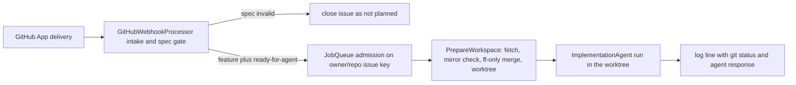

# Sebastian Wiki Quickstart

Sebastian is a self-hosted ASP.NET Core service (`net10.0`, AOT-published) that turns GitHub issue events into agent work on one local clone of one repository. There is no dashboard, no database, and no scheduler: everything it remembers between deliveries lives in git, in GitHub (labels, issue body, comments), and in the untracked `.sebastian/` folder.

**Source and tests are authoritative; these OpenWiki pages are generated context.** `AGENTS.md` says the same thing to coding agents: the wiki is optional just-in-time context, and a brief's "unknowns" are verification gaps, not requirements. When a page and the code disagree, the code wins — and the page is what needs fixing.



The one path that matters: intake decides, the queue admits and dedupes, workspace prep produces a directory, the agent edits it.

## The one path that matters

Four hops, four owners, and each hop is the only place its decision is made:

1. **Intake** — `src/Webhooks/GitHubWebhookProcessor.cs`. Filters issue actions, requires an open issue labeled `feature`, runs `SpecTemplateValidator`, and either posts a comment plus closes the issue or hands an `ImplementSpec` job to the queue. Push events skip the queue entirely and call `git.SyncMainAsync` inline.
2. **Admission** — `src/Jobs/JobQueue.cs` over the `IJob` contract in `src/Jobs/IJob.cs`. An unbounded channel, an in-flight key (`{owner}/{repository}#{issueNumber}`) that suppresses duplicate work, `MaxConcurrentJobs = 10`, and one DI scope per job.
3. **Workspace** — `Git` (`src/Libs/Git.cs`) executes the commands; `ImplementSpec.PrepareWorkspaceAsync` holds all the policy: fetch `origin`, refuse a dirty/ahead/not-on-`main` mirror, fast-forward, then create or reuse `.sebastian/workspaces/<issue>` on branch `sebastian/issue-<n>`.
4. **Agent** — `src/Agent/Roles/ImplementationAgent.cs` declares capabilities (one confined shell tool, a regex deny-list, a 10-minute timeout, no web search); `ImplementSpec.BuildPrompt` declares what this one run must do. The run's only product is uncommitted files in the worktree plus a log line — nothing is committed, pushed, or turned into a PR.

## Route by task

Read the row that matches what you are changing. Each page is the single place that behavior is described in depth.

| If you are… | Open | Why that page matters |
| --- | --- | --- |
| Getting oriented in the runtime shape | [System Overview and Runtime Topology](architecture/overview.md) | Maps the two HTTP endpoints, the two hosted services, the singleton collaborators, and who owns each domain. |
| Changing webhook behavior — which events, actions, labels, or repository checks count | [Webhook Intake and Event Routing](integrations/github-webhooks.md) | The intake filters, the exact guards in order, and the inline push-sync decision that makes webhook latency a design constraint. |
| Changing the spec contract an issue must satisfy | [Issue Spec Contract and Validation Gate](concepts/spec-validation.md) | The seven required markdown sections, the empty-section rules, and the close-with-comment terminal outcome. |
| Changing what the agent does — instructions, prompt, tools, sandbox | [Agent Roles, Tools, and Sandbox Boundaries](concepts/agent-execution.md) and [Workflow: Feature Issue to Agent Workspace](workflows/feature-implementation.md) | The first splits capability from instruction (role config versus per-run prompt); the second shows the prompt in the context of the whole trace. |
| Tracing one issue end to end, or debugging why a delivery did nothing | [Workflow: Feature Issue to Agent Workspace](workflows/feature-implementation.md) | Every hop's branch — silently dropped, closed, dormant awaiting a label, deduped, or enqueued — and what state survives each one. |
| Changing git or workspace behavior — mirror sync, worktrees, branches | [Git Mirror and Worktree Model](concepts/git-workspaces.md) | The content-root-equals-toplevel invariant, `FindMirrorProblemAsync`'s guards and messages, the static `PrepareLock`, and worktree reuse. |
| Changing queueing — concurrency, dedupe, cancellation, shutdown | [Job Queue and Execution Semantics](concepts/job-queue.md) | Why `TryAdd` and the consumer must be the same object, what the in-flight key costs, and what `StopAsync` does to queued versus running jobs. |
| Changing settings or startup wiring | [Startup, Composition, and Configuration Binding](architecture/startup-and-composition.md) | Options binding plus the source-generated validator, the singleton factories that share one instance with each hosted service, and what fails at startup versus on the first job. |
| Selecting a model or adding a provider | [Model Provider Resolution](concepts/model-providers.md) | How `Agent.Providers` is validated, how `Agent.General.Provider`/`Model` produce the `IChatClient`, and the default endpoint. |
| Changing GitHub writes or authentication | [GitHub App Authentication and Issue Writes](integrations/github-app-client.md) | The only two write operations the system performs (comment, close as `not_planned`) and the RSA/PEM installation-token setup behind them. |
| Working out whether a behavior is implemented or still intended | [Product Intent vs. Implemented Behavior](concepts/product-intent-and-gaps.md) | Reconciles `docs/PRD.md`'s triage and `ready-for-agent` gates with the narrower intake the code actually enforces, before you "fix" a missing stage. |
| Supporting a running instance or reading logs | [Running, Configuration, and Deployment](operations/running-and-deployment.md) | Pre-flight prerequisites enforced by code, the configuration key tree, the public tunnel, `/health` as liveness only, and the on-disk layout. |
| Diagnosing a failure, a restart, or a suspected race | [Failure Handling, Restart Behavior, and Known Races](operations/failure-handling.md) | Each failure path with its blast radius — bounded startup sync, swallowed sync exceptions, job-level isolation, worktree reuse, the documented `index.lock` race. |
| Adding or extending tests | [Testing Strategy and Harness](testing/test-strategy.md) | What the xunit suite pins, the `TestRepository` real-git fixture, the internal-visibility seam, and the large areas with no coverage. |
| Making a change that must pass review | [Code Conventions and Build Constraints](concepts/codebase-conventions.md) | Warnings-as-errors with `latest-all` analyzers, AOT safety, the experimental-API pragmas, internal-by-default types, and source-generated logging. |

## Before you touch anything

Two invariants explain most of the surprises in this codebase:

- **It is one process for one repository.** Sebastian must start from the root of the clone it serves, `origin` must parse to the `owner/repo` its GitHub App is installed on, and an issue event for any other repository fails instead of being redirected. Local `main` is a read-only mirror — never a workspace.
- **Nothing in the process commits or pushes.** The git layer has no such primitive, the agent is instructed not to run git commands, and the HTTP surface is `/health` plus the webhook endpoint. Adding a third capability is an architectural change, not a configuration one.

## Verifying a change

There is no solution file and no test workflow. Build the product and the suite separately:

```bash
dotnet build Sebastian.csproj
dotnet test tests/Sebastian.Tests/Sebastian.Tests.csproj
```

The test project is a *less strict* compilation than the product (`tests/**` is excluded from the web project), so a clean `dotnet test` does not prove analyzer or AOT cleanliness — see [Code Conventions and Build Constraints](concepts/codebase-conventions.md) for what the product build enforces.
