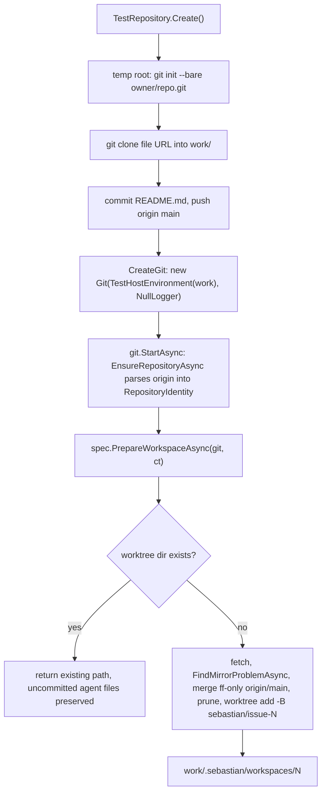

# Testing Strategy and Harness

The suite is one xunit project, `tests/Sebastian.Tests`, holding six test files and two helper types. It is not a mirror of the production tree: it covers the parts of Sebastian that can be exercised without a model provider, a GitHub installation, or an HTTP request, and it covers them from two very different angles — pure in-process unit tests, and four integration tests that shell out to a real `git` binary against a throwaway repository.

The most useful way to read this page is as a map of **where the regression net actually exists**. Several of the most change-prone files in the repository have no coverage at all, and the pages describing them say so; the summary is in [Coverage gaps](#coverage-gaps) below. Nothing here is enforced by automation: there is no test workflow, so `dotnet test` runs only when a developer runs it.

## The project and the two-project seam

`tests/Sebastian.Tests/Sebastian.Tests.csproj` is deliberately thin: `net10.0`, `ImplicitUsings`, `Nullable`, `IsPackable=false`, the xunit 2.9.3 stack plus `Microsoft.NET.Test.Sdk` and `coverlet.collector`, a global `<Using Include="Xunit" />` (which is why no test file has a `using Xunit;`), and a single `ProjectReference` to `..\..\Sebastian.csproj`. There is no solution file: `dotnet test tests/Sebastian.Tests/Sebastian.Tests.csproj` builds and runs the tests, and `dotnet build Sebastian.csproj` builds the product.

Two lines in the *product* project file are what make the suite possible:

```xml
<DefaultItemExcludes>$(DefaultItemExcludes);tests/**</DefaultItemExcludes>
...
<InternalsVisibleTo Include="Sebastian.Tests" />
```

`InternalsVisibleTo` is the reason every interesting type is `internal sealed` and stays that way. `Git`, `JobQueue`, `ProviderResolver`, `GitHubService`, `GitHubWebhookProcessor`, `ImplementSpec`, `AgentRole`, and `SpecTemplateValidator` are all invisible to a normal consumer, yet the tests construct them directly. Making a member `public` "so the tests can see it" is therefore the wrong move — the project file already grants access, and the [conventions page](../concepts/codebase-conventions.md) treats this as a hard rule.

The `DefaultItemExcludes` entry cuts the other way: the web project never compiles `tests/**`, so the test project is a *separate, less strict* compilation. It inherits none of `TreatWarningsAsErrors`, `AnalysisLevel=latest-all`, `PublishAot`, or `InvariantGlobalization`. Two practical consequences:

- A new analyzer diagnostic that fails the product build can pass in `tests/` — worth fixing anyway, but it will not be the thing that stops you.
- AOT-cleanliness of test code is never analyzed. Test code may use reflection freely; product code may not.

Test classes are `public sealed` (xunit discovers them by reflection) while the two helper types are `internal sealed` — the inverse of the production convention, which is exactly the internal-by-default rule relaxed only where a framework requires it.

## Test-only seams

Five seams exist, and every test in the suite is built out of some combination of them. They are worth naming because each one is a design decision in the *product* code that exists for testability, and removing one silently costs coverage.

| Seam | Where it lives | What it buys |
| --- | --- | --- |
| `InternalsVisibleTo` | `Sebastian.csproj` | tests can construct internal singletons and call internal members with no interface extraction |
| `TestHostEnvironment : IHostEnvironment` | test helper | `Git` needs only `ContentRootPath`; the fake supplies it and a `NullFileProvider` |
| `TestRepository` | test helper | a real, offline git fixture: bare `origin`, clone, seeded commit, `Git` factory |
| `Options.Create(config)` | `Microsoft.Extensions.Options` | config-shaped services are constructed with an in-memory `SebastianConfig`, no binder, no `appsettings.json` |
| `internal` seams on members | `AgentRole.CreateOptions`, `ImplementSpec.PrepareWorkspaceAsync` | the option graph and the workspace policy can be asserted without an agent, a chat client, or a session |

### `TestHostEnvironment`

```csharp
internal sealed class TestHostEnvironment(string contentRootPath) : IHostEnvironment
{
    public string EnvironmentName { get; set; } = Environments.Development;
    public string ApplicationName { get; set; } = "Sebastian.Tests";
    public string ContentRootPath { get; set; } = contentRootPath;
    public IFileProvider ContentRootFileProvider { get; set; } = new NullFileProvider();
}
```

It exists for one reason: `Git`'s constructor reads `environment.ContentRootPath` and nothing else. `Git` never reads files through `ContentRootFileProvider`, so `NullFileProvider` is honest rather than a stub — nothing would work if it were read. This is the whole reason `Git` can be pointed at a temporary clone instead of the running process's own checkout.

### `Options.Create` config builders

Configuration is asserted through in-memory objects, never through the binder. `ProviderResolverTests` builds a `SebastianConfig` by hand and passes `Options.Create(config)` into the resolver's constructor. The builder sets `GitHub = null!` on purpose — the resolver only reads `Agent`, so no PEM file or App credentials are needed. The one test that *does* validate the whole tree (`BlankApiKeyIsRejectedByGeneratedValidator`) fills in the complete `GitHubConfig` first, because the generated `ValidateSebastianConfig` walks `[ValidateObjectMembers]` and would report a missing `GitHub` section instead of the blank API key under test.

This pattern is the template for any new config test: construct the smallest object graph the code under test reads, fill the rest only when the validator is the subject. See [Model Provider Resolution](../concepts/model-providers.md) for what each of those assertions protects.

### `PrepareWorkspaceAsync` driven directly

`ImplementSpec.RunAsync` reads four services (including `ProviderResolver`), builds an agent, opens a session, and runs a model turn. None of that is testable offline. So `PrepareWorkspaceAsync` is `internal` rather than `private`, and `ImplementSpecTests` calls it directly:

```csharp
using var repository = TestRepository.Create();
var git = repository.CreateGit();
await git.StartAsync(CancellationToken.None);
var spec = new ImplementSpec("owner", "repo", 1, "First", "Body");

var first = await spec.PrepareWorkspaceAsync(git, CancellationToken.None);
```

All the git policy — repository identity check, fetch, mirror guards, fast-forward, worktree reuse or creation — is exercised; the agent half is not. The same idea appears in `AgentRoleTests`, where `internal HarnessAgentOptions CreateOptions()` lets a role's option graph be asserted with no `IChatClient` in sight. Both are documented as test seams in [Agent Roles, Tools, and Sandbox Boundaries](../concepts/agent-execution.md) and [Git Mirror and Worktree Model](../concepts/git-workspaces.md).

## The `TestRepository` fixture

`TestRepository` is the only non-trivial infrastructure in the test project, and it is a real git repository rather than a mock:

1. A root under `Path.GetTempPath()/sebastian-tests/<32-hex-guid>`.
2. `git init --bare --initial-branch=main` at `<root>/owner/repo.git`.
3. `git clone <file:// URL of that bare repo>` into `<root>/work`, then `user.name`/`user.email` set locally.
4. `README.md` written, committed, and pushed to `origin main`, so the clone starts clean and level with its remote.

`CreateGit()` then returns `new Git(new TestHostEnvironment(_work), NullLogger<Git>.Instance)`, and `Dispose()` clears `FileAttributes.Normal` on every file under the root before the recursive delete — git's object files are read-only, so the naive delete fails on Windows. `RunGit` throws `InvalidOperationException($"git {args} failed: {stderr}")` on a non-zero exit, which is how a broken fixture surfaces as a clear failure rather than a wrong assertion.



The fixture's lifecycle as seen from an `ImplementSpecTests` case: every step is real git, but the remote is a file URL.

Three properties of this fixture are load-bearing and easy to break by "tidying":

- **The origin path ends in `owner/repo.git`.** `RepositoryIdentity.Parse` takes the last two path segments of the URL, so a `file://` remote at `.../owner/repo.git` parses to `owner`/`repo`. That is why `new ImplementSpec("owner", "repo", …)` matches and `new ImplementSpec("other", "repo", …)` throws. Renaming the fixture directories to something tidier would silently turn `RejectsForeignRepository` into a test of nothing.
- **The remote is a `file://` URL, not `https://`.** Fetch, clone, and push all work with no network, so the suite is runnable offline and in a sandbox. `git` must still be on `PATH`.
- **Nothing points at the developer's checkout.** The bare repo, the clone, and the `.sebastian/workspaces` directories all live under the temp root, because `Git.Root` is the temp clone's content root. Running the suite cannot dirty the repository you are working in.

`git.StartAsync` is called in every `ImplementSpecTests` case, and it is not ceremonial: `EnsureRepositoryAsync` is the only thing that populates `Git.Repository`, and `PrepareWorkspaceAsync` treats a null `Repository` as "the hosted service has not started" and throws. Calling `StartAsync` also runs the best-effort bounded `SyncMainAsync` against the file remote, so the startup path's happy case is incidentally covered — but only the happy case.

## What each file pins

| File | Runtime needs | Invariant protected |
| --- | --- | --- |
| `Agent/ImplementSpecTests.cs` | real `git`, temp filesystem | workspace policy: reuse preserves uncommitted work, a removed worktree is recreated at the same path, dirty local `main` is refused, a foreign repository is refused |
| `Jobs/JobQueueTests.cs` | in-process only | queue contract: at most ten concurrent jobs, a throwing job does not stop the loop, a key is refused while its job runs and accepted again afterwards |
| `Libs/RepositoryIdentityTests.cs` | in-process only | remote URL parsing: four supported shapes (`https` with and without `.git`, scp-like `git@…:`, `ssh://`) and three that must return `null` |
| `GitHub/Issues/SpecTemplateValidatorTests.cs` | in-process only | spec gate: the seven required sections, with empty, `_No response_` and HTML-comment-only bodies all counting as missing |
| `Agent/ProviderResolverTests.cs` | in-process only, no network | fail-fast: empty provider list, duplicate names, and an unconfigured selected provider all throw with specific messages; a blank API key is rejected by the generated validator, not the constructor |
| `Agent/Roles/AgentRoleTests.cs` | in-process only | role wiring: `CreateOptions` applies `Configure`, and `ImplementationAgent` sets a file store with write tools enabled, one context provider, and exactly one tool |

A few of these deserve the mechanism rather than the label:

**`JobQueueTests` uses a real queue with an empty container.** `new JobQueue(new ServiceCollection().BuildServiceProvider(), NullLogger<JobQueue>.Instance)` — the provider exists only because the queue creates a scope per job; the local `TestJob` ignores the provider it receives. `TestJob` signals its `Completion` `TaskCompletionSource` in a `finally` inside `RunAsync`, which is what lets `ContinuesAfterJobFailure` await a *failed* job's completion without the exception propagating to the test. `RunsAtMostTenJobsConcurrently` submits twelve jobs whose bodies block on a shared `SemaphoreSlim` and asserts exactly ten have started before any are released — the only direct evidence that `MaxDegreeOfParallelism = 10` is an effective cap. See [Job Queue and Execution Semantics](../concepts/job-queue.md).

**`SpecTemplateValidatorTests` duplicates the section list on purpose.** It declares its own `RequiredSections` array rather than reading the validator's private one, so most edits to the production array break a test. That is useful but limited: it pins the validator against *itself*, not against `skills/to-spec/SKILL.md`, which the production file's "keep in sync" comment points at and no test reads. The parsing edges are also pinned: lowercase headings are accepted, CRLF line endings are accepted, `###` subheadings and unknown sections are ignored, and `Further Notes` is optional. What is not pinned is the multi-line HTML comment case, where only the opening `<!--` line is ignored. Details in [Issue Spec Contract and Validation Gate](../concepts/spec-validation.md).

**`AgentRoleTests` reaches into experimental API surface from the test project.** It carries the same `#pragma warning disable MAAI001` / `MEAI001` pair as the role files, because it touches `HarnessAgentOptions`, `FileAccessProviderOptions`, and `AIContextProviders` directly. Its `FakeRole : AgentRole` overrides `Configure` to prove the base class applies the override rather than duplicating a default, and the `ImplementationAgent` case constructs a real role against `Path.GetTempPath()` and disposes it with `await using` — which also asserts, indirectly, that construction allocates a shell that the role owns and releases.

**`ImplementSpecTests` covers the four policy branches inside `PrepareWorkspaceAsync` and nothing after it.** `RunAsync`'s remainder — provider resolution, session creation, the model turn, the `git status --short` read, and the completion log — has no test. `RejectsDirtyMain` and `RejectsForeignRepository` pin two of the three `FindMirrorProblemAsync` reasons; the "local `main` has commits not on `origin/main`" branch is not exercised, and neither is the "not on `main`" branch.

## Running the suite, and what it needs

- `git` on `PATH` for the four `ImplementSpecTests` cases. The fixture throws `"Could not start git."` if the binary is absent; the other test files do not touch git at all.
- A writable temp directory. Each `ImplementSpecTests` case creates a fresh repository and deletes it in `Dispose`, so a leaked directory under `sebastian-tests/` is itself a signal that a test failed mid-run.
- No network, no credentials, no `appsettings.json`, no PEM key, no GitHub App. Nothing in the suite contacts GitHub or a model endpoint.
- No ordering dependencies: each test creates its own fixture, and `ImplementSpec`'s static `PrepareLock` keeps concurrent preparation of the same process serialized even if xunit parallelizes across classes.

There is **no CI**. `.github/workflows/openwiki-update.yml` is the only workflow in the repository: it runs `openwiki code --update`, removes transient run state, and opens a documentation PR. It never builds, tests, or publishes Sebastian, and a red run means the wiki update failed, not that the code broke. Do not assume a test job exists; if the suite must gate changes, the workflow has to be added. (See [Running, Configuration, and Deployment](../operations/running-and-deployment.md) for what that workflow is and is not.)

## Coverage gaps

These are the places where a change has no regression net. They are stated explicitly because assuming coverage that does not exist is how a behavior gets broken silently.

| Area | Status | Why it matters |
| --- | --- | --- |
| `GitHubWebhookProcessor` | **no tests, no references** | every intake guard, the action list, the label comparisons, the ordering of spec validation before the `ready-for-agent` check, the exact comment text, the `not_planned` close, and the enqueue path rest on review alone |
| `GitHubService` / Octokit writes | **no tests, no references** | `PostCommentAsync` and `CloseIssueAsync`, the PEM import, the installation-token adapter, and the absence of retry are unverified |
| `Program.cs` / composition | **no `WebApplicationFactory`, no integration test** | nothing would fail if the eager-resolution block, a two-descriptor hosted-service factory, or the `WebhookEventProcessor` registration were removed |
| Agent runs | **no test starts an agent** | the prompt, the shell deny-list, the file-store rooting, tool approval, and `RunAsync`'s completion path are unexercised; no test ever creates a `HarnessAgent` |
| `Git.SyncMainAsync` | **no test at all** | the ref filter, the behind-count short-circuit, the swallow-on-failure behavior, and the ten-second bound are unexercised — this is the least-protected production code in the repository |
| `JobQueue` shutdown | **not covered** | admission refused after `StopAsync`, abandonment of buffered jobs, and both `OperationCanceledException` filters are unverified |
| Spec gate edges | **partially covered** | multi-line HTML comments and fenced code blocks can satisfy a section the validator should reject |
| Skill/template drift | **not covered** | nothing reads `skills/to-spec/SKILL.md`, so a renamed heading there breaks intake with no build failure |

Two adjacent gaps are worth calling out because they are *seams that exist but are unused* rather than missing abstractions:

- **`TestRepository` is half-used.** `LocalHead`, `RemoteHead`, `RemoteTrackingHead`, `CloneAgain`, `CommitFile`, and `HeadAt` are exposed but referenced by no test — only `RunGit` is used from outside the fixture (to force-remove a worktree). That surface is precisely the scaffolding a mirror-sync test needs, and it is currently dead weight; either write those tests or shrink the fixture.
- **`IChatClient` is the existing, unused agent seam.** `AgentRole.CreateAgent(IChatClient)` already accepts any client, and `ProviderResolver` is the only thing that requires a network. A fake `IChatClient` could drive `HarnessAgent` with no provider, but no such fake exists.

## Extending the tests safely

- **Testing git or workspace behavior** — use `TestRepository`; do not hand-roll `Process.Start`. Call `CreateGit()` and `await git.StartAsync(...)` first, or `PrepareWorkspaceAsync` will throw on the null `Repository`. Keep new fixture directories shaped so that the last two path segments still read as `owner/repo`.
- **Testing the mirror sync** — the missing test is a second clone: `CloneAgain()`, `CommitFile(...)` on it, `RunGit(clone, "push", ...)`, then assert `LocalHead()` follows `RemoteHead()` via `git.SyncMainAsync(...)`, and that `FindMirrorProblemAsync` returns the expected reason for ahead/dirty/off-branch states. All the primitives already exist; only the assertions are missing.
- **Testing the webhook processor** — a seam must be introduced *first*. `GitHubWebhookProcessor` is `internal sealed`, takes concrete `GitHubService`, `Git`, and `JobQueue` singletons, and constructs `ImplementSpec` inline, so there is nothing to substitute. Extracting `IGitHubService` / an enqueue abstraction, or factoring the guard logic into a pure function that takes an `IssuesEvent`, is the change that makes intake testable at all.
- **Testing the agent** — inject a fake `IChatClient` through `AgentRole.CreateAgent`, and assert on the option graph (`CreateOptions`) for everything that does not need a run. Do not add a network-dependent test; the whole suite works offline today.
- **Testing configuration** — build a `SebastianConfig` and pass `Options.Create(config)`. Fill in every section only when the generated validator is the subject.
- **Where new tests belong** — mirror the production namespace in the folder (`Agent/`, `Agent/Roles/`, `GitHub/Issues/`, `Jobs/`, `Libs/`), make the class `public sealed`, and use the global `Xunit` using. Helpers go next to the class or in the project root, `internal sealed`, like `TestRepository` and `TestHostEnvironment`.
- **Do not rely on the build to police test code.** The test project has no warnings-as-errors and no AOT analysis, so a passing `dotnet test` says nothing about how the same code would behave in `src/`.
