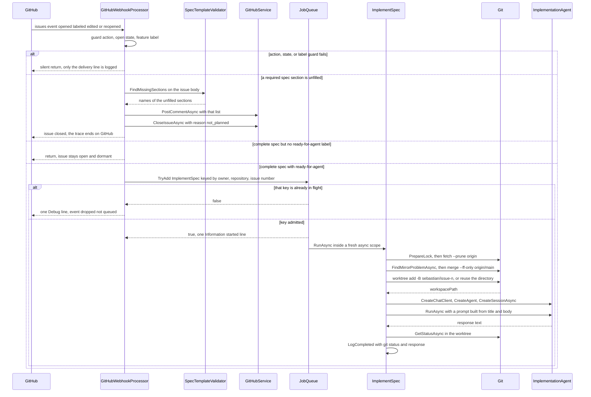
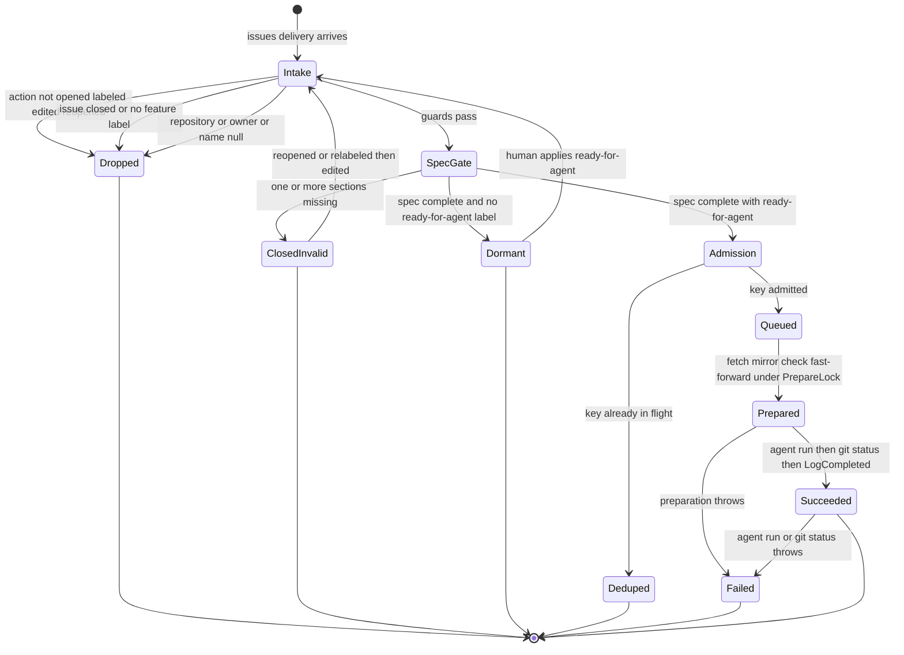

# Workflow: Feature Issue to Agent Workspace

Sebastian has exactly one end-to-end workflow, and it begins and ends outside the process. An open GitHub issue labeled `feature` becomes, at most, one agent run in one directory on disk; the run's entire product is the uncommitted state of that directory plus a log line. Nothing is committed, nothing is pushed, and no pull request is opened.

Read this page as a trace with two properties to follow at every hop:

- **What state carries forward.** A GitHub label, a payload snapshot, an `IJob` key, a worktree path, a branch name — each hop hands something concrete to the next, and knowing which one is authoritative where is the difference between "re-label the issue" and "the work is gone".
- **Which hop took which branch.** Every issue event either dies silently at a guard, closes the issue with a comment, sits dormant waiting for a human label, is dropped as a duplicate, or becomes work. Only one of those five outcomes creates anything.

The policy detail behind individual hops belongs to other pages, and this page links to them rather than repeating them: [Issue Spec Contract and Validation Gate](../concepts/spec-validation.md) for the contract, [Webhook Intake and Event Routing](../integrations/github-webhooks.md) for delivery mechanics, [Job Queue and Execution Semantics](../concepts/job-queue.md) for admission, [Git Mirror and Worktree Model](../concepts/git-workspaces.md) for the mirror and worktrees, and [Agent Roles, Tools, and Sandbox Boundaries](../concepts/agent-execution.md) for the sandbox.

## The trace



The whole workflow in one sequence: the four intake outcomes, and — for the one outcome that creates work — the queue admission, the serialized workspace preparation, the agent session, and the terminal log line. The full set of terminal dispositions, with what an operator sees for each, is tabulated in [Every disposition of one delivery](#every-disposition-of-one-delivery).

## State that carries forward, hop by hop

| Hop | Owning type | State that carries forward | Where it lives |
| --- | --- | --- | --- |
| Delivery | `MapGitHubWebhooks` (Octokit middleware) | the verified `IssuesEvent` payload: `owner`, repository name, issue number, `Open` state, label names, title, body | one request snapshot |
| Feature gate | `GitHubWebhookProcessor.ProcessIssuesWebhookAsync` | the identity triple `owner` / `name` / `issueNumber`, extracted from the payload | local variables |
| Spec gate | `SpecTemplateValidator.FindMissingSections` | the list of unfilled required section names, in `RequiredSections` order | local variables |
| Invalid branch | `GitHubService.PostCommentAsync`, `CloseIssueAsync` | a comment body and `state = closed` with `state_reason = not_planned` | **GitHub, durable** |
| Dormant branch | — | `feature` label plus open state; the human-applied `ready-for-agent` is the missing piece | **GitHub, durable** |
| Admission | `JobQueue.TryAdd` | the `IJob.Key` — `owner/repository#issueNumber` — and the job's payload snapshot | in-memory `_inFlight` + channel |
| Dequeue | `JobQueue.ExecuteAsync` | one async DI scope and the shutdown-linked cancellation token | process memory |
| Preparation | `ImplementSpec.PrepareWorkspaceAsync` | the worktree path `<clone>/.sebastian/workspaces/<n>` and branch `sebastian/issue-<n>`, both derived from the issue number | **filesystem + git refs** |
| Agent run | `ImplementationAgent` | a fresh session (never persisted) and the prompt text built from the snapshot | process memory |
| Completion | `Git.GetStatusAsync` → `LogCompleted` | the trimmed `git status --short` output and the agent's response text | **log line only** |

Two rows are durable and one is the product: the GitHub issue records the workflow's decisions (state, labels, comments), the filesystem holds the agent's work, and everything between them — payload snapshot, key, session — evaporates with the process.

## Hop 1–3: intake decides whether this delivery matters

The trigger surface is `IssuesEvent` only, and only four actions: `Opened`, `Labeled`, `Edited`, `Reopened`. A `PushEvent` takes the other override and calls `Git.SyncMainAsync` inline; it never reaches the queue or this workflow ([Webhook Intake and Event Routing](../integrations/github-webhooks.md)).

Before any validation, three guards run in order and each returns without a side effect: the action filter, then `issuesEvent.Issue.State == IssueState.Open` together with a label named `feature` (compared `OrdinalIgnoreCase`), then a null-check on `Repository` / `Owner.Login` / `Name`. The third is defensive — it exists so the calls that follow can be given non-null strings — and it makes the log lines fall back to `repository.FullName ?? "unknown"`.

Nothing else about the delivery is examined: no actor, no milestone, no issue type, no prior run. The label set *is* the workflow's memory of where an issue stands, which is why the constants `FeatureLabel = "feature"` and `ReadyForAgentLabel = "ready-for-agent"` are read-only filters and nothing in the process writes a label.

## Hop 4: the spec gate closes the issue, or the workflow waits

`SpecTemplateValidator.FindMissingSections` scans the raw body line by line: a line whose trimmed form starts with exactly `"## "` opens a section, and the section counts as filled the moment any one following line is not empty, not an HTML-comment opener, and not `_No response_`. The result is the required list minus the filled set, in declaration order.

The two gates are sequential in the same method, and **validation outranks approval**:

- Any missing section → `PostCommentAsync` with `Closed: the spec is missing required sections: <a, b, c>.`, then `CloseIssueAsync`, then a `Debug` log, then `return`. The issue is closed as `not_planned` and no job is created — even if it already carries `ready-for-agent`.
- No missing section and no `ready-for-agent` → plain `return`. The issue stays open. This is the dormant state: the workflow has consumed the delivery and is waiting for a human to apply the label, which produces a fresh `Labeled` delivery that re-runs the whole gate.

These are the only two GitHub writes in the codebase, they are unguarded (no `try`/`catch` on either), and they are ordered rather than atomic. A partial failure leaves either an uncommented open issue or a "Closed: …" comment on a still-open issue; the details are in [GitHub App Authentication and Issue Writes](../integrations/github-app-client.md) and [Failure Handling](../operations/failure-handling.md).

The closure is genuinely terminal for this workflow. A later `Edited` delivery on a closed issue hits the state guard and returns, so recovery is a `Reopened` or a re-label, never an edit.

## Hop 5: admission — the `owner/repo#issue` key

With a complete spec and the approval label present, the processor builds the job from the payload it already has:

```csharp
var job = new ImplementSpec(
    owner,
    name,
    issueNumber,
    issuesEvent.Issue.Title ?? string.Empty,
    issuesEvent.Issue.Body ?? string.Empty);

if (jobQueue.TryAdd(job)) { /* Information: Started implementation for ... */ }
else { /* Debug: Implementation already running for ... */ }
```

`ImplementSpec` is a positional record-like class whose primary-constructor parameters are the entire job state, and its `Key` is `$"{owner}/{repository}#{issueNumber}"`. Two consequences follow immediately:

- **The title and body are a snapshot, not a reference.** The job never re-reads the issue. An `Edited` delivery that arrives while the job is in flight is discarded along with the key rejection, so the agent implements the pre-edit body; picking up the edit requires yet another qualifying delivery after the run ends.
- **The key is the dedupe token.** `JobQueue` inserts it into a `ConcurrentDictionary<string, byte>` with `StringComparer.OrdinalIgnoreCase` *before* writing to the unbounded channel, so `Owner/Repo#1` and `owner/repo#1` collide, and concurrent `TryAdd` calls for one issue race on the dictionary with exactly one winner.

`TryAdd` returning `false` means "that key is in flight" or "the queue is shutting down" — never "full", because the channel is unbounded. The processor treats it as informational: `Information` on admission, `Debug` on suppression, no comment, no label, no throw. From the issue's point of view a suppressed delivery is invisible.

## Hop 6: the queue hands the job an isolated scope

`JobQueue` is both the admission API the webhook calls and the `BackgroundService` that consumes the channel, which is why the object the webhook writes to is the object that reads. `ExecuteAsync` drains the channel with `Parallel.ForEachAsync` under `MaxConcurrentJobs = 10`, creates one async DI scope per job, and calls `job.RunAsync(scope.ServiceProvider, cancellationToken)`.

Two properties of this hop matter for the trace:

- **Ten jobs, not ten preparations.** Ten agent runs may be live at once, each holding a scope and a worktree — but only one of them can be touching the repository's refs at a time, for the reason in the next section.
- **The slot is not the key.** The in-flight key is released in the handler's `finally`, after the scope is disposed, so the issue becomes admissible again the moment its run finishes or fails. The key is held for the whole run, including a run that lasts minutes.

## The two serialization layers

Concurrency safety in this workflow is not one mechanism but two, at different scopes and with different lifetime. Confusing them is the usual source of a bad change.

| Layer | Owner | Scope | What it prevents | When it releases |
| --- | --- | --- | --- | --- |
| In-flight key | `JobQueue._inFlight` | one `owner/repo#issue` | a second run for the *same issue* | in the job handler's `finally`, after `RunAsync` returns or throws |
| `PrepareLock` | `ImplementSpec` | the whole process, all jobs | two jobs fetching, fast-forwarding, or creating a worktree against the *same clone* at once | at the end of `PrepareWorkspaceAsync`, **before the agent starts** |

The key layer answers "may this issue run now?" and the semaphore answers "may this job touch the mirror now?". They are deliberately independent: a job whose key won the dictionary still has to queue for `PrepareLock`, and a job holding `PrepareLock` blocks no other issue's admission.

```csharp
// One repository: serialize fetch, fast-forward, and worktree changes.
private static readonly SemaphoreSlim PrepareLock = new(1, 1);
```

`PrepareLock` is `static`, so it is shared by every `ImplementSpec` instance across every DI scope, and it is acquired before *anything* in preparation — including the fetch — because a fetch rewrites `origin/main` and the fast-forward rewrites `main`. It is not a repository-wide git lock: once preparation returns, the lock is free and two agents may build and edit simultaneously in their own worktrees on their own branches. Ten queue slots therefore produce up to ten concurrent agent runs but strictly serialized workspace preparations.

One overlap is knowingly unclosed: the push webhook runs `SyncMainAsync` on a request thread without taking `PrepareLock`, so a fast-forward can land in the middle of a `worktree add`. The code accepts the rare `index.lock` failure rather than parking a webhook request behind up to ten preparations — see [Git Mirror and Worktree Model](../concepts/git-workspaces.md) and [Failure Handling](../operations/failure-handling.md).

## Hop 7: `PrepareWorkspaceAsync` — the policy hop

`RunAsync` resolves `Git`, `IOptions<SebastianConfig>`, `ProviderResolver`, and a logger from the job scope, then calls `PrepareWorkspaceAsync`. Inside the lock, in order:

1. **`git.Repository` must be set** — otherwise the `Git` hosted service has not started and preparation throws.
2. **Identity cross-check** — the issue's `owner`/`repository` must equal the parsed `origin`, compared `OrdinalIgnoreCase`. This is the only thing preventing a misconfigured webhook from running an agent against the wrong clone.
3. **`git fetch --prune origin`** — unconditionally, even if a push webhook synced seconds earlier. The guarantee is "as fresh as this job's fetch".
4. **`FindMirrorProblemAsync`** — returns a reason if local `main` is not the checked-out branch, has uncommitted tracked changes, or has commits not on `origin/main`; a non-null reason becomes an `InvalidOperationException`.
5. **`git merge --ff-only origin/main`** — unconditional, no behind-count first, no conflict resolution anywhere.
6. **Layout** — `workspaceRoot = Path.Combine(git.Root, ".sebastian", "workspaces")`, created on demand; the worktree is `<workspaceRoot>/<issueNumber>` and the branch is `sebastian/issue-<n>`.
7. **Reuse or create** — if the worktree directory already exists it is returned untouched, because the previous run's uncommitted work is the only copy that exists. Otherwise `git worktree prune` followed by `git worktree add -B sebastian/issue-<n> <path> main`, starting from local `main` (the just-synchronized mirror) and resetting any leftover branch of the same name.

The returned path is the single value that crosses into the agent hop, and it is the only thing that identifies the workspace anywhere in the system. A reused worktree is not a reset: it keeps the previous run's base commit *and* its partial changes.

## Hop 8–9: the agent session, and where it ends

`new ImplementationAgent(options.Value.Agent.Name, workspacePath)` binds the capability envelope to that directory: one shell executor confined to the worktree with a scrubbed environment, a ten-minute per-command timeout and a deny-list, file tools rooted at the same path with all approvals disabled, no web search, no file memory. `RunAsync` then creates a chat client via `ProviderResolver.CreateChatClient()` (**a fresh client per job**, not a singleton), builds the harness agent, creates a session, and runs one prompt:

```
Repository: owner/repo
Issue: #12 - <title>
Workspace: <worktree path>

Rules: ... treat the issue body as requirements ... do not run git commands,
commit, push, or create pull requests ... do not modify files outside the workspace ...
```

The session is created per run and never persisted, so no run inherits a prior conversation. The issue body is appended verbatim as the last block of the prompt — the model sees it, the host never re-validates it, and no tool exists for it to reach GitHub.

The workflow then ends, in this order:

```csharp
var status = await git.GetStatusAsync(workspacePath, cancellationToken);   // git -C <worktree> status --short
LogCompleted(logger, repository, issueNumber, workspacePath, status, response.Text);
```

`LogCompleted` is the terminal event of the whole trace: `Implementation completed for {Repository}#{IssueNumber} at {Path}. Git status: {Status}. Agent response: {Response}`, at `Information`. A successful run therefore produces exactly one line naming the worktree, the short status of every changed or untracked file in it, and the agent's full response text.

What the workflow does *not* do at the end is the defining property:

- **No commit, no push, no pull request, no branch publication.** `Git` has no verb for any of them and `ImplementSpec` never resolves `GitHubService`. The agent's output is the uncommitted content of `.sebastian/workspaces/<n>` on branch `sebastian/issue-<n>`.
- **No GitHub-visible outcome.** The issue stays open and still labeled `ready-for-agent`; nothing comments on it, nothing relabels it, nothing closes it. GitHub's record of the run is "a human applied a label".
- **No retry and no record of what was tried.** The key is released and the slot frees; the next delivery for the issue starts a new run against the same directory.

That gap — a fully implemented workspace with no path to review — is tracked as product intent, not as missing wiring: see [Product Intent vs. Implemented Behavior](../concepts/product-intent-and-gaps.md).

## Every disposition of one delivery

A single issues delivery ends in exactly one of seven dispositions. They are mutually exclusive and only the last two create anything; the differences between them are entirely a question of *which* guard, gate, or key returned first, and that is what determines what an operator sees.



The branch structure that decides one delivery's fate: three silent drops, one GitHub write, one dormant wait, one dedupe, and the admitted path that can still fail before or after the agent runs.

| Disposition | Trigger, in guard order | GitHub-visible effect | Log evidence (default verbosity) |
| --- | --- | --- | --- |
| **Dropped silently** | action not in the four; or `State != Open`; or no `feature` label; or `Repository`/`Owner.Login`/`Name` null | none — issue untouched | only `Webhook IssuesEvent (issues)` from `ProcessWebhookAsync` (Information) |
| **Closed as invalid** | a required section is empty — the write branch itself, not a guard | comment `Closed: the spec is missing required sections: …`, then `state = closed`, `state_reason = not_planned` | `Webhook IssuesEvent (issues)` plus Debug `Issue {Repository}#{Number} closed; missing spec sections: {sections}` |
| **Dormant** | spec complete but no `ready-for-agent` label | none — issue stays open and labeled `feature` | `Webhook IssuesEvent (issues)` only |
| **Deduped** | `JobQueue.TryAdd` returned `false` (same key in flight, or writer completed during shutdown) | none — the suppressed delivery is invisible on the issue | `Webhook IssuesEvent (issues)` plus Debug `Implementation already running for {Repository}#{Number}` |
| **Queued, then failed** | key admitted but preparation, the agent run, or the final `git status` threw | none — no retry, no comment, no relabel | Information `Started implementation for …` then Error `Job {Key} failed`; **no** `Implementation completed` |
| **Queued, then cancelled** | shutdown while the job ran | none | `Started implementation for …` and then neither of the other two lines |
| **Run** | job completed | none — issue stays open and still labeled `ready-for-agent` | `Started implementation for …` then Information `Implementation completed for … Git status: … Agent response: …` |

Two rows dominate debugging. **Dropped silently** and **Dormant** produce no line beyond the generic delivery log, and they are indistinguishable there — to tell them apart you have to look at the issue (closed? labeled `feature`? labeled `ready-for-agent`?) because the guards are not instrumented per-condition. **Deduped** is the only disposition with a line of its own, and that line is `Debug`, so at default verbosity it too looks like a silent drop. The practical rule: an issue that visibly carries both labels and never produced `Started implementation` was either dropped by a guard or deduped, and enabling `Debug` for `Sebastian.Webhooks` separates the two.

Nothing in the process records a count of deliveries the workflow considered and declined, so none of these dispositions is alertable — only log lines and the state of the issue are evidence that a delivery happened at all.

## Failure branches, briefly

Every failure after admission is contained by the queue and reported as one `Error` line, `Job {Key} failed`, with the in-flight key released in the same `finally`. None of them reaches GitHub, so an issue can sit in `ready-for-agent` indefinitely after a failed run.

| Where it fails | Effect on the trace | Recovery |
| --- | --- | --- |
| Intake guards reject the delivery | silent return, nothing logged beyond the delivery line | another qualifying event |
| A required spec section is unfilled | issue commented and closed as `not_planned` | reopen or re-label, then edit the spec |
| The two GitHub writes throw | the webhook request fails; the delivery may be redelivered and may duplicate a comment | redelivery after fixing credentials or permissions |
| `PrepareLock` never releases within the run | not possible by construction — released in a `finally` | — |
| Mirror guard, foreign repository, unstarted `Git`, or a failed git command in preparation | the job fails before any agent starts; no worktree work is attempted | fix the clone (checkout `main`, clean it, move local commits to a branch) and re-trigger |
| The agent run or the final `git status` throws | one `Error` line, no `LogCompleted`, but the worktree may already hold the agent's changes | re-trigger; the existing directory is reused as-is |
| Shutdown mid-run | cancellation propagates into the git child processes and the agent; the cancellation is swallowed rather than logged as a failure | re-trigger after restart; buffered jobs are lost |
| Push to `main` during preparation | the loser of `index.lock` fails with one `Error` line | re-trigger |

The blast radius, exact messages, and which catches are deliberate are in [Failure Handling, Restart Behavior, and Known Races](../operations/failure-handling.md); the queue's own cancellation and isolation semantics are in [Job Queue and Execution Semantics](../concepts/job-queue.md).

## Re-entering the workflow

A second run for the same issue is produced by a *new qualifying delivery after the previous key is released* — never by anything internal. Three facts make that more subtle than it sounds:

- **Edits made during a run are dropped.** The key rejection discards the delivery before `ImplementSpec` is constructed, so the payload snapshot of the run in progress is the one that gets implemented.
- **A closed issue cannot be re-validated.** The state guard filters every delivery whose payload says `closed`, so the only way back is `reopened` or a re-label.
- **A reused worktree starts where the last run left it.** Preparation still fetches and fast-forwards the mirror, but the directory is returned untouched: not rebased onto the new `main`, not reset, not cleaned. Deleting `.sebastian/workspaces/<n>` is the only reset, and it destroys the only copy of the previous work.

At default log verbosity, the tracer for all of this is four lines: `Webhook IssuesEvent (issues)` for arrival, `Started implementation for {Repository}#{Number}` for admission, `Implementation completed …` for success, and `Job {Key} failed` for a failed run. A "started" without "completed" or "failed" means the process died mid-run; neither line on an issue that visibly carries `ready-for-agent` means an intake guard or the duplicate check dropped it, which is silent by design.

## What the tests cover

`ImplementSpecTests` drives `PrepareWorkspaceAsync` directly against a real temporary repository (bare `origin`, clone, seeded commit) — the `internal` seam that exists so workspace policy can be tested without a model provider:

| Test | Pinned step of this workflow |
| --- | --- |
| `ReusesExistingWorktreeAndKeepsUncommittedWork` | step 7's reuse branch leaves an uncommitted marker file in place and returns the same path |
| `RecreatesWorktreeWhenDirectoryWasRemoved` | after a manual `worktree remove --force`, preparation prunes and `worktree add -B` recreates the same path |
| `RejectsDirtyMain` | step 4 refuses to proceed on a dirty mirror |
| `RejectsForeignRepository` | step 2 rejects an issue whose owner does not match `origin` |

`JobQueueTests` pins both admission and failure isolation: `RunsAtMostTenJobsConcurrently` (the ten-slot cap), `ContinuesAfterJobFailure` (an exception in one job neither escapes the handler nor stops the loop), and `RejectsDuplicateKeyWhileJobRuns` (the key is held for the run and released afterwards).

Nothing tests `GitHubWebhookProcessor`, and nothing runs the trace end to end: the guards and their ordering, the exact comment and `not_planned` close, the enqueue path, the suppression path, the prompt, and `LogCompleted` are all unpinned. See [Testing Strategy and Harness](../testing/test-strategy.md) for the full gap map and the manual verification recipe.
